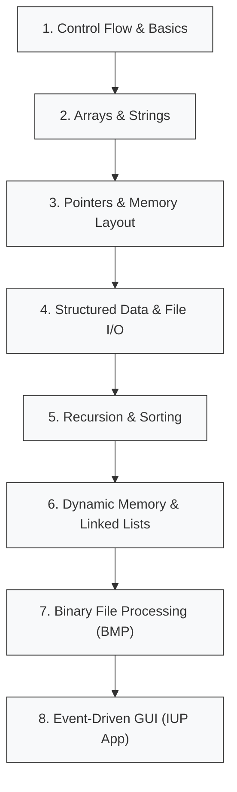

# CSE 1101: Structured Programming Language (C) - Knowledge Base

Welcome to the comprehensive Obsidian knowledge base for **CSE 1101: Structured Programming Language (C)**. This documentation is written from first principles to explain every algorithm, language mechanism, data structure, and system interaction from the first semester coursework.

> [!abstract] Course Mission & Core Architecture
> In this course, we transition from basic algorithmic control flow to bare-metal memory manipulation, dynamic data structures, binary stream I/O, and event-driven graphical applications in C.

---

## ??? Master Folder Map

Navigate the knowledge base through the dedicated folder indexes:

| Folder Index | Primary Focus | Key Highlights |
| :--- | :--- | :--- |
| [[CLASS - Index]] | Lecture Demonstrations (28 programs) | Basics, Pointers, Pointer Arithmetic, Structs, Bitfields, Caesar/Binary Encryption |
| [[LAB - Index]] | Laboratory Experiments (30 experiments) | Algorithms, Recursion, Pointer manipulation, Titanic CSV analysis, Grayscale BMP processing |
| [[ASG - Index]] | Graded Assignments (10 problem sets) | Complex patterns, CGPA sorting, Grading applications, Self-referential structs & linked lists |
| [[PROJ - Index]] | Applied Projects & Examinations | IUP 3.32 Image Editor, Tic-Tac-Toe, Hangman, Midterm Exam & Grader, Final Exam Food Ordering System |
| [[PRAC - Index]] | Drill & Deep Practice | Concept-wise pointer drills, LeetCode solutions, C Book exercises, GUI tutorials |
| [[BUET - Index]] | External University Problem Sets | Math algorithms, numerical roots, Pascal triangles, offlines |
| [[ARCH - Index]] | Architectural Archives & Evolution | Development logs, bug post-mortems, learning guides, early prototypes |

---

## ??? Tag Classification System
Explore all notes grouped by concept, role, and difficulty level in the [[Tag Glossary]]:
- **By Concept:** `c/pointers`, `c/arrays`, `c/file-io`, `c/structs`, `c/recursion`, `c/image-processing`, `c/gui-iup`, etc.
- **By Activity Type:** `type/lecture`, `type/lab`, `type/assignment`, `type/project`, `type/practice`, `type/archive`.
- **By Difficulty:** `level/basic`, `level/intermediate`, `level/advanced`.

---

## ?? Suggested Reading Order & Conceptual Progression

To rebuild your understanding of C from the ground up, follow this conceptual roadmap:

1. **Foundations (Scalar Control Flow):**
   - Begin with [[CLASS 01 - calculator]] through [[CLASS 06 - calc menu switch]], [[LAB 01 - change var temp]] through [[LAB 10 - discount budget]].
   - Master operators, conditions, variable scopes, and iterative loops.
2. **Sequential Memory (Arrays & Strings):**
   - Read [[CLASS 07 - avg temperature array]] through [[CLASS 11 - string merge]] and [[LAB 11 - sort array]] through [[LAB 14 - merge array]].
   - Internalize the null terminator (`\0`), continuous stack allocations, and array indexing.
3. **Pointers & Indirection (The Heart of C):**
   - Read [[CLASS 12 - pointer strlen]] through [[CLASS 20 - cmd arg]] alongside [[LAB 18 - pointer sort]] through [[LAB 24 - merge sort]] and [[PRAC - Index]].
   - Understand addresses (`&`), dereferencing (`*`), pointer arithmetic (`*(p + i)`), and pointer parameter passing.
4. **Persistent Streams & Formatted Data (File I/O):**
   - Study [[CLASS 21 - file basic]] (the deep guide to streams), followed by [[CLASS 22 - space finder]] to [[CLASS 25 - file sort cg]], and [[LAB 25 - titanic p1]] through [[LAB 27 - titanic p3]].
5. **Composed Types & Encapsulation (Structs & Unions):**
   - Study [[CLASS 26 - struct student info]], [[CLASS 27 - binary encryption]], and [[ASG 06 - grading app]] / [[ASG 07 - book reservation]].
6. **Recursive Problem Solving & Linked Structures:**
   - Transition through [[LAB 15 - sum array recursion]] to [[LAB 17 - merge sort recursion]], [[ASG 08 - recursion practice]], and [[ASG 10 - self ref struct]] (Singly Linked List with `malloc`/`free`).
7. **Binary File Architecture & Image Processing:**
   - Deep-dive into [[LAB 29 - grayscale]], [[PRAC GUI 06 - red bmp]] to [[PRAC GUI 13 - threshold]], and [[PROJ Image Editor - image]].
   - Understand BMP file headers, DIB headers, 24-bit BGR pixel arrays, and row byte padding.
8. **Real-World Systems Engineering:**
   - Explore the complete [[PROJ - Index]] suite: terminal games ([[PROJ - Hangman]], [[PROJ TicTacToe - array]]), the comprehensive [[PROJ Final Exam - food ordering system]] and [[PROJ Final Exam - grader harness]], culminating in the full IUP GUI image editor [[PROJ Image Editor - Overview]].

---
*Created on 2026-10-29. Maintained for CSE 1101 coursework documentation.*
