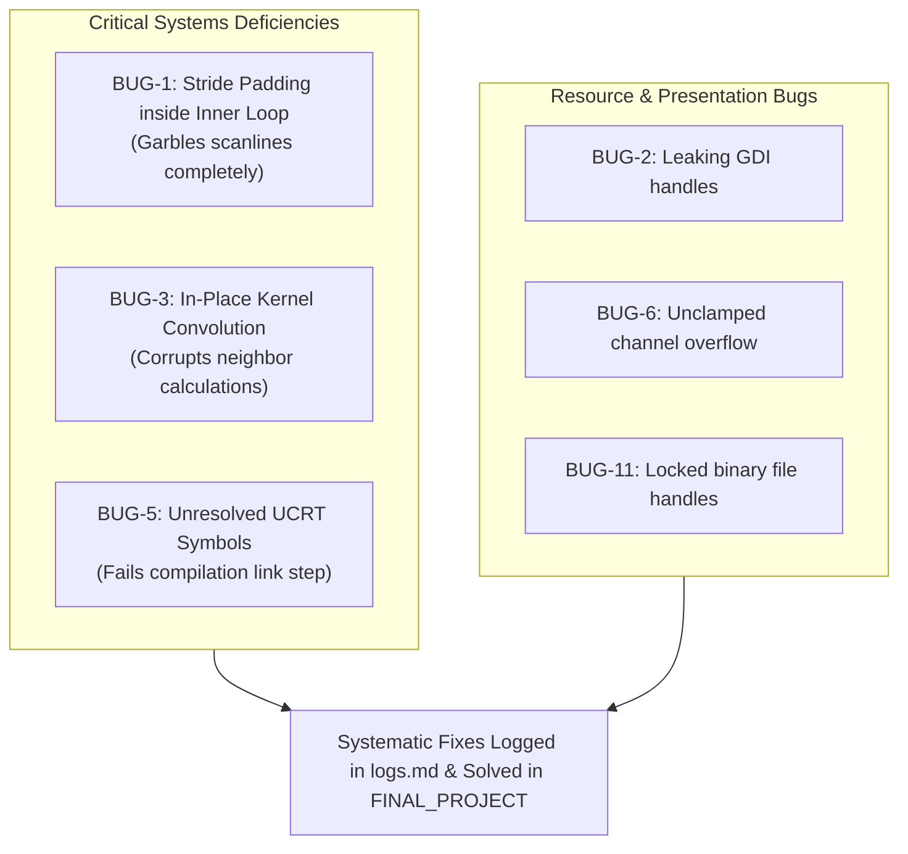

# ARCH - Image editor bugs

> [!abstract] Summary
> A detailed retrospective analysis of the 11 real-world software defects discovered during the initial code audit of the early desktop image editor prototype.

**Source:** `99_archive/Image Manipulation Software/Image Manipulation Software/BUGS.md`

## The 11 Audited Defects

| Bug ID | Component | Severity | Defect Classification | Summary |
|---|---|---|---|---|
| **BUG-1** | `bmp.c` | Critical | Data Corruption | **Row Padding Inside Pixel Loop:** Row padding bytes were skipped inside the per-pixel inner loop rather than after each row, garbling the entire image! |
| **BUG-2** | `gui.c` | Moderate | Resource Leak | **GDI Handle Leak:** Prior `IupImageRGB` instances were never destroyed with `IupDestroy()`, causing GDI resource exhaustion after repeated filter clicks. |
| **BUG-3** | `operation.c` | Major | Algorithm Corruption | **In-Place Convolution:** Mutating source pixels during 3x3 convolution filtering corrupted neighbor sampling for subsequent pixels. |
| **BUG-4** | `operation.c` | Major | Memory Access Fault | **Unbounded Convolution Neighborhood:** Accessing neighbor pixels $(-1, -1)$ along image edges read out-of-bounds heap memory. |
| **BUG-5** | `compat.c` | Critical | Linker Failure | **Missing UCRT Symbols:** GCC MinGW link errors on `__imp___argc` and `__imp___argv` when linking static IUP libraries. |
| **BUG-6** | `operation.c` | Moderate | Integer Wrap-Around | **Absence of Clamping:** Adding brightness offsets without bounds clamping caused unsigned byte wrapping ($250 + 20 = 14$), producing black speckles. |
| **BUG-7** | `operation.c` | Moderate | Visual Orientation Fault | **Vertical Flip Inversion:** Inverting vertical scanlines top-to-bottom without accounting for BMP bottom-up row storage order. |
| **BUG-8** | `bmp.c` | Major | Buffer Overflow | **Heap Misallocation in Crop:** Cropping sub-images allocated buffers with stale source dimensions instead of destination dimensions. |
| **BUG-9** | `gui.c` | Minor | UI Responsiveness | **Missing Canvas Refresh:** Applying filters updated in-memory buffers but omitted `IupRefresh()`, failing to trigger repaint until window resize. |
| **BUG-10** | `operation.c` | Moderate | Color Channel Transposition | **BGR / RGB Channel Confusion:** Applying sepia color matrix coefficients to BGR bytes as if they were RGB, distorting color hues. |
| **BUG-11** | `build.bat` | Minor | Build Tooling Lockout | **File-in-Use Compilation Failure:** Failing to terminate running instances of the executable locked `app.exe`, causing GCC write permission errors. |

## Diagram / trace

## Key takeaways
- The most damaging bugs in binary C programming stem from misinterpreting loop scopes (placing row-padding logic inside pixel-level loops).
- Numerical processing requires explicit bounding functions (`clamp`) to eliminate silent overflow errors.
- Rigorous bug cataloging transforms chaotic debugging into structured engineering refinement.

## My notes
> [!question]- My notes

## Related
- [[ARCH - Image editor logs]]
- [[PROJ Image Editor - image]]
- [[PROJ Image Editor - filter]]
