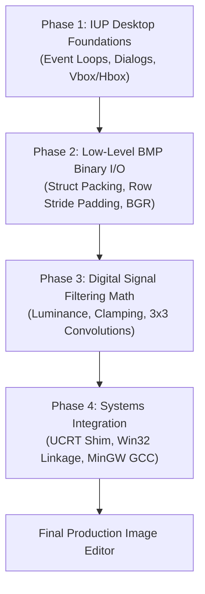

# ARCH - Learning guide

> [!abstract] Summary
> Summarizes the comprehensive 62KB architectural learning manual that guides beginners through the theory, binary file specifications, GUI callbacks, and step-by-step reconstruction of the Image Editor software.

**Source:** `99_archive/learning_guide.md`

## Overview & Pedagogical Purpose
The Learning Guide is an exhaustive technical manual written for students seeking to master the principles behind the IUP desktop image manipulation software. It breaks down the system into structured learning phases, ensuring that complex low-level concepts (bit alignment, convolution kernels, event loops) are thoroughly explained from first principles.

## Core Concepts Covered

### Phase 1: IUP Framework Fundamentals
- Explains native desktop programming in C without heavyweight dependencies.
- Covers the lifecycle functions (`IupOpen`, `IupShowXY`, `IupMainLoop`, `IupClose`).
- Demystifies hierarchical container boxes (`IupVbox`, `IupHbox`) and attribute inheritance (`IupSetAttribute`).
- Teaches callback registration and memory safety for desktop controls.

### Phase 2: Binary BMP File Format Anatomy
- Deconstructs the 54-byte BMP header structure:
  - 14-byte `BMPFileHeader`: Magic number `0x4D42` (`'BM'`), file size, and offset to pixel data.
  - 40-byte `BMPInfoHeader`: Width, height, color planes, and 24-bit color depth.
- Demonstrates why struct packing (`#pragma pack(push, 1)`) is required to avoid compiler-injected padding bytes.
- Explains row stride alignment: why every horizontal row in a BMP must be padded to a 4-byte boundary ($4 - (W \times 3) \% 4) \% 4$.
- Visualizes Little-Endian BGR byte ordering vs in-memory RGB ordering.

### Phase 3: In-Memory Representation & Filtering Math
- Structures in-memory image objects with dynamic heap buffers (`Image` and `Pixel`).
- Details point transformations: photometric luminance weighting ($0.299R + 0.587G + 0.114B$), color inversion ($255 - c$), and clamping.
- Details geometric transformations: scanline swapping for flips, coordinate transposition for 90° clockwise rotation, and rectangular sub-image cropping.
- Details 2D spatial convolution kernels: applying a 3x3 matrix window over neighboring pixels for Gaussian blurring and edge sharpening.

### Phase 4: Systems Integration & Build Pipelines
- Explains MinGW-w64 compiler options, include paths, and native Win32 library linking (`-lgdi32`, `-lcomdlg32`, etc.).
- Resolves the Microsoft Universal C Runtime (UCRT) linker dilemma through the `ucrt_compat.c` symbol bridge.

## Diagram / trace

## Key takeaways
- Software engineering mastery requires understanding both high-level user interfaces and low-level byte-level memory structures.
- Structured pedagogical documentation enables future developers to reconstruct complex systems with confidence.
- Mathematical precision (exact clamping, exact row padding) separates robust software from buggy prototypes.

## My notes
> [!question]- My notes

## Related
- [[PROJ Image Editor - Overview]]
- [[ARCH - Project documentation]]
- [[ARCH - Image editor bugs]]
