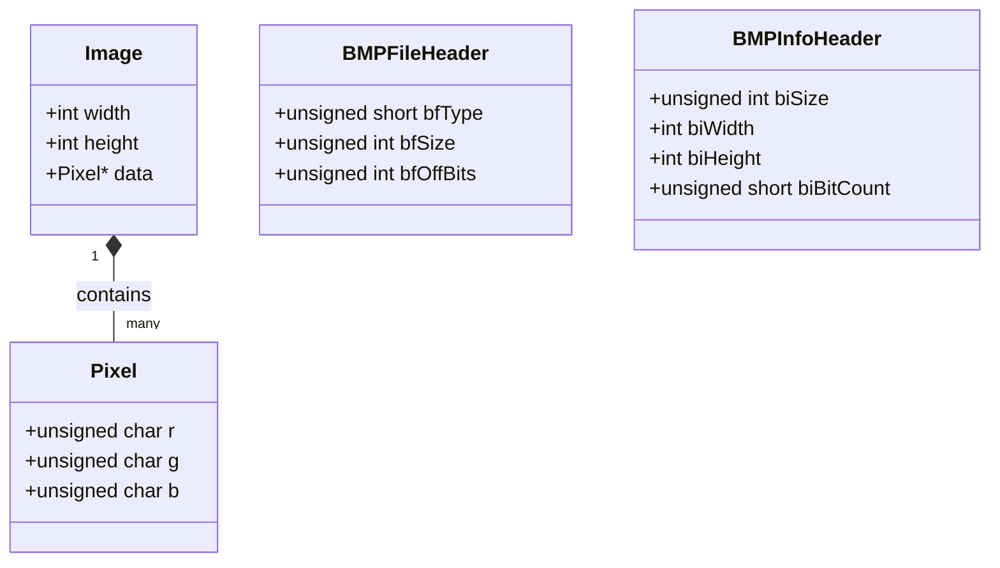

# ARCH - Project documentation

> [!abstract] Summary
> Summarizes the formal technical reference documentation for the Image Manipulation Software, detailing module APIs, struct specifications, algorithms, and build instructions.

**Source:** `99_archive/project_documentation.md`

## Overview
This document represents the formal system specification and technical API reference for the desktop image editor, describing data contracts, function prototypes, coordinate mapping conventions, and memory management guarantees.

## Key Technical Specifications

### Data Structures
```c
typedef struct {
    unsigned char r;
    unsigned char g;
    unsigned char b;
} Pixel;

typedef struct {
    int width;
    int height;
    Pixel *data;
} Image;
```

### Module Responsibilities & APIs
- **`bmp.h` / `bmp.c` (Image I/O):**
  - `Image *load_bmp(const char *path)`: Ingests 24-bit uncompressed BMP, validates headers, strips row padding, swaps BGR to RGB.
  - `int save_bmp(const Image *img, const char *path)`: Emits formatted BMP headers, swaps RGB to BGR, writes scanlines with 4-byte zero padding.
  - `Image *create_image(int width, int height)`: Allocates zero-initialized heap image.
  - `void free_image(Image *img)`: Safely deallocates pixel array and container.
- **`operation.h` / `operation.c` (Filter Operations):**
  - `void grayscale(Image *img)`: Applies luminance weighting.
  - `void brightness(Image *img, int delta)`: Signed channel adjustment with clamping.
  - `void inversion(Image *img)`: Negative color conversion.
  - `void flip_h(Image *img)` & `void flip_v(Image *img)`: Scanline mirroring.
  - `void rotate90(Image *img)`: 90° clockwise coordinate transposition ($W' = H, H' = W$).
  - `void crop(Image *img, int x, int y, int w, int h)`: Sub-grid extraction.
  - `void blur(Image *img)` & `void sharpen(Image *img)`: 3x3 convolution filtering.
- **`gui.h` / `gui.c` (Presentation Layer):**
  - Native window creation, IUP container hierarchy, callback dispatching, and dynamic canvas preview updates via `IupImageRGB`.

## Diagram / trace


## Key takeaways
- Maintaining formal API documentation guarantees predictable module interactions across development iterations.
- Clear ownership models (who allocates and who frees an `Image*`) eliminate double-free errors and memory leaks.
- Abstracting pixel filters into a standalone mathematical API makes them fully testable independent of the GUI.

## My notes
> [!question]- My notes

## Related
- [[PROJ Image Editor - Overview]]
- [[ARCH - Learning guide]]
- [[PROJ Image Editor - filter]]
