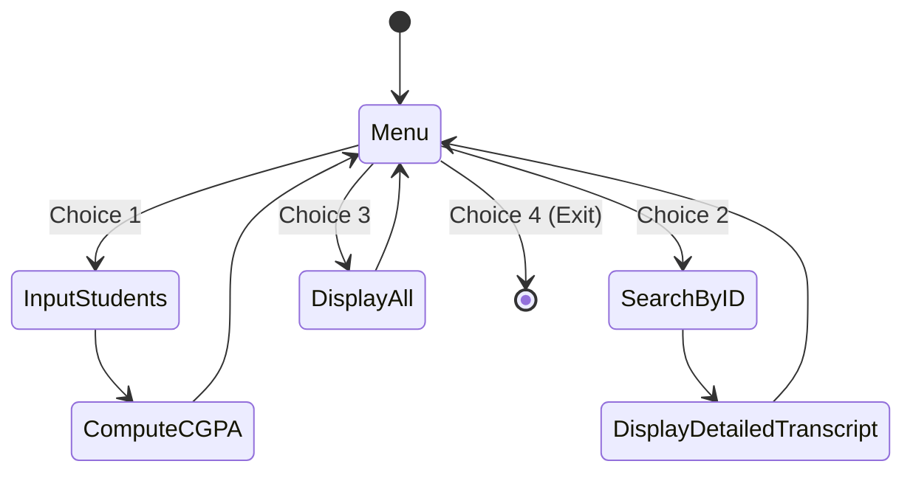

# ASG 06 - grading app

> [!abstract] Summary
> An interactive console grading application calculating weighted composite subject scores (60% continuous, 40% final), credit-weighted CGPA, letter grades, and roster reports.

**Source:** `ASSIGNMENT/ASSIGNMENT_06/grading_app.c`

## Problem
Manage grades for up to 50 students across 7 academic subjects. Each subject score blends continuous assessment (60%) and final exam marks (40%). Convert total marks to letter grades and calculate overall credit-weighted semester CGPA, supporting search by student ID and roster display.

## Concepts used
- **3D Array Storage:** Storing student marks in `studentMarks[50][7][2]`, where dimension 0 is student index, dimension 1 is subject index (0 to 6), and dimension 2 stores continuous vs final marks.
- **Composite Score Weighting:** Evaluating subject total marks via formula:
  $$\text{Total} = 0.60 \times \text{Continuous} + 0.40 \times \text{Final}$$
- **Credit-Weighted CGPA Rules:** Multiplying grade points by course credits (3.0 credits for subjects 1–6, 1.5 credits for lab subject 7), dividing by total semester credits ($19.5$).
- **Menu Event Loop:** Interactive numerical menu with options for entry, individual search, full display, and exit.

## Code
```c
#include<stdio.h>
#include<string.h>

char studentName[50][100];
int subjectId[7];
int studentMarks[50][7][2];
char subjectGrade[50][7][10];
float studentCGPA[50];
char studentGrade[50][10];

int totalStudents = 0;

float checkCGPA(int marks)
{
    if(marks < 40 || marks > 100) return 0;
    if (marks >= 80)  return 4.0;
    if (marks >= 75)  return 3.75;
    if (marks >= 70)  return 3.5;
    if (marks >= 65)  return 3.25;
    if (marks >= 60)  return 3.0;
    if (marks >= 55)  return 2.75;
    if (marks >= 50)  return 2.5;
    if (marks >= 45)  return 2.25;
    if (marks >= 40)  return 2.0;
    return 0;
}

void checkGrade(float cgpa, char grade[]){
    if(cgpa >= 4.0)       strcpy(grade, "A+");
    else if(cgpa >= 3.75) strcpy(grade, "A");
    else if(cgpa >= 3.5)  strcpy(grade, "A-");
    else if(cgpa >= 3.25) strcpy(grade, "B+");
    else if(cgpa >= 3.0)  strcpy(grade, "B");
    else if(cgpa >= 2.75) strcpy(grade, "B-");
    else if(cgpa >= 2.5)  strcpy(grade, "C+");
    else if(cgpa >= 2.25) strcpy(grade, "C");
    else if(cgpa >= 2.0)  strcpy(grade, "D");
    else                  strcpy(grade, "F");
}

float countCGPA(int idx){
    float sum = 0;
    for (int i = 0; i < 7; i++) {
        int marks = (int)(0.6 * studentMarks[idx][i][0] + 0.4 * studentMarks[idx][i][1]);
        float gpa = checkCGPA(marks);
        checkGrade(gpa, subjectGrade[idx][i]);
        if (i < 6) sum += gpa * 3;
        else sum += gpa * 1.5;
    }
    float cgpa = sum / 19.5;
    studentCGPA[idx] = cgpa;
    checkGrade(cgpa, studentGrade[idx]);
    return cgpa;
}

void searchID(){
    int id;
    printf("Enter student index (1-%d): ", totalStudents);
    scanf("%d", &id);
    id--;
    if(id < 0 || id >= totalStudents){
        printf("Invalid student ID!\n");
        return;
    }
    printf("\n--- Student: %s ---\n", studentName[id]);
    printf("%-10s %-15s %-10s %-10s %-10s\n", "Subject", "Continuous", "Final", "Total", "Grade");
    for(int j = 0; j < 7; j++){
        int total = (int)(0.6 * studentMarks[id][j][0] + 0.4 * studentMarks[id][j][1]);
        printf("%-10d %-15d %-10d %-10d %-10s\n", j+1, studentMarks[id][j][0], studentMarks[id][j][1], total, subjectGrade[id][j]);
    }
    printf("CGPA: %.2f | Grade: %s\n", studentCGPA[id], studentGrade[id]);
}

void displayAll(){
    printf("\n%-5s %-20s %-10s %-10s\n", "No", "Name", "CGPA", "Grade");
    for(int i = 0; i < totalStudents; i++){
        printf("%-5d %-20s %-10.2f %-10s\n", i+1, studentName[i], studentCGPA[i], studentGrade[i]);
    }
}

void inputStudents(){
    int n;
    printf("How many students to enter (max %d): ", 50 - totalStudents);
    scanf("%d", &n);
    if(n <= 0 || n + totalStudents > 50){
        printf("Invalid number!\n");
        return;
    }
    for(int i = totalStudents; i < totalStudents + n; i++){
        printf("\n--- Student %d ---\n", i + 1);
        printf("Enter name: ");
        getchar();
        fgets(studentName[i], 100, stdin);
        studentName[i][strcspn(studentName[i], "\n")] = '\0';
        for(int j = 0; j < 7; j++){
            printf("Subject %d - Enter continuous assessment marks (out of 100): ", j + 1);
            scanf("%d", &studentMarks[i][j][0]);
            printf("Subject %d - Enter final exam marks (out of 100): ", j + 1);
            scanf("%d", &studentMarks[i][j][1]);
        }
        countCGPA(i);
        printf("CGPA: %.2f | Grade: %s\n", studentCGPA[i], studentGrade[i]);
    }
    totalStudents += n;
}

int main(){
    int choice;
    while(1){
        printf("\n===== Student Grading System =====\n");
        printf("1. Input Students\n");
        printf("2. Search Student by ID\n");
        printf("3. Display All Students\n");
        printf("4. Exit\n");
        printf("Enter choice: ");
        scanf("%d", &choice);
        switch(choice){
            case 1: inputStudents(); break;
            case 2: searchID(); break;
            case 3: displayAll(); break;
            case 4: return 0;
            default: printf("Invalid choice!\n");
        }
    }
    return 0;
}
```

## How it works
1. Global state maintains parallel arrays for student names, subject grades, raw marks, and overall CGPA.
2. `inputStudents()`:
   - Prompts for the number of students to enroll ($n$).
   - For each student, reads their full name using `fgets()` and trims trailing newlines.
   - For each of the 7 subjects, reads continuous marks and final exam marks out of 100.
   - Calls `countCGPA(i)` to compute composite marks, individual letter grades, and total CGPA.
3. `searchID()` queries for student index (1 to $N$), printing a formatted breakdown across all 7 subjects.
4. `displayAll()` prints a summary table of all enrolled students with their CGPA and letter grade.
5. `main()` coordinates the interactive `while (1)` menu loop.

## Diagram / trace


## Sample run
```text
===== Student Grading System =====
1. Input Students
2. Search Student by ID
3. Display All Students
4. Exit
Enter choice: 1
How many students to enter (max 50): 1

--- Student 1 ---
Enter name: Alice
Subject 1 - Enter continuous assessment marks (out of 100): 80
Subject 1 - Enter final exam marks (out of 100): 80
... (subjects 2-7 entered) ...
CGPA: 4.00 | Grade: A+

===== Student Grading System =====
1. Input Students
2. Search Student by ID
3. Display All Students
4. Exit
Enter choice: 3

No    Name                 CGPA       Grade     
1     Alice                4.00       A+        

===== Student Grading System =====
1. Input Students
2. Search Student by ID
3. Display All Students
4. Exit
Enter choice: 4
```

## Gotchas
> [!warning] Consuming Newline before `fgets`
> In `inputStudents()`, `getchar()` is called on line 92 before `fgets(studentName[i], 100, stdin)` to consume the leftover newline from previous integer `scanf` calls. Without this `getchar()`, `fgets` would immediately read an empty string.

## Possible improvements
- Replace parallel arrays with an array of `struct Student` records to group student data into a single coherent data type.
- Add file persistence (`fwrite`/`fread`) so enrolled grades are saved across program executions.

## Key takeaways
- Complex multi-attribute data sets (students, subjects, assessment components) can be mapped into multidimensional arrays (`marks[student][subject][type]`).
- Blended academic grading requires careful integer-to-float conversions before computing grade points.
- Clearing stdin buffers between numeric `scanf` and string `fgets` is essential for responsive console applications.

## My notes
> [!question]- My notes

## Related
- [[ASG 04 - sort student by cgpa]]
- [[LAB 30 - student app]]
- [[CLASS 26 - struct student info]]
