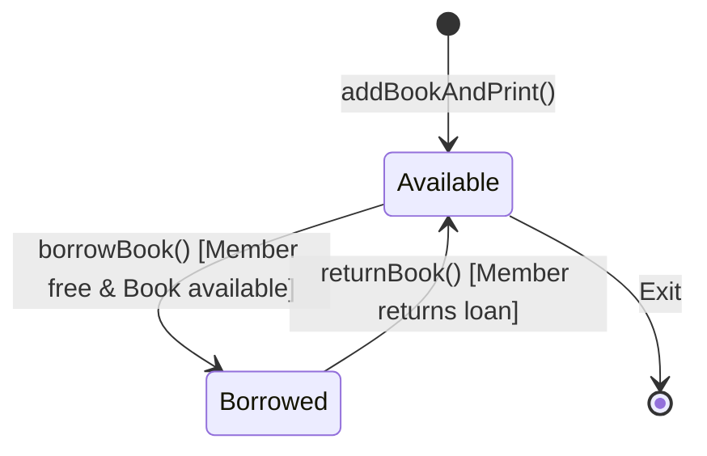

# ASG 07 - book reservation

> [!abstract] Summary
> Implements a console library book reservation and borrowing system managing book catalogs, availability status flags, and member loan tracking.

**Source:** `ASSIGNMENT/ASSIGNMENT_07/book_reservation.c`

## Problem
Create an interactive library management console supporting up to 20 books and 50 members. Allow adding new books, borrowing available titles (one book per member), returning borrowed books, and inspecting member borrowing status.

## Concepts used
- **Parallel Array State Management:**
  - Books: `bookID[20]`, `bookTitle[20][100]`, and `bookStatus[20]` ($1 = \text{available}, 0 = \text{borrowed}$).
  - Members: `memberID[50]` and `memberStatus[50]` ($0 = \text{no book}, > 0 = \text{borrowed book ID}$).
- **Relational Cross-Referencing:** Linking a member's loan record (`memberStatus[mIdx]`) to the corresponding book catalog entry by matching `bookID[i]`.
- **Validation & Business Logic:** Enforcing loan rules: a member cannot borrow multiple books simultaneously, and unavailable books cannot be checked out.

## Code
```c
#include<stdio.h>
#include<string.h>
#include<math.h>

#define MAX_BOOKS 20
#define MAX_MEMBERS 50

int totalBooks = 0;
char bookTitle[MAX_BOOKS][100];
int bookID[MAX_BOOKS];
int bookStatus[MAX_BOOKS]; // 1 = available, 0 = unavailable

int memberID[MAX_MEMBERS];
int memberStatus[MAX_MEMBERS]; // 0 = no book borrowed, book ID = borrowed book ID

// a. Function to add a new book and print the list of books
void addBookAndPrint(){
    if(totalBooks >= MAX_BOOKS){
        printf("Cannot add more books! Maximum limit reached.\n\n");
        return;
    }

    int i = totalBooks;
    printf("Enter Book ID: ");
    scanf("%d", &bookID[i]);
    printf("Enter Book Title: ");
    scanf(" %[^\n]", bookTitle[i]);
    bookStatus[i] = 1; // 1 means available to borrow
    totalBooks++;

    printf("\nBook added successfully!\n");
    printf("--- Current Book List ---\n");
    for(int j = 0; j < totalBooks; j++){
        printf("Book ID: %d | Title: %s | Status: %s\n", 
               bookID[j], bookTitle[j], bookStatus[j] == 1 ? "Available (1)" : "Unavailable (0)");
    }
    printf("\n");
}

// b. Function to borrow a book by a member
void borrowBook(){
    int mID, bID;
    printf("Enter Member ID (1 to 50): ");
    scanf("%d", &mID);

    if(mID < 1 || mID > MAX_MEMBERS){
        printf("Invalid Member ID!\n\n");
        return;
    }

    int mIdx = mID - 1; // 0-based array index

    if(memberStatus[mIdx] != 0){
        printf("Member %d has already borrowed Book ID %d! (Limit: 1 book)\n\n", mID, memberStatus[mIdx]);
        return;
    }

    printf("Enter Book ID to borrow: ");
    scanf("%d", &bID);

    int bookIdx = -1;
    for(int i = 0; i < totalBooks; i++){
        if(bookID[i] == bID){
            bookIdx = i;
            break;
        }
    }

    if(bookIdx == -1){
        printf("Book ID not found!\n\n");
        return;
    }

    if(bookStatus[bookIdx] == 0){
        printf("Book is currently unavailable!\n\n");
        return;
    }

    // Process borrowing
    memberStatus[mIdx] = bID;
    bookStatus[bookIdx] = 0; // Set book status to unavailable
    printf("Member %d successfully borrowed '%s'!\n\n", mID, bookTitle[bookIdx]);
}

// c. Function to return a book by a member
void returnBook(){
    int mID;
    printf("Enter Member ID (1 to 50): ");
    scanf("%d", &mID);

    if(mID < 1 || mID > MAX_MEMBERS){
        printf("Invalid Member ID!\n\n");
        return;
    }

    int mIdx = mID - 1;

    if(memberStatus[mIdx] == 0){
        printf("Member %d has not borrowed any book!\n\n", mID);
        return;
    }

    int borrowedBookID = memberStatus[mIdx];

    // Find and update book status back to available
    for(int i = 0; i < totalBooks; i++){
        if(bookID[i] == borrowedBookID){
            bookStatus[i] = 1;
            break;
        }
    }

    // Reset member status
    memberStatus[mIdx] = 0;
    printf("Book returned successfully by Member %d!\n\n", mID);
}

// d. Search function to check if a member borrowed a book and its title
void searchMember(){
    int mID;
    printf("Enter Member ID (1 to 50): ");
    scanf("%d", &mID);

    if(mID < 1 || mID > MAX_MEMBERS){
        printf("Invalid Member ID!\n\n");
        return;
    }

    int mIdx = mID - 1;

    if(memberStatus[mIdx] == 0){
        printf("Member %d has not borrowed any book.\n\n", mID);
    } else {
        int borrowedBookID = memberStatus[mIdx];
        char borrowedTitle[100] = "Unknown Title";

        for(int i = 0; i < totalBooks; i++){
            if(bookID[i] == borrowedBookID){
                strcpy(borrowedTitle, bookTitle[i]);
                break;
            }
        }
        printf("Member %d HAS borrowed a book.\n", mID);
        printf("Book ID: %d\n", borrowedBookID);
        printf("Book Title: %s\n\n", borrowedTitle);
    }
}

int main(){
    // Initialize member list
    for(int i = 0; i < MAX_MEMBERS; i++){
        memberID[i] = i + 1;
        memberStatus[i] = 0; // 0 means no book borrowed
    }

    int choice;
    do {
        printf("1. Add Book & Display List\n");
        printf("2. Borrow Book\n");
        printf("3. Return Book\n");
        printf("4. Search Member Status\n");
        printf("5. Exit\n");
        printf("\n");

        printf("Enter your choice: ");
        scanf("%d", &choice);
        printf("\n");

        if(choice == 1) addBookAndPrint();
        else if(choice == 2) borrowBook();
        else if(choice == 3) returnBook();
        else if(choice == 4) searchMember();
        else if(choice != 5) printf("Invalid choice!\n\n");

    } while(choice != 5);

    return 0;
}
```

## How it works
1. In `main()`, initializes all 50 members with ID $1 \dots 50$ and status 0 (no books borrowed).
2. The interactive menu runs until option 5 (Exit) is selected:
   - **Option 1 (Add Book & Display):** Prompts for Book ID and Title, marks status as Available (1), increments `totalBooks`, and displays the complete catalog.
   - **Option 2 (Borrow Book):** Prompts for Member ID and Book ID. Verifies member has no active loans and book is available. Marks book status 0 and records book ID in `memberStatus`.
   - **Option 3 (Return Book):** Prompts for Member ID. Validates active loan, resets `memberStatus` to 0, and restores book availability to 1.
   - **Option 4 (Search Member Status):** Displays whether the member currently holds a book and shows the title.

## Diagram / trace


## Sample run
```text
1. Add Book & Display List
2. Borrow Book
3. Return Book
4. Search Member Status
5. Exit

Enter your choice: 1

Enter Book ID: 101
Enter Book Title: The C Programming Language

Book added successfully!
--- Current Book List ---
Book ID: 101 | Title: The C Programming Language | Status: Available (1)

1. Add Book & Display List
2. Borrow Book
3. Return Book
4. Search Member Status
5. Exit

Enter your choice: 5
```

## Gotchas
> [!warning] Space Handling in Book Titles
> Line 29 uses `scanf(" %[^
]", bookTitle[i]);`. The leading space is essential to skip whitespace and newline characters from previous integer inputs. Without it, book titles would be recorded as empty strings.

## Possible improvements
- Encapsulate books and members into distinct C structures (`struct Book`, `struct Member`).
- Implement dynamic array resizing (`realloc`) or linked lists to remove the hard limit of 20 books and 50 members.

## Key takeaways
- Relational database concepts (primary keys, foreign key references) can be implemented in plain C using parallel array lookups.
- State machines with boolean flags ($0 / 1$) effectively track resource availability and loan status.
- Thorough input validation (ID range checks, availability checks) prevents state corruption in interactive applications.

## My notes
> [!question]- My notes

## Related
- [[CLASS 18 - pointer books 2d arr]]
- [[LAB 30 - student app]]
