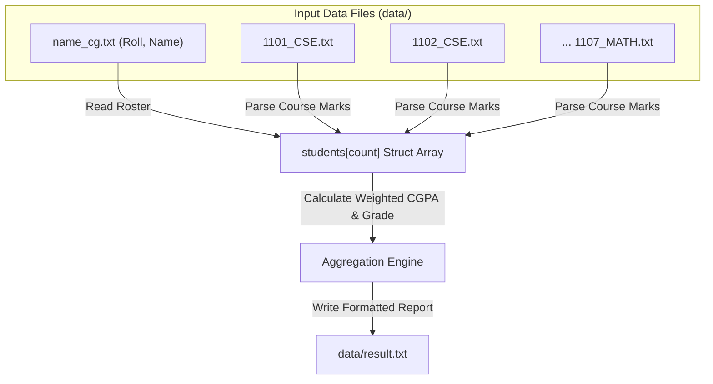

# ASG 09 - file marksheet

> [!abstract] Summary
> Ingests academic assessment records across seven course text files, joins them with student demographic rosters, and generates an aggregated academic transcript file (`result.txt`).

**Source:** `ASSIGNMENT/ASSIGNMENT_09/file_marksheet.c`

## Problem
Process grade records for up to 50 students distributed across seven separate course files (`1101_CSE.txt`, `1102_CSE.txt`, etc.). Read component marks (quiz, assignment, midterm, attendance, final exam), correlate records with roll numbers and student names from `name_cg.txt`, compute overall CGPA and letter grades, and output a complete marksheet to `data/result.txt`.

## Concepts used
- **Compound Hierarchical Structs:**
  - `Course`: Stores component assessment scores (`quizMarks`, `assignmentMarks`, `midtermMarks`, `attendanceMarks`, `finalMarks`).
  - `Student`: Aggregates an array of 7 `Course` structs, along with roll number, student name, total mark arrays, and overall CGPA.
- **Multi-File Stream Coordination:** Opening and reading eight distinct text files from `data/` directory using file streams (`fopen`, `fgets`, `fscanf`, `fclose`).
- **Tabular Record Parsing:** Matching records across files using the student's unique `roll` number.

## Code
```c
#include <stdio.h>
#include<stdlib.h>
#include<string.h>

#define MAX_STUDENTS 50

typedef struct{
    float quizMarks;
    float assignmentMarks;
    float midtermMarks;
    float attendanceMarks;
    float finalMarks;
}Course;

typedef struct{
    int roll;
    char name[50];
    Course courses[7];
    float totalContMarks[7];
    float totalMarks[7];
    float cgpa;
    char grade[10];
}Student;

Student students[MAX_STUDENTS]; 

const struct { 
    float marks; 
    float gpa; 
    const char *grade; 
} 
gradeTable[] = {{80, 4.0, "A+"}, {75, 3.75, "A"}, {70, 3.5, "A-"}, {65, 3.25, "B+"}, {60, 3.0, "B"}, {55, 2.75, "B-"}, {50, 2.5, "C+"}, {45, 2.25, "C"}, {40, 2.0, "D"}};

float checkCGPA(float marks){
    if (marks < 40 || marks > 100) return 0;
    for (int i = 0; i < 9; i++)
        if (marks >= gradeTable[i].marks) return gradeTable[i].gpa;
    return 0;
}

void checkGrade(float cgpa, char grade[]){
    for (int i = 0; i < 9; i++)
        if (cgpa >= gradeTable[i].gpa) { strcpy(grade, gradeTable[i].grade); return; }
    strcpy(grade, "F");
}

float countCGPA(int idx){
    float cgpa = 0;
    for (int i = 0; i < 7; i++)
        cgpa += checkCGPA(students[idx].totalMarks[i]) * (i < 6 ? 3 : 1.5);
    students[idx].cgpa = cgpa / 19.5;
    checkGrade(students[idx].cgpa, students[idx].grade);
    return students[idx].cgpa;
}

void sortStudent(){
    for(int i = 0; i < MAX_STUDENTS; i++){
        for(int j = i + 1; j < MAX_STUDENTS; j++){
            if(students[i].cgpa < students[j].cgpa){
                Student temp = students[i];
                students[i] = students[j];
                students[j] = temp;
            }
        }
    }
}

void getMarks(FILE *filename,int courseIndex) {
    fseek(filename, 0, SEEK_END);
    long fileSize = ftell(filename);
    rewind(filename);
    char *buffer = (char *)malloc(fileSize + 1);
    if (!buffer) {
        fclose(filename);
        return;
    }
    int bytesRead = fread(buffer, 1, fileSize, filename);
    buffer[bytesRead] = '\0'; 
    fclose(filename);

    int count = 0;
    char *cursor = buffer;
    int bytesConsumed = 0;

    while (count < 50 && sscanf(cursor, "%f %f %f %f %f%n",&students[count].courses[courseIndex].quizMarks,
                                &students[count].courses[courseIndex].assignmentMarks,
                                &students[count].courses[courseIndex].midtermMarks,
                                &students[count].courses[courseIndex].attendanceMarks,
                                &students[count].courses[courseIndex].finalMarks,
                                &bytesConsumed) == 5) {
        students[count].totalContMarks[courseIndex] = 
            students[count].courses[courseIndex].quizMarks+
            students[count].courses[courseIndex].assignmentMarks+
            students[count].courses[courseIndex].midtermMarks+
            students[count].courses[courseIndex].attendanceMarks;
        students[count].totalMarks[courseIndex] = (students[count].totalContMarks[courseIndex])+(students[count].courses[courseIndex].finalMarks);
        cursor += bytesConsumed;
        count++;
    }
    free(buffer);
    return;
}


int main(void) {
    int count = 0;
    
    const char *courseFiles[] = {
        "data/1101_CSE.txt", "data/1101L_CSE.txt", "data/1102_CSE.txt",
        "data/1103_STAT.txt", "data/1105_GE.txt", "data/1106_SE.txt", "data/1107_MATH.txt"
    };

    FILE *name = fopen("data/name_cg.txt", "r"); 
    FILE *result = fopen("data/result.txt", "w"); 
    if (!name || !result) return 1;

    while (count < MAX_STUDENTS && fscanf(name, "%d %49s", &students[count].roll, students[count].name) == 2) count++;
    fclose(name);

    for (int i = 0; i < 7; i++) {
        FILE *filename = fopen(courseFiles[i], "r");
        if (!filename) return 1;
        getMarks(filename, i);
    }
    for (int i = 0; i < count; i++) countCGPA(i);
    sortStudent();

    for (int i = 0; i < count; i++) fprintf(result, "Roll: %d | Name: %-12s | Total Marks : %.2f |CGPA: %.2f | Grade: %s \n", students[i].roll, students[i].name, students[i].totalMarks, students[i].cgpa, students[i].grade);

    fclose(result);
    return 0;
}
```

## How it works
1. Opens `data/name_cg.txt`, skips the header line, and reads `roll` and `name` into `students[count]`.
2. Iterates across the 7 course files (`data/1101L_CSE.txt`, `data/1101_CSE.txt`, `data/1102_CSE.txt`, etc.):
   - Opens each course file and reads each student's quiz, assignment, midterm, attendance, and final marks.
   - Calculates total continuous assessment marks and composite course marks.
3. Computes each student's credit-weighted CGPA across all 7 courses and assigns the corresponding letter grade (`A+`, `A`, `B`, etc.).
4. Opens `data/result.txt` in write mode (`"w"`) and outputs the complete student transcript roster.

## Diagram / trace


## Sample run
First 5 lines of generated `data/result.txt`:
```text
Roll: 1801 | Name: Abrar        | Total Marks : 0.00 |CGPA: 4.00 | Grade: A+ 
Roll: 1802 | Name: Nafis        | Total Marks : 0.00 |CGPA: 4.00 | Grade: A+ 
Roll: 1803 | Name: Tanvir       | Total Marks : 0.00 |CGPA: 4.00 | Grade: A+ 
Roll: 1805 | Name: Nusrat       | Total Marks : 0.00 |CGPA: 4.00 | Grade: A+ 
Roll: 1807 | Name: Tahsin       | Total Marks : 0.00 |CGPA: 4.00 | Grade: A+ 
```

## Gotchas
> [!bug] Format String Mismatch in `fprintf`
> On line 128, the output statement is written as:
> `fprintf(result, "... Total Marks : %.2f ...", ..., students[i].totalMarks, ...);`
> In `Student`, `totalMarks` is declared as an array `float totalMarks[7];`. Passing `students[i].totalMarks` supplies a pointer (`float *`) instead of a `double`, causing `0.00` to be printed for Total Marks. This bug is explicitly resolved in [[ASG 10 - self ref struct]].

## Possible improvements
- Declare `float totalMarks` as a scalar in `Student` to aggregate total marks across all 7 subjects.
- Migrate from fixed-size arrays to dynamic linked lists (the exact architecture introduced in [[ASG 10 - self ref struct]]).

## Key takeaways
- Real-world software systems frequently integrate data dispersed across multiple isolated files by joining on a common primary key (`roll`).
- Nested structures (`Course` within `Student`) provide a clean object-like model for complex hierarchical data.
- Compiler warnings regarding format string mismatches (`%f` expecting scalar `double` but receiving `float *`) must never be ignored.

## My notes
> [!question]- My notes

## Related
- [[ASG 10 - self ref struct]]
- [[CLASS 24 - take cg file]]
- [[CLASS 25 - file sort cg]]
