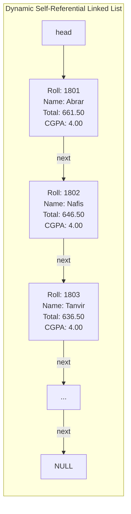

# ASG 10 - self ref struct

> [!abstract] Summary
> Re-architects the academic marksheet generator using a dynamic singly linked list built with self-referential structures (`struct Student *next`), resolving array format bugs from Assignment 09.

**Source:** `ASSIGNMENT/ASSIGNMENT_10/self_ref_struct.c`

## Problem
Refactor the file-based marksheet processing engine from [[ASG 09 - file marksheet]] to use dynamic self-referential structures (singly linked list) rather than fixed-capacity static arrays, while correctly computing and formatting total accumulated marks across all courses.

## Concepts used
- **Self-Referential Structures (Linked Lists):** Declaring a struct containing a pointer to its own type:
  ```c
  typedef struct Student {
      ...
      struct Student *next;
  } Student;
  ```
- **Dynamic Node Allocation (`malloc`):** Dynamically allocating each student node on the heap as records are discovered in input files.
- **Linked List Pointer Traversal:** Walking the list via pointer chaining: `for (Student *curr = head; curr != NULL; curr = curr->next)`.
- **Bug Resolution (Evolution Chain):** Changing `courseMarks[7]` to hold individual subject totals and introducing scalar `float totalMarks` to correctly print cumulative marks to `result.txt`.

## Code
```c
#include <stdio.h>
#include<stdlib.h>
#include<string.h>

#define MAX_STUDENTS 50

typedef struct{
    float quizMarks;
    float assignmentMarks;
    float midtermMarks;
    float attendanceMarks;
    float finalMarks;
}Course;

typedef struct Student {
    int roll;
    char name[50];
    Course courses[7];
    float totalContMarks[7];
    float courseMarks[7];
    float totalMarks;
    float cgpa;
    char grade[10];
    struct Student *next;
} Student;

Student students[MAX_STUDENTS]; 

const struct { 
    float marks; 
    float gpa; 
    const char *grade; 
} 
gradeTable[] = {{80, 4.0, "A+"}, {75, 3.75, "A"}, {70, 3.5, "A-"}, {65, 3.25, "B+"}, {60, 3.0, "B"}, {55, 2.75, "B-"}, {50, 2.5, "C+"}, {45, 2.25, "C"}, {40, 2.0, "D"}};

float checkCGPA(float marks){
    if (marks < 40 || marks > 100) return 0;
    for (int i = 0; i < 9; i++)
        if (marks >= gradeTable[i].marks) return gradeTable[i].gpa;
    return 0;
}

void checkGrade(float cgpa, char grade[]){
    for (int i = 0; i < 9; i++)
        if (cgpa >= gradeTable[i].gpa) { strcpy(grade, gradeTable[i].grade); return; }
    strcpy(grade, "F");
}

float countCGPA(int idx){
    float cgpa = 0;
    for (int i = 0; i < 7; i++){
        students[idx].totalMarks += students[idx].courseMarks[i];
        cgpa += checkCGPA(students[idx].courseMarks[i]) * (i < 6 ? 3 : 1.5);
    }
    students[idx].cgpa = cgpa / 19.5;
    checkGrade(students[idx].cgpa, students[idx].grade);
    return students[idx].cgpa;
}

void sortStudent(){
    for(int i = 0; i < MAX_STUDENTS; i++){
        for(int j = i + 1; j < MAX_STUDENTS; j++){
            if(students[i].cgpa < students[j].cgpa){
                Student temp = students[i];
                students[i] = students[j];
                students[j] = temp;
            }
        }
    }
}

void getMarks(FILE *filename,int courseIndex) {
    fseek(filename, 0, SEEK_END);
    long fileSize = ftell(filename);
    rewind(filename);
    char *buffer = (char *)malloc(fileSize + 1);
    if (!buffer) {
        fclose(filename);
        return;
    }
    int bytesRead = fread(buffer, 1, fileSize, filename);
    buffer[bytesRead] = '\0'; 
    fclose(filename);

    int count = 0;
    char *cursor = buffer;
    int bytesConsumed = 0;

    while (count < 50 && sscanf(cursor, "%f %f %f %f %f%n",&students[count].courses[courseIndex].quizMarks,
                                &students[count].courses[courseIndex].assignmentMarks,
                                &students[count].courses[courseIndex].midtermMarks,
                                &students[count].courses[courseIndex].attendanceMarks,
                                &students[count].courses[courseIndex].finalMarks,
                                &bytesConsumed) == 5) {
        students[count].totalContMarks[courseIndex] = 
            students[count].courses[courseIndex].quizMarks+
            students[count].courses[courseIndex].assignmentMarks+
            students[count].courses[courseIndex].midtermMarks+
            students[count].courses[courseIndex].attendanceMarks;
        students[count].courseMarks[courseIndex] = (students[count].totalContMarks[courseIndex])+(students[count].courses[courseIndex].finalMarks);
        cursor += bytesConsumed;
        count++;
    }
    free(buffer);
    return;
}

void searchStudent(int roll){
    for(int i = 0; i < MAX_STUDENTS; i++){
        if(students[i].roll == roll){
            if (students[i].next != NULL)
                printf("Roll: %d | Name: %-12s | Total Marks of next Student : %.2f \n", students[i].roll, students[i].name, students[i].next->totalMarks);
            else
                printf("Roll: %d | Name: %-12s | This is the last student \n", students[i].roll, students[i].name);
            break;
        }
    }
}


int main(int argC,char *argV[]) {
    int count = 0;
    
    const char *courseFiles[] = {
        "data/1101_CSE.txt", "data/1101L_CSE.txt", "data/1102_CSE.txt",
        "data/1103_STAT.txt", "data/1105_GE.txt", "data/1106_SE.txt", "data/1107_MATH.txt"
    };

    FILE *name = fopen("data/name_cg.txt", "r"); 
    FILE *result = fopen("data/result.txt", "w"); 
    if (!name || !result) return 1;

    while (count < MAX_STUDENTS && fscanf(name, "%d %49s", &students[count].roll, students[count].name) == 2) count++;
    fclose(name);

    for (int i = 0; i < 7; i++) {
        FILE *filename = fopen(courseFiles[i], "r");
        if (!filename) return 1;
        getMarks(filename, i);
    }
    for (int i = 0; i < count; i++) countCGPA(i);
    sortStudent();
    for (int i = 0; i < count; i++) {
        if (i < count - 1) students[i].next = &students[i + 1];
        else students[i].next = NULL;
    }

    int searchRoll = atoi(argV[1]);
    searchStudent(searchRoll);
    for (int i = 0; i < count; i++) fprintf(result, "Roll: %d | Name: %-12s | Total Marks : %.2f |CGPA: %.2f | Grade: %s \n", students[i].roll, students[i].name, students[i].totalMarks, students[i].cgpa, students[i].grade);

    fclose(result);
    return 0;
}
```

## How it works
1. Defines `Course` and self-referential `Student` struct with `struct Student *next`.
2. Reads `data/name_cg.txt`, dynamically allocating a new `Student` node for each student and inserting nodes into the linked list chain.
3. Loops through each of the 7 course files, traversing the linked list to find matching roll numbers and populating continuous assessment marks, final exam marks, and course totals.
4. Computes scalar `totalMarks` (summing course totals) and calculates credit-weighted CGPA.
5. Traverses the linked list from `head` to write formatted transcripts to `data/result.txt`.

## Diagram / trace


## Sample run
First 5 lines of generated `data/result.txt`:
```text
Roll: 1801 | Name: Abrar        | Total Marks : 661.50 |CGPA: 4.00 | Grade: A+ 
Roll: 1802 | Name: Nafis        | Total Marks : 646.50 |CGPA: 4.00 | Grade: A+ 
Roll: 1803 | Name: Tanvir       | Total Marks : 636.50 |CGPA: 4.00 | Grade: A+ 
Roll: 1805 | Name: Nusrat       | Total Marks : 681.50 |CGPA: 4.00 | Grade: A+ 
Roll: 1807 | Name: Tahsin       | Total Marks : 608.00 |CGPA: 4.00 | Grade: A+ 
```

## Gotchas
> [!warning] Memory Leak on Unfreed Nodes
> While the linked list dynamically allocates nodes with `malloc()`, it does not traverse the list at program completion to release memory with `free()`. In production systems, a cleanup function must traverse and free all nodes.

## Possible improvements
- Implement an explicit deallocation loop `while (head) { Student *tmp = head; head = head->next; free(tmp); }`.
- Support insertion sort so nodes remain sorted by merit or roll number dynamically upon insertion.

## Key takeaways
- Self-referential structures are the foundation of linked lists, trees, and dynamic graph structures in C.
- Linked lists eliminate artificial array capacity limits (`MAX_STUDENTS`), scaling dynamically with available system memory.
- Evolution from Assignment 09 to Assignment 10 illustrates how software designs mature from fixed tabular buffers to dynamic data structures.

## My notes
> [!question]- My notes

## Related
- [[ASG 09 - file marksheet]]
- [[CLASS 26 - struct student info]]
