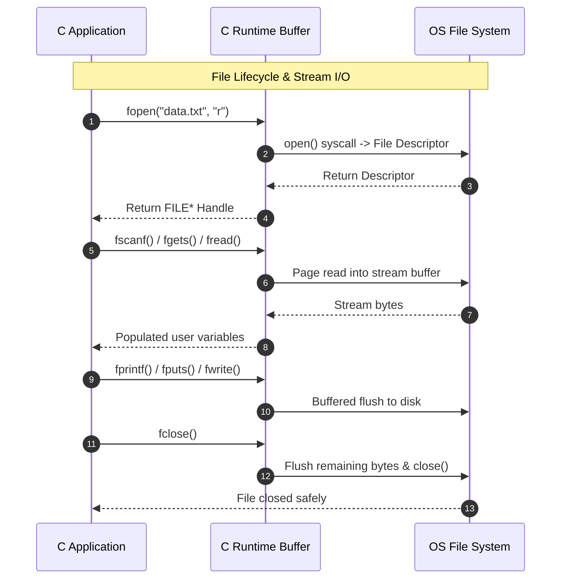

# CLASS 21 - file basic

> [!abstract] Summary
> Comprehensive architectural reference demonstrating the five foundational modes of C file I/O: formatted text, raw character streams, line buffering, binary block serialization, and direct file pointer repositioning.

**Source:** `CLASS/21_file_basic.c`

## Problem
In C, transient program variables stored in RAM stack/heap frames disappear when the program terminates. To create persistent applications, programmers must master reading from and writing to non-volatile disk files across diverse formats (plain text, tabular records, binary structures).

## Concepts used
- **File Stream Pointers (`FILE*`)**: An opaque structure handle managed by the C runtime containing the OS file descriptor, I/O buffer pointers, position indicators, and error/EOF flags.
- **Stream Open Modes**:
  - `"r"` / `"w"` / `"a"`: Text read, write (truncate), and append modes.
  - `"rb"` / `"wb"`: Binary modes preventing Windows OS carriage-return/line-feed (`\r\n` $\leftrightarrow$ `\n`) translation.
- **Formatted vs Raw I/O**:
  - `fprintf`/`fscanf`: Parses and formats human-readable text according to format specifiers (`%d`, `%s`, `%f`).
  - `fgetc`/`fputc`: Reads and writes single raw byte values. Returns `EOF` (integer `-1`) upon reaching stream termination.
  - `fgets`/`fputs`: Safe line-buffered reading respecting maximum buffer boundaries and preserving newline characters.
- **Binary Block I/O (`fread`/`fwrite`)**: Directly blitting contiguous structs or arrays between RAM and disk bytes without ASCII conversion.
- **Random-Access Positioning**:
  - `fseek(stream, offset, origin)`: Shifts stream position relative to `SEEK_SET` (beginning), `SEEK_CUR` (current), or `SEEK_END` (end).
  - `ftell(stream)`: Queries the current byte offset from the start of the file.
  - `rewind(stream)`: Resets position to offset 0 and clears error flags.

## Code
```c
/* Lines 1 - 25: Header & Program Overview */
/* ... Includes: <stdio.h>, <stdlib.h>, <string.h> ... */

/* Lines 26 - 65: Formatted I/O: fprintf & fscanf */
void demo_formatted_io(void) {
    FILE *in = fopen("data/formatted_input.txt", "r");
    FILE *out = fopen("data/formatted_output.txt", "w");
    char name[32]; int age; float gpa;
    fprintf(out, "%-10s %-5s %-6s\n", "NAME", "AGE", "GPA");
    while (fscanf(in, "%31s %d %f", name, &age, &gpa) == 3) {
        printf("[fscanf Read]  Name: %-10s | Age: %d | GPA: %.2f\n", name, age, gpa);
        fprintf(out, "%-10s %-5d %-6.2f\n", name, age, gpa);
    }
    fclose(in); fclose(out);
}

/* Lines 66 - 105: Character I/O: fgetc & fputc */
void demo_char_io(void) {
    FILE *in = fopen("data/char_input.txt", "r");
    FILE *out = fopen("data/char_output.txt", "w");
    int ch;
    while ((ch = fgetc(in)) != EOF) {
        fputc(ch, out);
    }
    fclose(in); fclose(out);
}

/* Lines 106 - 145: Line-by-Line I/O: fgets & fputs */
void demo_line_io(void) {
    FILE *in = fopen("data/line_input.txt", "r");
    FILE *out = fopen("data/line_output.txt", "w");
    char buffer[256];
    while (fgets(buffer, sizeof(buffer), in) != NULL) {
        fputs(buffer, out);
    }
    fclose(in); fclose(out);
}

/* Lines 146 - 195: Binary Block I/O: fread & fwrite */
typedef struct { int id; char name[20]; float marks; } Student;
void demo_binary_io(void) {
    FILE *fout = fopen("data/students.bin", "wb");
    Student students[3] = {{101, "Alice", 88.5f}, {102, "Bob", 76.0f}, {103, "Charlie", 92.3f}};
    fwrite(students, sizeof(Student), 3, fout);
    fclose(fout);

    FILE *fin = fopen("data/students.bin", "rb");
    Student read_students[3];
    fread(read_students, sizeof(Student), 3, fin);
    fclose(fin);
}

/* Lines 196 - 230: Stream Positioning: fseek, ftell, rewind */
void demo_file_positioning(void) {
    FILE *f = fopen("data/char_input.txt", "r");
    fseek(f, 0, SEEK_END);
    long size = ftell(f);
    printf("File size: %ld bytes\n", size);
    rewind(f);
    fclose(f);
}
```
*(Complete 230-line program in repository file `CLASS/21_file_basic.c`)*

## How it works
1. **Formatted Text Stream (`demo_formatted_io`)**: Opens `formatted_input.txt` with `"r"` and `formatted_output.txt` with `"w"`. Loops `while (fscanf(...) == 3)` to parse tabular records (`name`, `age`, `gpa`) and writes aligned columns using `fprintf(out, "%-10s %-5d %-6.2f\n", ...)`.
2. **Character-Level Stream (`demo_char_io`)**: Reads `char_input.txt` byte-by-byte using `ch = fgetc(in)` where `ch` is typed as `int` to store `EOF`. Writes each byte to `char_output.txt` using `fputc(ch, out)`.
3. **Line-Oriented Stream (`demo_line_io`)**: Reads lines safely with `fgets(buffer, sizeof(buffer), in)`. Because `fgets` guarantees null-termination and prevents buffer overflows, it is the gold standard for text line reading. Writes lines with `fputs`.
4. **Binary Serialization (`demo_binary_io`)**: Directly writes an array of 3 `Student` structs into `students.bin` using `fwrite(students, sizeof(Student), 3, fout)`. Reads them back into fresh memory with `fread`.
5. **Stream Metrics & Navigation (`demo_file_positioning`)**: Moves to the end of the file with `fseek(f, 0, SEEK_END)`, captures total file size in bytes using `ftell(f)`, and resets to the start with `rewind(f)`.

## Diagram / trace


## Sample run
```text
============================================================
         C Standard File I/O Operations Demo               
============================================================

=== 1. Formatted I/O (fprintf / fscanf) ===
[fscanf Read]  Name: Alice      | Age: 25 | GPA: 3.85
[fscanf Read]  Name: Bob        | Age: 30 | GPA: 3.40
[fscanf Read]  Name: Charlie    | Age: 22 | GPA: 3.95
-> Formatted data written to data/formatted_output.txt

=== 2. Character I/O (fgetc / fputc) ===
Copied 154 characters from data/char_input.txt to data/char_output.txt

=== 3. Line-by-Line I/O (fgets / fputs) ===
[Line 1] First line of text input.
[Line 2] Second line with structured words.
-> Written to data/line_output.txt

=== 4. Binary Block I/O (fwrite / fread) ===
-> Wrote 3 Student records to data/students.bin (72 bytes)
[fread Record 1] ID: 101 | Name: Alice      | Marks: 88.50
[fread Record 2] ID: 102 | Name: Bob        | Marks: 76.00
[fread Record 3] ID: 103 | Name: Charlie    | Marks: 92.30

=== 5. File Positioning (fseek / ftell / rewind) ===
File size of data/char_input.txt: 154 bytes
```

## Gotchas
> [!warning] Critical File Stream Pitfalls
> 1. **NULL Pointer Dereferencing**: Always check `if (file == NULL)` after `fopen`. Attempting to read or close a `NULL` pointer crashes the application.
> 2. **`fgetc` Return Type**: Always store the result of `fgetc()` in an `int`, **never a `char`**! `EOF` is negative integer `-1`. If `char` is unsigned on the host architecture, `ch` will never equal `EOF`, causing an infinite loop.
> 3. **Binary Portability**: `fwrite` dumps raw in-memory struct bytes. These are subject to compiler struct padding and endianness, meaning binary files written on an x86 machine may not read correctly on ARM or other compilers.

## Possible improvements
- Add dynamic path validation to ensure data directories exist before opening write streams.
- Wrap binary serialization in a versioned header to prevent schema mismatches.
- Implement error recovery using `ferror()` and `clearerr()`.

## Key takeaways
- Always pair every `fopen` with a corresponding `fclose` to flush buffers and release operating system file handles.
- Use `fgets` with explicit buffer length constraints in preference to unbounded `fscanf("%s")` for robust text input.
- File streams are buffered: changes written with `fprintf`/`fputc` may remain in user-space RAM until `fflush()` or `fclose()` is called.

## My notes
> [!question]- My notes

## Related
- [[CLASS 22 - space finder]] - Practical text file character analysis
- [[CLASS 24 - take cg file]] - Parsing tabular student records
- [[LAB 25 - titanic p1]] - Complex multi-column CSV file stream processing
