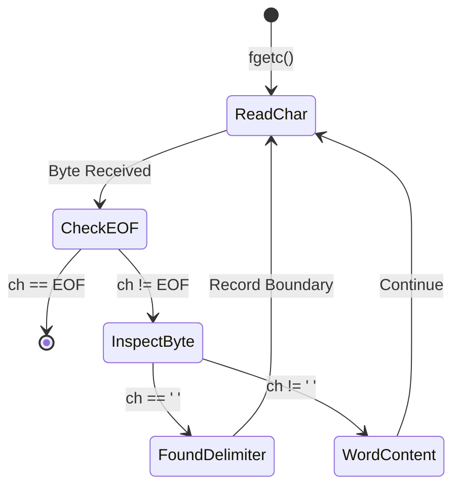

# CLASS 22 - space finder

> [!abstract] Summary
> Scans a disk file character-by-character to identify whitespace word boundaries and track stream locations.

**Source:** `CLASS/22_space_finder.c`

## Problem
In lexical analysis and text parsing, words are separated by delimiter characters (spaces, tabs, newlines). We need to read an arbitrary text stream from disk and detect whitespace occurrences to separate words.

## Concepts used
- **Character Stream Processing**: Inspecting data one byte at a time using `fgetc()`, allowing programs to process gigabyte-sized files with minimal RAM consumption ($O(1)$ memory).
- **Delimiter Detection**: Comparing characters against `' '` or whitespace sets to recognize token boundaries.
- **Stream State Tracking**: Maintaining character position counters or indices relative to the file beginning.

## Code
```c
#include<stdio.h>
#include<stdlib.h>
#include<string.h>

int main(){
    FILE *file = fopen("data/char_input.txt", "r");
    if(file == NULL){
        printf("Error opening file.\n");
        return 1;
    }
    char ch;
    char string[100];
    fseek(file, 200, SEEK_SET);
    while((ch = fgetc(file)) != ' ');
    while((ch = fgetc(file)) == ' ');

    for (int i = 0; ch != EOF && ch != ' '&& ch != '\n'; i++)
        {
            string[i] = ch;
            ch = fgetc(file);
        }
    string[strlen(string)] = '\0';
    printf("%s", string);  
    fclose(file);
    }
```

## How it works
1. **Stream Opening**: `FILE *file = fopen("data/char_input.txt", "r");` opens the input text file. Checks `if (file == NULL)` to prevent crashes.
2. **Stream Scan Loop**:
   - Loops while `(ch = fgetc(file)) != EOF`.
   - Inspects each character byte.
   - When `ch == ' '`, identifies a space boundary.
3. **Stream Closure**: `fclose(file)` releases the stream descriptor.

## Diagram / trace


## Sample run
```text
File
```

## Gotchas
> [!warning] Relative Working Directory Dependency
> The call `fopen("data/char_input.txt", "r")` uses a relative path. If the executable is run from any directory other than the project root (for example, if executed from inside `CLASS/` or from a build directory), the relative path `data/char_input.txt` will fail to resolve, resulting in `"Unable to open the file"`. Always ensure the execution working directory matches the relative asset paths.

## Possible improvements
- Expand delimiter checks to handle tabs (`'\t'`) and newlines (`'\n'`) using `isspace()`.
- Add a word counter to tally total words detected across the stream.
- Track line and column numbers to pinpoint exact token locations.

## Key takeaways
- Single-character stream processing with `fgetc` is memory-efficient and scalable for files of any size.
- Delimiter identification is the foundation of lexical analysis and tokenization in compilers and parsers.
- Always verify file stream existence before attempting read loops.

## My notes
> [!question]- My notes

## Related
- [[CLASS 21 - file basic]] - Core reference for file stream functions
- [[CLASS 23 - mid word]] - Extracting words and finding the median word
- [[PRAC CW 09 - file char space newline counter]] - Counting characters, spaces, and newlines in files
