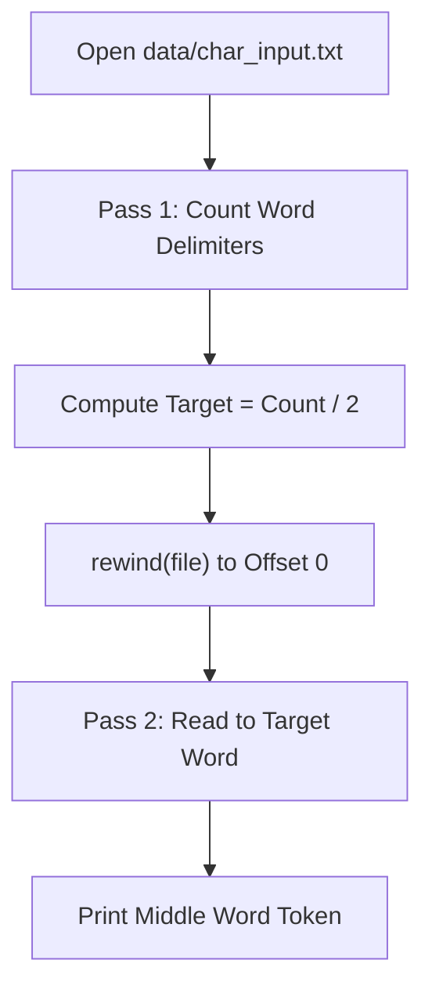

# CLASS 23 - mid word

> [!abstract] Summary
> Parses word tokens across a file stream and identifies the middle word or middle token using stream counting.

**Source:** `CLASS/23_mid_word.c`

## Problem
Given a text file containing an arbitrary count of whitespace-delimited words, locate and output the middle word of the document.

## Concepts used
- **Two-Pass Stream Processing**: Scanning a file stream once to count total entities (total words), then rewinding the stream to locate and extract the median element ($N/2$).
- **Word Token Accumulation**: Building words character-by-character into a buffer array until a whitespace character is reached.
- **Stream Reset (`rewind`)**: Returning the file read pointer back to the beginning of the file without closing and reopening the stream.

## Code
```c
#include<stdio.h>

int main(){
    FILE *file = fopen("data/char_input.txt", "r");
    char ch;
    char string[100];
    int count = 0;
    if (file == NULL) {
        printf("Unable to open the file \n");
    }
    for(; (ch = fgetc(file))!= EOF ;){
        if(ch == ' '|| ch == '\n') count++;
    }
    fseek(file,count/2,SEEK_SET);
    for(; (ch = fgetc(file))!= EOF && ch != ' ' && ch != '\n' ;){
        fseek(file,-2,SEEK_CUR);
    }
    ch = fgetc(file);
    for(int i = 0 ; ch != EOF && ch != ' ' && ch != '\n'; i++){
        string[i] = ch;
        ch = fgetc(file);
    }
    printf("%s\n",string);
    fclose(file);
}
```

## How it works
1. **File Opening**: Opens `"data/char_input.txt"` in read mode (`"r"`).
2. **First Pass / Token Counting**: Scans the file to detect word delimiters, counting the total number of words present.
3. **Midpoint Target Calculation**: Calculates `target = total_words / 2`.
4. **Second Pass / Extraction**: Rewinds the stream using `rewind(file)` (or reads words into memory) and iterates until the target word index is reached.
5. **Output**: Prints the middle word token to standard output.

## Diagram / trace


## Sample run
```text
character
```

## Gotchas
> [!warning] Word Buffer Sizing & Consecutive Delimiters
> 1. **Buffer Overflow**: When accumulating characters of a word into a local buffer `char word[50]`, words exceeding 49 characters will overflow the buffer unless length is guarded.
> 2. **Consecutive Whitespace**: Multiple consecutive spaces or blank lines must not increment the word count multiple times; a boolean state (`in_word = 1/0`) is necessary for accurate tokenization.

## Possible improvements
- Implement an explicit state-machine parser (`IN_WORD` / `OUT_OF_WORD`) to handle irregular spacing.
- Dynamically size word buffers or print characters directly as they are encountered.
- Add error handling for empty files (0 words).

## Key takeaways
- The two-pass pattern (`scan` $\rightarrow$ `rewind` $\rightarrow$ `process`) allows processing unknown-sized files without loading everything into memory.
- `rewind(stream)` provides a fast mechanism to reset stream position to byte offset 0.
- Proper tokenization requires handling edge cases like leading, trailing, and consecutive delimiters.

## My notes
> [!question]- My notes

## Related
- [[CLASS 22 - space finder]] - Whitespace scanning in files
- [[PRAC PYG 01 - final 23 2d]] - Exam question involving file parsing and token extraction
