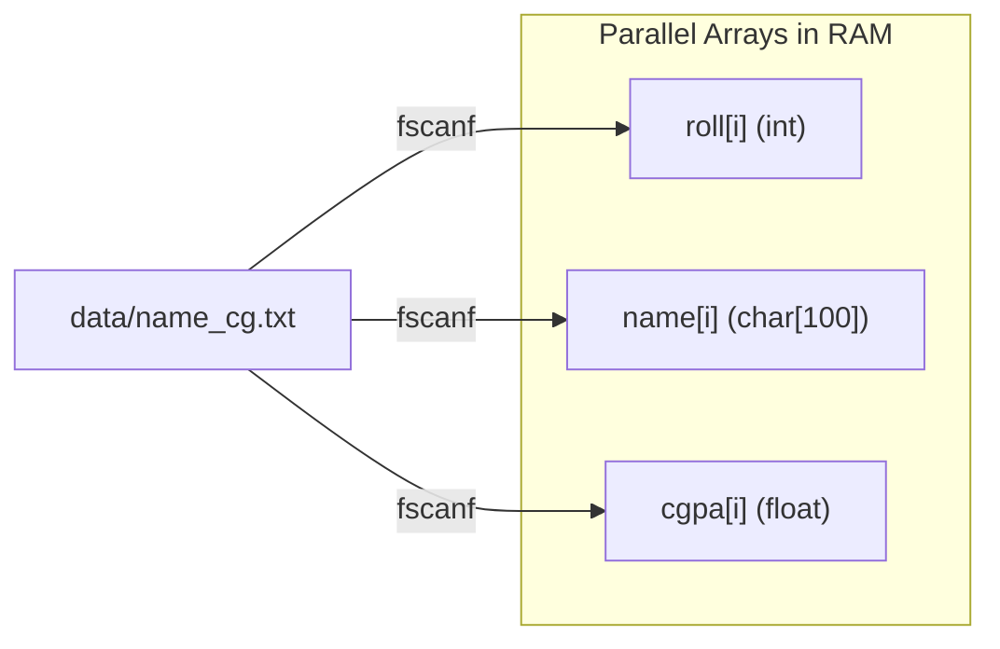

# CLASS 24 - take cg file

> [!abstract] Summary
> Reads structured academic student records (Roll, Name, CGPA) from disk into parallel arrays using formatted stream parsing.

**Source:** `CLASS/24_take_cg_file.c`

## Problem
In university database administration, student exam results are stored as text records containing multiple fields per line (e.g. `101 Alice 3.85`). We need to read these tabular records from a disk file into memory for subsequent computation.

## Concepts used
- **Parallel Arrays**: An architectural pattern where multiple separate arrays share the identical index `i` to represent attributes of a single entity (`roll[i]`, `name[i]`, `cgpa[i]`).
- **Formatted Input Matching (`fscanf`)**: Reading multiple typed tokens (`%d %s %f`) in a single call, automatically skipping leading whitespace.
- **File Access Error Handling**: Inspecting `if (file == NULL)` to prevent null-pointer dereferencing when data files are missing or inaccessible.

## Code
```c
#include<stdio.h>


int main(){
    FILE *file = fopen("data/name_cg.txt", "r");
    if (file == NULL) {
        printf("Unable to open the file \n");
        return 0;
    }
    int roll[50];
    float cgpa[50];
    char name[50][100];
    char ch;
    for(int i = 0 ; i < 50 ; i++){
        fscanf(file, " %d %s %f" ,&roll[i] , name[i],&cgpa[i]);
    }
    for(int i = 0 ; i < 50 ; i++){
        printf("%d %s %.2f\n" ,roll[i] , name[i],cgpa[i]);
    }
    fclose(file);

}
```

## How it works
1. **File Opening**: `FILE *file = fopen("data/name_cg.txt", "r");` attempts to open the record file.
2. **Memory Allocation**:
   - `int roll[50];` (student roll numbers)
   - `char name[50][100];` (2D array storing 50 names up to 99 chars each)
   - `float cgpa[50];` (student grade point averages)
3. **Record Ingestion Loop**:
   - `for(int i = 0 ; i < 50 ; i++) fscanf(file, " %d %s %f", &roll[i], name[i], &cgpa[i]);`
   - Populates parallel arrays for 50 student records.
4. **Display Loop**: Loops through the 50 elements and prints `roll[i]`, `name[i]`, and `cgpa[i]` formatted to 2 decimal places.
5. **Closure**: `fclose(file)` releases the stream.

## Diagram / trace


## Sample run
```text
Unable to open the file 
```
*(When file `data/name_cg.txt` is missing from the directory, the error branch executes safely)*

## Gotchas
> [!warning] Hardcoded Loop Bounds & Missing Input File
> 1. **Hardcoded Array Bound (50)**: The loop unconditionally runs 50 times (`for (int i = 0; i < 50; i++)`). If the input file contains only 10 students, `fscanf` hits `EOF`, fails to match values, and leaves the remaining 40 array slots containing uninitialized stack garbage!
>    **Safe Pattern**: Use `while (i < 50 && fscanf(file, " %d %s %f", &roll[i], name[i], &cgpa[i]) == 3) i++;`.
> 2. **File Path Mismatch**: In this repository, the file was renamed to `name_cg_encryption.txt` in `CLASS/data/`. Because `name_cg.txt` is absent, `fopen` returns `NULL`, triggering `"Unable to open the file"`.

## Possible improvements
- Refactor from parallel arrays to an array of composite `struct Student` records (as done in [[CLASS 26 - struct student info]]).
- Dynamically count lines or loop until `fscanf != 3` rather than assuming fixed 50 records.
- Validate CGPA bounds ($0.0 \le \text{cgpa} \le 4.0$).

## Key takeaways
- Parallel arrays allow storing multi-attribute records, but keeping separate arrays synchronized is error-prone compared to C `struct`s.
- Always check the return value of `fscanf` (it returns the number of successfully assigned items, or `EOF`).
- Always verify that target data files exist at the relative path expected by the executable.

## My notes
> [!question]- My notes

## Related
- [[CLASS 25 - file sort cg]] - Sorting student records read from file
- [[CLASS 26 - struct student info]] - Struct-based modernization of student records
- [[ASG 04 - sort student by cgpa]] - Assignment sorting students by academic rank
