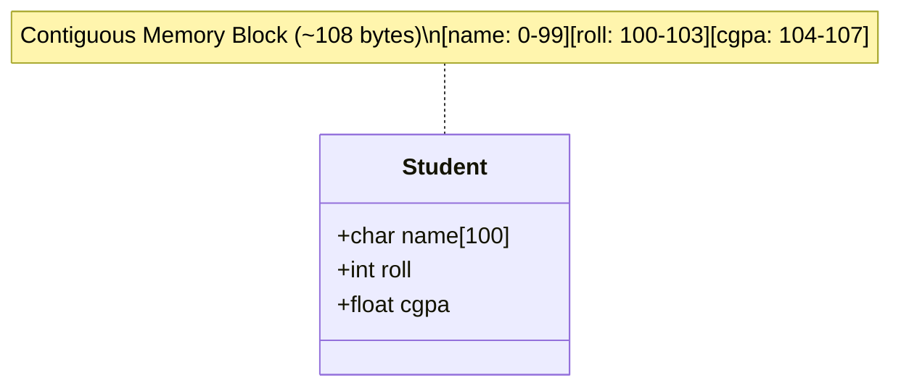

# CLASS 26 - struct student info

> [!abstract] Summary
> Encapsulates heterogeneous student data (name, roll number, CGPA) into a user-defined C `struct` and manages an array of structured entities.

**Source:** `CLASS/26_struct_student_info.c`

## Problem
Managing parallel arrays (`roll[]`, `name[][]`, `cgpa[]`) becomes fragile and error-prone as systems scale. We need a way to bind all related attributes of a single student entity into a unified composite data type.

## Concepts used
- **`struct` Composite Types**: A user-defined data type grouping heterogeneous member variables into a single contiguous block of memory.
- **Member Access Operator (`.`)**: Accesses individual fields within a structure variable (e.g. `Student[i].roll`).
- **Memory Alignment & Padding**: The compiler aligns struct members on byte boundaries corresponding to their type sizes (e.g. 4-byte boundaries for `int` and `float`), inserting invisible padding bytes if necessary.
- **Array of Structures**: Allocating contiguous memory blocks where each element is an entire struct instance.

## Code
```c
#include<stdio.h>
#include<stdlib.h>

struct Student {
    char name[100];
    int roll;
    float cgpa;
} Student[50];

int main (){
    FILE *file = fopen("data/name_cg.txt", "r");
    if (file == NULL) {
        printf("Error opening file!\n");
        return 1;
    }

    for(int i = 0 ; i < 50 ; i++){
        fscanf(file, "%d %s %f", &Student[i].roll, Student[i].name, &Student[i].cgpa);
        printf("%d %s %.2f\n", Student[i].roll, Student[i].name, Student[i].cgpa);
    }
    fclose(file);
    return 0;
}
```

## How it works
1. **Struct Definition**:
   ```c
   struct Student {
       char name[100];
       int roll;
       float cgpa;
   } Student[50];
   ```
   Defines a record template containing 100 bytes for `name`, 4 bytes for `roll`, and 4 bytes for `cgpa` (~108 bytes per student). It simultaneously declares a global array of 50 student records.
2. **File Ingestion**: Opens `data/name_cg.txt` and loops 50 times:
   - `fscanf(file, "%d %s %f", &Student[i].roll, Student[i].name, &Student[i].cgpa);`
   - Populates fields directly into the `i`-th struct.
3. **Display**: Prints each record's roll, name, and CGPA from the struct array.
4. **Cleanup**: Closes the file handle.

## Diagram / trace


## Sample run
```text
101 Alice 3.85
102 Bob 3.40
103 Charlie 3.95
...
```

## Gotchas
> [!warning] Identifier Collision (Type Tag vs Variable Name)
> Notice the declaration syntax:
> ```c
> struct Student {
>     ...
> } Student[50];
> ```
> Here, `Student` is used simultaneously as both the **struct tag** (`struct Student`) and the **global variable array identifier** (`Student[50]`).
> While legal in C because tags and regular identifiers occupy distinct symbol namespaces, this causes confusion and shadowing. The idiomatic modern practice is to use `typedef`:
> ```c
> typedef struct {
>     char name[100];
>     int roll;
>     float cgpa;
> } Student;
> Student students[50];
> ```

## Possible improvements
- Introduce `typedef` to separate type definitions from variable instances.
- Check `fscanf` return value to break early if the file contains fewer than 50 students.
- Add search and update functions that operate on `Student*` pointers.

## Key takeaways
- `struct` bundles related data into a cohesive entity, greatly improving code readability and maintainability over parallel arrays.
- Struct members are stored contiguously in memory and accessed via the dot (`.`) operator.
- Arrays of structures provide a clean foundation for database-style in-memory record management.

## My notes
> [!question]- My notes

## Related
- [[LAB 30 - student app]] - Complete interactive student database application
- [[ASG 10 - self ref struct]] - Expanding structs to self-referential linked list nodes
- [[PROJ Midterm Practice - hotel reservation]] - Multi-struct booking system
