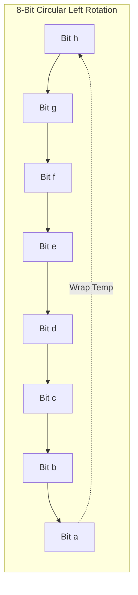

# CLASS 27 - binary encryption

> [!abstract] Summary
> Implements a bit-level stream cipher that encrypts files by circularly rotating character bits using a C `union` with a 1-bit bitfield struct.

**Source:** `CLASS/27_binary_encryption.c`

## Problem
Text-level Caesar ciphers can be easily decrypted through frequency analysis. To obscure data at the lowest hardware level, we want to perform a bitwise stream encryption that cyclically rotates the 8 individual bits of every byte in a file.

## Concepts used
- **C `union` Memory Sharing**: A union allocates only enough memory to hold its largest member, and all members share the **exact same memory address**. Writing to one member immediately alters the representation of the others.
- **Bitfields (`unsigned char a:1`)**: Specifying the exact bit-width of struct members. An 8-member struct of 1-bit fields packs cleanly into a single 8-bit byte.
- **Circular Bit Permutation (Bit Rotation)**: Shifting each bit to the neighboring position ($a \leftarrow b \leftarrow c \dots$) while wrapping the most significant bit back to the least significant bit ($h \leftarrow a_{orig}$).
- **Stream Cipher Loop**: Reading bytes with `fgetc()`, transforming each byte via bit rotation, and writing the encrypted bytes with `fprintf("%c")` or `fputc()`.

## Code
```c
#include <stdio.h>

union Data {
    char x;
    struct {
        unsigned char a:1;
        unsigned char b:1;
        unsigned char c:1;
        unsigned char d:1;
        unsigned char e:1;
        unsigned char f:1;
        unsigned char g:1;
        unsigned char h:1;
    } Bits;
};

char enryption_bit(char x) {
    union Data d;
    d.x = x;
    int temp = d.Bits.a;
    d.Bits.a = d.Bits.b;
    d.Bits.b = d.Bits.c;
    d.Bits.c = d.Bits.d;
    d.Bits.d = d.Bits.e;
    d.Bits.e = d.Bits.f;
    d.Bits.f = d.Bits.g;
    d.Bits.g = d.Bits.h;
    d.Bits.h = temp;
    return d.x;
}


int main() {
    char ch;

    FILE *input = fopen("data/name_cg.txt","r");
    FILE *output = fopen("data/name_cg_encrypted.txt","w");
    if(input == NULL || output == NULL){
        printf("File not found\n");
        return 1;
    }
    while((ch=fgetc(input)) != EOF){
        fprintf(output,"%c",enryption_bit(ch));
    }

    fclose(input);
    fclose(output);
    
    return 0;

}
```

## How it works
1. **Union Definition**:
   ```c
   union Data {
       char x;
       struct {
           unsigned char a:1, b:1, c:1, d:1, e:1, f:1, g:1, h:1;
       } Bits;
   };
   ```
   Both `x` and `Bits` occupy the exact same 1 byte of memory.
2. **Bit Rotation Function (`enryption_bit`)**:
   - Assigns input character `d.x = x`.
   - Saves bit `a` in `temp`.
   - Shifts each bit: `a = b`, `b = c`, `c = d`, `d = e`, `e = f`, `f = g`, `g = h`, `h = temp`.
   - Returns `d.x`, which now contains the rotated byte.
3. **File Stream Processing**:
   - Opens `"data/name_cg.txt"` for reading and `"data/name_cg_encrypted.txt"` for writing.
   - Loops `while ((ch = fgetc(input)) != EOF)`.
   - Encrypts each character and writes it to the output stream.

## Diagram / trace


## Sample run
```text
[Input File]:   Hello World
[Encrypted]:    ??????????? (Raw non-printable byte stream written to data/name_cg_encrypted.txt)
```

## Gotchas
> [!warning] Bitfield Endianness & Binary Stream Modes
> 1. **Compiler-Dependent Bit Ordering**: The C standard does **not** specify whether bitfields are allocated from least-significant bit (LSB) to most-significant bit (MSB) or vice versa! On GCC x86 (little-endian), `a` is bit 0; on other architectures, `a` could be bit 7. This means bitfield encryption is machine-dependent.
> 2. **Text vs Binary Mode on Windows**: The files are opened in text mode (`"r"` / `"w"`). When encrypting binary bytes, an encrypted character might equal `0x1A` (`EOF` on Windows text streams) or `0x0A` (`\n`, which Windows expands to `\r\n`). Encrypted streams should always be opened with `"rb"` and `"wb"`.

## Possible improvements
- Implement bitwise operators (`(x << 1) | ((x >> 7) & 1)`) which are 100% portable across all architectures.
- Provide a matching decryption function that rotates bits in reverse.
- Open streams in `"rb"` and `"wb"` binary modes.

## Key takeaways
- C `union` allows inspecting and manipulating the same underlying memory through multiple distinct representations.
- Bitfields provide language-level access to individual bits within integer types.
- Stream ciphers process data incrementally, requiring only $O(1)$ memory regardless of file size.

## My notes
> [!question]- My notes

## Related
- [[CLASS 28 - shift encryption]] - Caesar character shift encryption
- [[LAB 29 - grayscale]] - Manipulating raw binary image bytes
