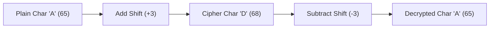

# CLASS 28 - shift encryption

> [!abstract] Summary
> Implements a Caesar substitution cipher driven by command-line shift parameters to encrypt and decrypt disk file streams.

**Source:** `CLASS/28_shift_encryption.c`

## Problem
Encrypt a disk file using a substitution cipher where character byte codes are shifted by integer offsets supplied directly as command-line arguments.

## Concepts used
- **Caesar Substitution Cipher**: An encryption technique where each character is replaced by a character found a fixed number of positions further down the alphabet/ASCII table ($C = P + K$).
- **Command-Line Configuration**: Utilizing `argC` and `argV` to dynamically parameterize the encryption key without recompiling or pausing for user prompts.
- **Symmetric Inversion**: Decryption is mathematically identical to encryption with a negated key ($P = C - K$).

## Code
```c
#include<stdio.h>
#include<stdlib.h>

char encryption(char ch,int SHIFT){
    ch += SHIFT;
    return ch;
}

char decryption(char ch,int SHIFT){
    encryption(ch,-SHIFT);
}

int main(int argC,char *argV[]){
    char ch;
    FILE *input = fopen("data/name_cg.txt","r");
    FILE *output = fopen("data/name_cg_encryption.txt","w");
    if(input == NULL || output == NULL){
        printf("Unable to open file\n");
        return 1;
    }
    for(int i = 0; (ch=fgetc(input)) != EOF; i++){
        if(i > argC) i-=argC;
        int SHIFT = atoi(argV[i]);
        fprintf(output,"%c",encryption(ch,SHIFT));
    }
    fclose(input);
    fclose(output);
}
```

## How it works
1. **Encryption Routine**:
   - `char encryption(char ch, int SHIFT) { ch += SHIFT; return ch; }`
   - Offsets the character byte by `SHIFT`.
2. **Decryption Routine**: Calls `encryption(ch, -SHIFT)` to invert the transformation.
3. **Command-Line Processing**:
   - In `main(int argC, char *argV[])`, opens `"data/name_cg.txt"` for reading and `"data/name_cg_encryption.txt"` for writing.
   - For each character read by `fgetc(input)`, parses the shift amount from command-line arguments using `atoi(argV[i])`.
   - Cycles through available arguments if character count exceeds `argC`.
   - Writes the encrypted characters to the output file.

## Diagram / trace


## Sample run
```text
$ ./prog 3
-> Reads data/name_cg.txt
-> Encrypts with shift key 3
-> Generates data/name_cg_encryption.txt
```

## Gotchas
> [!warning] Missing Return Statement & CLI Argument Indexing
> 1. **Missing Return in `decryption`**:
>    ```c
>    char decryption(char ch, int SHIFT) {
>        encryption(ch, -SHIFT);
>    }
>    ```
>    The function calls `encryption()`, but **does not return the result**! In C, falling off the end of a non-void function returns undefined garbage from the CPU register (`%al`/`%eax`). It must be `return encryption(ch, -SHIFT);`.
> 2. **`argV[0]` Program Name Gotcha**: The loop initializes `int i = 0` and accesses `argV[i]`. But `argV[0]` is the **program executable name** (e.g. `"prog.exe"`). Passing `"prog.exe"` to `atoi()` returns `0`, meaning the first character is shifted by 0! User arguments start at index 1.
> 3. **Argument Wrap Logic**: The line `if (i > argC) i -= argC;` has boundary flaws that can access out-of-bounds pointers.

## Possible improvements
- Add alphabet wrapping with modulo arithmetic (`(ch - 'A' + SHIFT) % 26 + 'A'`) to keep letters within the readable A?Z range.
- Fix the missing `return` statement in `decryption`.
- Validate `argC >= 2` before attempting to access `argV[1]`.

## Key takeaways
- Caesar substitution ciphers demonstrate the direct relationship between characters and their underlying integer ASCII representations.
- Symmetric encryption/decryption can share identical code paths by simply negating the operational key.
- Command-line arguments must always be validated against `argc` before being accessed.

## My notes
> [!question]- My notes

## Related
- [[CLASS 27 - binary encryption]] - Bitwise stream cipher using union bitfields
- [[CLASS 20 - cmd arg]] - Command-line argument mechanics
