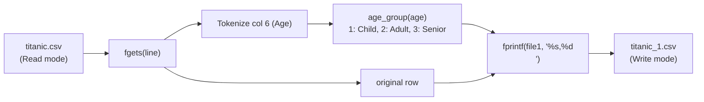

# LAB 26 - titanic p2

> [!abstract] Summary
> Enriches an existing CSV dataset by extracting passenger ages, computing categorical age brackets, and generating an augmented CSV file with a new column (`Age_Group`).

**Source:** `LAB/26_titanic_p2.c`

## Problem
Read records from `data/titanic.csv`, evaluate each passenger's age into categorical brackets (Child = 1, Adult = 2, Senior = 3), and export an enriched copy to `data/titanic_1.csv` with an additional `Age_Group` column appended.

## Concepts used
- **Dual File Streaming:** Concurrently reading from an input file (`fopen(..., "r")`) while streaming transformed rows to an output file (`fopen(..., "w")`).
- **Feature Engineering / Discretization:** Mapping continuous numeric ages into discrete numerical categories ($1, 2, 3$) via conditional helper function `age_group()`.
- **String Stripping (`strcspn`):** Locating and removing trailing carriage returns and newlines (`\r\n`) to keep row lines clean.
- **Header Modification:** Appending `,Age_Group\n` to the original header line.

## Code
```c
    #include <stdio.h>
    #include <stdlib.h>
    #include <string.h>


    #define MAX_ROWS 1000

    int age_group(float age) {
        if (age > 0 && age < 18.0) return 1; 
        else if (age >= 18.0 && age < 40.0) return 2;
        else if (age >= 40.0) return 3;
    }

    int main() {
        FILE *file = fopen("data/titanic.csv", "r");
        FILE *file1 = fopen("data/titanic_1.csv", "w");
        if (!file) {
            printf("Error: Could not open titanic.csv\n");
            return 1;
        }

        char line[1024];
        char original[1024];
        float age[MAX_ROWS];
        int count = 0;

        if(fgets(line,sizeof(line),file)){
            line[strcspn(line,"\r\n")] = '\0';
            fprintf(file1,"%s,Age_Group\n",line);
        }

    

        while (fgets(line, sizeof(line), file) != NULL && count < MAX_ROWS) {
            strcpy(original,line);
            original[strcspn(original,"\r\n")] = '\0';
            char *ptr = line;
            int col = 0;

            while (ptr) {
                char *next = strchr(ptr, ',');
                if (next) {
                    *next = '\0'; 
                }
                if (col == 6) {
                    if (*ptr == '\0' || *ptr == '\r' || *ptr == '\n') age[count] = -1.0;
                    else  age[count] = atof(ptr);
                }
                if (!next) break;
                ptr = next + 1;
                col++;
            }
            if(age[count] != -1.0) {
                fprintf(file1,"%s,%d\n",original,age_group(age[count]));
            }
            count++;
        }
        fclose(file);
        fclose(file1);
        return 0;
    }
```

## How it works
1. Opens input stream `data/titanic.csv` and output stream `data/titanic_1.csv`.
2. Reads the original header line, strips trailing newline characters, and writes the augmented header `... ,Age_Group\n` to the new file.
3. Loops over each passenger line:
   - Preserves a duplicate of the untouched raw row in buffer `original`.
   - Parses tokens using `strchr(ptr, ',')` to locate column 6 (Age).
   - If age is present and non-empty, converts to float via `atof(ptr)` and classifies it:
     - Group 1: Child ($0 < \text{age} < 18$)
     - Group 2: Adult ($18 \le \text{age} < 40$)
     - Group 3: Senior ($	ext{age} \ge 40$)
   - Writes `original,group\n` to `file1`.
4. Closes both file handles upon completion.

## Diagram / trace


## Sample run
```text
(Generates data/titanic_1.csv)
```

First 4 lines of generated `data/titanic_1.csv`:
```csv
PassengerId,Survived,Pclass,Name,Sex,Age,SibSp,Parch,Ticket,Fare,Cabin,Embarked,Age_Group
1,0,3,"Braund, Mr. Owen Harris",male,22,1,0,A/5 21171,7.25,,S,2
2,1,1,"Cumings, Mrs. John Bradley (Florence Briggs Thayer)",female,38,1,0,PC 17599,71.2833,C85,C,2
3,1,3,"Heikkinen, Miss. Laina",female,26,0,0,STON/O2. 3101282,7.925,,S,2
4,1,1,"Futrelle, Mrs. Jacques Heath (Lily May Peel)",female,35,1,0,113803,53.1,C123,S,2
```

## Gotchas
> [!warning] Missing Age Handling
> If the age column is blank or missing, `age_group()` does not explicitly return a value for negative/empty cases, causing undefined return values to be written for passengers without recorded ages.

## Possible improvements
- Return a dedicated code (e.g., `0` or `-1`) for unknown or missing ages and write `NA` or `0` into the output column.
- Verify that `file1` opened successfully alongside `file` before proceeding with writes.

## Key takeaways
- Pre-processing datasets by engineering new categorical attributes directly in C prepares raw data for downstream statistical analysis.
- Keeping a pristine copy of the original row (`strcpy(original, line)`) makes appending derived columns trivial.
- Always sanitize line breaks (`\r` and `\n`) when moving text files across Windows and POSIX systems.

## My notes
> [!question]- My notes

## Related
- [[LAB 25 - titanic p1]]
- [[LAB 27 - titanic p3]]
- [[CLASS 21 - file basic]]
