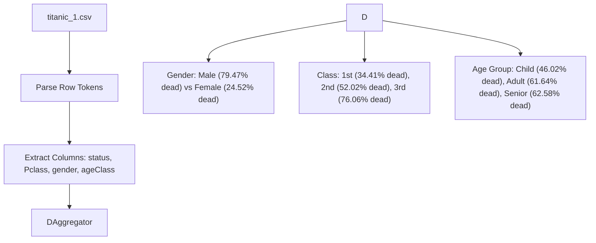

# LAB 27 - titanic p3

> [!abstract] Summary
> Ingests the enriched dataset (`titanic_1.csv`) to compute and display multidimensional survival and mortality analytics across gender, passenger ticket class, and age groups.

**Source:** `LAB/27_titanic_p3.c`

## Problem
Read up to 1000 rows of the preprocessed file `data/titanic_1.csv`, aggregate alive and dead counts partitioned across three independent categorical axes (Gender, Passenger Class, and Age Class), and output structured mortality percentages for each demographic segment.

## Concepts used
- **Multivariate Aggregation:** Simultaneously maintaining separate accumulator counters for gender (`alive_male`, `dead_male`, `alive_female`, `dead_female`), ticket class (`total_pclass1`, `dead_pclass1`, etc.), and age brackets (`total_age1`, `dead_age1`, etc.).
- **Token Filtering with Column Indices:** Navigating CSV tokens by index:
  - `col == 1`: Survival status ($0$ or $1$)
  - `col == 2`: Ticket class ($1, 2, 3$)
  - `col == 5`: Gender string (`"male"` or `"female"`)
  - `col == 12`: Derived age class ($1, 2, 3$)
- **Ratio Formatting:** Calculating percentage expressions `100.0 * dead / total` using floating-point multiplication to prevent integer truncation.

## Code
```c
    #include <stdio.h>
    #include <stdlib.h>
    #include <string.h>

    #define MAX_ROWS 1000

    int main() {
        FILE *file = fopen("data/titanic_1.csv", "r");
        if (!file) {
            printf("Error: Could not open titanic_1.csv\n");
            return 1;
        }

        char line[1024];
        char gender[MAX_ROWS][10];
        int status[MAX_ROWS];
        int passengerClass[MAX_ROWS];
        int ageClass[MAX_ROWS];
        int count = 0;

        fgets(line, sizeof(line), file);

        while (fgets(line, sizeof(line), file) != NULL && count < MAX_ROWS) {
            char *ptr = line;
            int col = 0;

            while (ptr) {
                char *next = strchr(ptr, ',');
                if (next) {
                    *next = '\0'; 
                }

                if (col == 1) status[count] = atoi(ptr);
                if (col == 2) passengerClass[count] = atoi(ptr);
                if (col == 5) strcpy(gender[count], ptr);
                if (col == 13) ageClass[count] = atoi(ptr);

                if (!next) break;
                ptr = next + 1;
                col++;
            }
            count++;
        }
        
        fclose(file);
        
        int dead_male = 0, alive_male = 0;
        int dead_female = 0, alive_female = 0;

        int dead_pclass1 = 0, alive_pclass1 = 0;
        int dead_pclass2 = 0, alive_pclass2 = 0;
        int dead_pclass3 = 0, alive_pclass3 = 0;

        int dead_age1 = 0, alive_age1 = 0;
        int dead_age2 = 0, alive_age2 = 0;
        int dead_age3 = 0, alive_age3 = 0;

        for (int i = 0; i < count; i++) {
            if (strcmp(gender[i], "male") == 0) {
                if (status[i] == 1) alive_male++;
                else if (status[i] == 0) dead_male++;
            } else if (strcmp(gender[i], "female") == 0) {
                if (status[i] == 1) alive_female++;
                else if (status[i] == 0) dead_female++;
            }

            if (passengerClass[i] == 1) {
                if (status[i] == 1) alive_pclass1++;
                else if (status[i] == 0) dead_pclass1++;
            } else if (passengerClass[i] == 2) {
                if (status[i] == 1) alive_pclass2++;
                else if (status[i] == 0) dead_pclass2++;
            } else if (passengerClass[i] == 3) {
                if (status[i] == 1) alive_pclass3++;
                else if (status[i] == 0) dead_pclass3++;
            }

            if (ageClass[i] == 1) {
                if (status[i] == 1) alive_age1++;
                else if (status[i] == 0) dead_age1++;
            } else if (ageClass[i] == 2) {
                if (status[i] == 1) alive_age2++;
                else if (status[i] == 0) dead_age2++;
            } else if (ageClass[i] == 3) {
                if (status[i] == 1) alive_age3++;
                else if (status[i] == 0) dead_age3++;
            }
        }

        int total_male = alive_male + dead_male;
        int total_female = alive_female + dead_female;

        int total_pclass1 = alive_pclass1 + dead_pclass1;
        int total_pclass2 = alive_pclass2 + dead_pclass2;
        int total_pclass3 = alive_pclass3 + dead_pclass3;

        int total_age1 = alive_age1 + dead_age1;
        int total_age2 = alive_age2 + dead_age2;
        int total_age3 = alive_age3 + dead_age3;

        printf("=== GENDER CATEGORY ===\n");
        printf("Total Male: %d\n", total_male);
        printf("Alive Male: %d\n", alive_male);
        printf("Dead Male: %d\n", dead_male);
        printf("Percentage of Dead Male: %.2f%%\n\n", 100.0 * dead_male / total_male);

        printf("Total Female: %d\n", total_female);
        printf("Alive Female: %d\n", alive_female);
        printf("Dead Female: %d\n", dead_female);
        printf("Percentage of Dead Female: %.2f%%\n\n", 100.0 * dead_female / total_female);

        printf("=== PASSENGER CLASS CATEGORY ===\n");
        printf("Total Class 1: %d\n", total_pclass1);
        printf("Alive Class 1: %d\n", alive_pclass1);
        printf("Dead Class 1: %d\n", dead_pclass1);
        printf("Percentage of Dead Class 1: %.2f%%\n\n", 100.0 * dead_pclass1 / total_pclass1);

        printf("Total Class 2: %d\n", total_pclass2);
        printf("Alive Class 2: %d\n", alive_pclass2);
        printf("Dead Class 2: %d\n", dead_pclass2);
        printf("Percentage of Dead Class 2: %.2f%%\n\n", 100.0 * dead_pclass2 / total_pclass2);

        printf("Total Class 3: %d\n", total_pclass3);
        printf("Alive Class 3: %d\n", alive_pclass3);
        printf("Dead Class 3: %d\n", dead_pclass3);
        printf("Percentage of Dead Class 3: %.2f%%\n\n", 100.0 * dead_pclass3 / total_pclass3);

        printf("=== AGE CLASS CATEGORY ===\n");
        printf("Total Child (Class 1): %d\n", total_age1);
        printf("Alive Child (Class 1): %d\n", alive_age1);
        printf("Dead Child (Class 1): %d\n", dead_age1);
        printf("Percentage of Dead Child (Class 1): %.2f%%\n\n", 100.0 * dead_age1 / total_age1);

        printf("Total Adult (Class 2): %d\n", total_age2);
        printf("Alive Adult (Class 2): %d\n", alive_age2);
        printf("Dead Adult (Class 2): %d\n", dead_age2);
        printf("Percentage of Dead Adult (Class 2): %.2f%%\n\n", 100.0 * dead_age2 / total_age2);

        printf("Total Senior (Class 3): %d\n", total_age3);
        printf("Alive Senior (Class 3): %d\n", alive_age3);
        printf("Dead Senior (Class 3): %d\n", dead_age3);
        printf("Percentage of Dead Senior (Class 3): %.2f%%\n", 100.0 * dead_age3 / total_age3);

        return 0;
    }
```

## How it works
1. Opens `data/titanic_1.csv` and reads past the header row.
2. Loops through rows up to `MAX_ROWS`:
   - Splits tokens using `strchr(ptr, ',')`.
   - Populates parallel arrays: `status[count]`, `passengerClass[count]`, `gender[count]`, and `ageClass[count]`.
   - Increments `count`.
3. Iterates through the loaded records, incrementing respective cohort tallies:
   - Gender: checks `gender[i]` equality with `"male"` / `"female"` and `status[i]`.
   - Class: checks `passengerClass[i] == 1, 2, 3` and `status[i]`.
   - Age: checks `ageClass[i] == 1, 2, 3` and `status[i]`.
4. Outputs comprehensive formatted tables for Gender, Passenger Class, and Age Group categories.

## Diagram / trace


## Sample run
```text
=== GENDER CATEGORY ===
Total Male: 453
Alive Male: 93
Dead Male: 360
Percentage of Dead Male: 79.47%

Total Female: 261
Alive Female: 197
Dead Female: 64
Percentage of Dead Female: 24.52%

=== PASSENGER CLASS CATEGORY ===
Total Class 1: 186
Alive Class 1: 122
Dead Class 1: 64
Percentage of Dead Class 1: 34.41%

Total Class 2: 173
Alive Class 2: 83
Dead Class 2: 90
Percentage of Dead Class 2: 52.02%

Total Class 3: 355
Alive Class 3: 85
Dead Class 3: 270
Percentage of Dead Class 3: 76.06%

=== AGE CLASS CATEGORY ===
Total Child (Class 1): 113
Alive Child (Class 1): 61
Dead Child (Class 1): 52
Percentage of Dead Child (Class 1): 46.02%

Total Adult (Class 2): 446
Alive Adult (Class 2): 171
Dead Adult (Class 2): 275
Percentage of Dead Adult (Class 2): 61.64%

Total Senior (Class 3): 155
Alive Senior (Class 3): 58
Dead Senior (Class 3): 97
Percentage of Dead Senior (Class 3): 62.58%
```

## Gotchas
> [!warning] Dependency on Pipeline Step 2
> Running this program requires `data/titanic_1.csv` to already exist on disk (generated by [[LAB 26 - titanic p2]]). If run directly against the pristine repo without executing experiment 26 first, `fopen` fails with `Error: Could not open titanic_1.csv`.

## Possible improvements
- Replace repeated `if/else` tally ladders with a 2D frequency matrix `table[category][status]`.
- Store records in an array of structures (`struct Passenger`) for cleaner readability.

## Key takeaways
- The Titanic disaster data clearly reflects historical social prioritization: females had a dramatically lower mortality rate (24.52%) than males (79.47%).
- Ticket class strongly correlated with survival: 3rd-class passengers suffered a 76.06% mortality rate compared to 34.41% for 1st-class.
- Multi-stage data pipelines (raw data -> feature enrichment -> aggregate reporting) mirror real-world data science workflows.

## My notes
> [!question]- My notes

## Related
- [[LAB 25 - titanic p1]]
- [[LAB 26 - titanic p2]]
- [[CLASS 24 - take cg file]]
