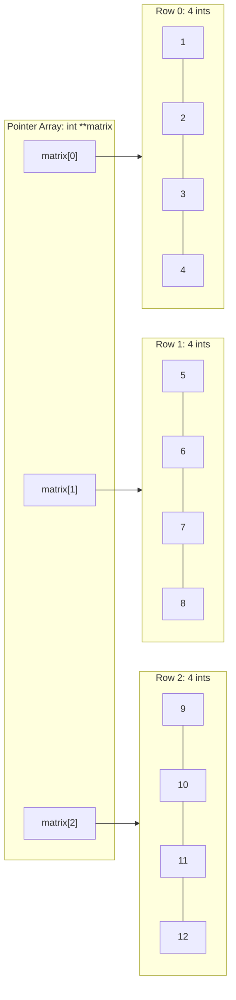

# LAB 28 - matrix

> [!abstract] Summary
> Allocates a dynamic 2D matrix on the heap using a double pointer (`int **`), populates elements sequentially via pointer arithmetic dereferencing, and performs clean multi-stage memory deallocation.

**Source:** `LAB/28_matrix.c`

## Problem
Construct a dynamic 2-dimensional matrix with 3 rows and 4 columns on the heap, initialize each cell with an incremental counter using double pointer arithmetic (`*(*(matrix + i) + j)`), print the formatted grid, and free all dynamically allocated memory.

## Concepts used
- **Double Pointers (`int **`):** A pointer to a contiguous array of pointers, where each pointer element stores the base address of a row array.
- **Two-Stage Heap Allocation:**
  1. Allocate an array of $R$ row pointers: `(int **)malloc(rows * sizeof(int *))`.
  2. For each row $i$, allocate $C$ columns: `*(matrix + i) = (int *)malloc(cols * sizeof(int))`.
- **Double Dereference Arithmetic:** Accessing cell $(i, j)$ as `*(*(matrix + i) + j)`. The expression `*(matrix + i)` yields the pointer to row $i$, and adding $j$ before the outer dereference yields the integer value at column $j$.
- **Two-Stage Memory Deallocation:** Deallocating every individual row array first (`free(*(matrix + i))`) before freeing the parent array of row pointers (`free(matrix)`).

## Code
```c
#include <stdio.h>
#include <stdlib.h>

int main() {
    int rows = 3;
    int cols = 4;

    int **matrix = (int **)malloc(rows * sizeof(int *));
    if (matrix == NULL) {
        printf("Memory allocation failed!\n");
        return 1;
    }

    for (int i = 0; i < rows; i++) {
        *(matrix + i) = (int *)malloc(cols * sizeof(int));
        if (*(matrix + i) == NULL) {
            printf("Memory allocation failed for row %d!\n", i);
            return 1;
        }
    }

    int count = 1;
    for (int i = 0; i < rows; i++) {
        for (int j = 0; j < cols; j++) {
            *(*(matrix + i) + j) = count++;
        }
    }
    printf("Matrix (%dx%d):\n", rows, cols);
    for (int i = 0; i < rows; i++) {
        for (int j = 0; j < cols; j++) {
            printf("%3d ", *(*(matrix + i) + j));
        }
        printf("\n");
    }

    for (int i = 0; i < rows; i++) {
        free(*(matrix + i));
    }
    free(matrix);

    return 0;
}
```

## How it works
1. Defines dimensions `rows = 3` and `cols = 4`.
2. Allocates row pointer spine: `int **matrix = (int **)malloc(rows * sizeof(int *))`. Checks for allocation failure.
3. In a loop from $i = 0$ to $2$, allocates each row buffer `*(matrix + i) = (int *)malloc(cols * sizeof(int))`.
4. Uses nested loops to assign sequential integers ($1 \dots 12$) to cells using `*(*(matrix + i) + j) = count++`.
5. Prints the grid with `%3d` formatting for tabular column alignment.
6. Frees each row buffer `*(matrix + i)`, and finally frees the top-level pointer `matrix`.

## Diagram / trace


## Sample run
```text
Matrix (3x4):
  1   2   3   4 
  5   6   7   8 
  9  10  11  12 
```

## Gotchas
> [!warning] Freeing in Reverse Order
> Freeing `matrix` before freeing each row `*(matrix + i)` produces dangling pointers and severe memory leaks: once `matrix` is released, the addresses of the row allocations are lost forever. Always deallocate rows first, then the spine.

## Possible improvements
- Generalize matrix creation and destruction into reusable helper functions `int** create_matrix(int r, int c)` and `void free_matrix(int **m, int r)`.
- Consider allocating a single contiguous block `malloc(rows * cols * sizeof(int))` to reduce heap fragmentation and allow single-call freeing.

## Key takeaways
- Dynamic 2D arrays in C require a double pointer (`int **`) pointing to an array of pointers, each pointing to a row buffer.
- Bracket notation `matrix[i][j]` is syntactically equivalent to double dereference pointer arithmetic `*(*(matrix + i) + j)`.
- Always deallocate dynamic matrices in reverse order of allocation: free children rows before freeing the parent pointer table.

## My notes
> [!question]- My notes

## Related
- [[CLASS 19 - pointer row sum]]
- [[CLASS 18 - pointer books 2d arr]]
