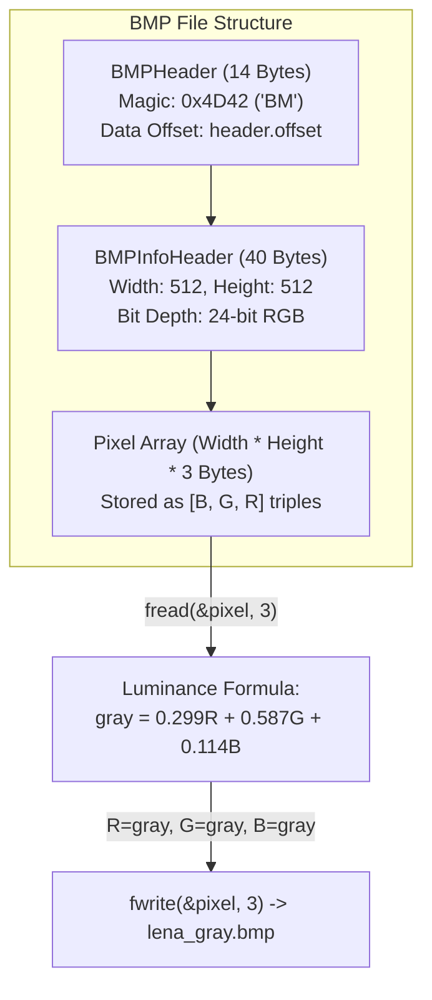

# LAB 29 - grayscale

> [!abstract] Summary
> Parses binary 24-bit uncompressed Windows BMP image headers, reads raw RGB pixel bytes, applies the standard photometric grayscale luminance formula, and outputs a converted grayscale BMP file.

**Source:** `LAB/29_grayscale.c`

## Problem
Open an uncompressed 24-bit BMP image (`data/lena.bmp`), validate the `'BM'` magic identifier, extract width, height, and data offsets, and generate a new grayscale image (`data/lena_gray.bmp`) by converting each pixel's color channels into equal luminance values.

## Concepts used
- **Packed Binary Structs (`#pragma pack(push, 1)`):** Forcing byte-aligned struct packing to prevent automatic compiler padding from altering file offset offsets during binary I/O.
- **BMP File Format Architecture:**
  - `BMPHeader` (14 bytes): Magic bytes `type = 0x4D42` (`'BM'`), file size, and offset to pixel data.
  - `BMPInfoHeader` (40 bytes): Image width, height, color planes, and bits per pixel (24-bit).
  - `RGB` (3 bytes): Raw pixel channels stored in Little-Endian byte order: Blue, Green, Red.
- **Binary File Streaming (`fread`/`fwrite`/`fseek`):** Direct block-level byte reading and writing without text transformations.
- **Photometric Luminance Conversion:** Human eye weighted formula:
  $$\text{Gray} = 0.299 \times R + 0.587 \times G + 0.114 \times B$$

## Code
```c
#include <stdio.h>
#include <stdlib.h>
#include <stdint.h>

#pragma pack(push, 1)
#pragma pack(push, 1)
typedef struct {
    unsigned short type;        
    unsigned int   size;       
    unsigned short reserved1;
    unsigned short reserved2;
    unsigned int   offset;     
} BMPHeader;

typedef struct {
    unsigned int   size;        
    int            width;       
    int            height;      
    unsigned short planes;      
    unsigned short bpp;         
    unsigned int   compression; 
} BMPInfoHeader;
#pragma pack(pop)

typedef struct{
    unsigned char  RED;
    unsigned char GREEN;
    unsigned char BLUE;
} RGB;

#pragma pack(pop)

int main(){
    FILE *input = fopen("data/lena.bmp","rb");
    FILE *output = fopen("data/gray_lena.bmp","wb");

    if (!input || !output) {
        printf("Error: Could not open input file.\n");
        return 1;
    } 
    BMPHeader header;
    BMPInfoHeader info;


    fread(&header,sizeof(BMPHeader),1,input);
    if (header.type != 0x4D42) {
        printf("NOT A BMP FILE !\n");
        fclose(input);
        return 0;
    }
    fread(&info,sizeof(BMPInfoHeader),1,input);
    
    fwrite(&header,sizeof(BMPHeader),1,output);
    fwrite(&info,sizeof(BMPInfoHeader),1,output);

    int width = info.width;
    int height = info.height;
    
    printf("%d \n",height );
    printf("%d",width);

    fseek(input ,header.offset ,SEEK_SET);
    fseek(output ,header.offset ,SEEK_SET);
    for(int h = 0 ; h < height ; h++){
        RGB pixel;
        for(int w = 0 ; w < width ; w++){
            fread(&pixel,sizeof(RGB),1,input);

            int gray = 0.299*pixel.RED + 0.587*pixel.GREEN + 0.114*pixel.BLUE;
            pixel.RED = gray;
            pixel.GREEN = gray;
            pixel.BLUE = gray;

            fwrite(&pixel,sizeof(RGB),1,output);

        }
    }

    fclose(input);
    fclose(output);
}
```

## How it works
1. Opens `data/lena.bmp` in binary read mode (`"rb"`) and `data/lena_gray.bmp` in binary write mode (`"wb"`).
2. Reads `BMPHeader` and checks `header.type != 0x4D42`. If invalid, prints `NOT A BMP FILE !` and exits.
3. Reads `BMPInfoHeader` and writes both headers directly into the output file.
4. Reads dimensions: `width = info.width`, `height = info.height`.
5. Seeks to the pixel array start in both streams using `fseek(..., header.offset, SEEK_SET)`.
6. Iterates over rows $h$ and columns $w$:
   - Reads 3 bytes into `RGB pixel` struct.
   - Computes grayscale luminance: `gray = 0.299*pixel.RED + 0.587*pixel.GREEN + 0.114*pixel.BLUE`.
   - Reassigns all three color channels: `pixel.RED = gray; pixel.GREEN = gray; pixel.BLUE = gray;`.
   - Writes the modified pixel struct directly to the output stream.
7. Closes both files.

## Diagram / trace


## Sample run
```text
512 
512
```
Produces `data/lena_gray.bmp` (512x512 grayscale BMP image identical in dimensions and structure to `data/lena.bmp`).

## Gotchas
> [!warning] Row Padding in Arbitrary BMP Images
> In standard BMP files, each row must be padded with zero-bytes to a multiple of 4 bytes. For a $512 \times 512$ 24-bit image, $512 \times 3 = 1536$ bytes per row, which is already a multiple of 4 ($1536 / 4 = 384$, remainder 0), so no padding bytes were needed. However, images whose width $\times 3$ is not a multiple of 4 will produce skewed/diagonal artifacts if padding bytes are not explicitly read and written.

## Possible improvements
- Add dynamic row padding calculation: `int padding = (4 - (width * 3) % 4) % 4;` to support arbitrary image widths.
- Modularize pixel filters into separate function pointers for sepia, invert, and brightness adjustments (as implemented in [[PROJ Image Editor - filter]]).

## Key takeaways
- Struct packing (`#pragma pack(push, 1)`) is vital when mapping C structs directly to binary file format specifications.
- 24-bit BMP pixels store color components in BGR (Blue, Green, Red) order in raw bytes.
- Luminance weighting ($0.299R + 0.587G + 0.114B$) models the human eye's heightened sensitivity to green wavelengths.

## My notes
> [!question]- My notes

## Related
- [[PROJ Image Editor - filter]]
- [[PRAC GUI 06 - red bmp]]
- [[CLASS 27 - binary encryption]]
