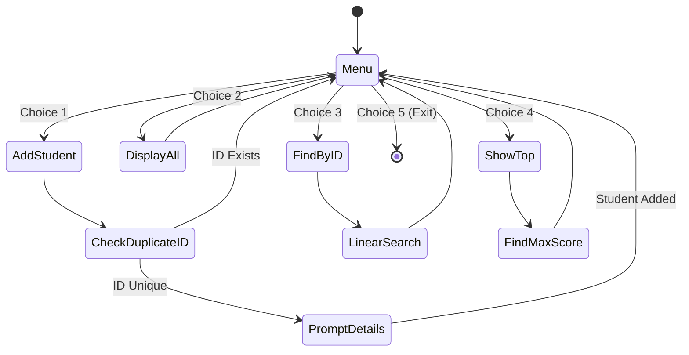

# LAB 30 - student app

> [!abstract] Summary
> Implements a menu-driven student information management system supporting record creation, roster display, ID-based linear search, and top-performer detection.

**Source:** `LAB/30_student_app.c`

## Problem
Design an interactive console application to manage a roster of up to 150 students using a custom C struct (`Student`), providing a menu to add students, view the full roster, search by student ID, and find the student with the highest total score.

## Concepts used
- **Compound Types (`struct` & `typedef`):** Grouping heterogeneous data fields (`studentID`, `name`, `midtermMarks`, `finalMarks`, `totalMarks`) under a single user-defined type `Student`.
- **Pass-by-Pointer (`Student *studentPtr`):** Modifying caller struct members in place inside helper functions (`promptStudentDetails`) without copying entire struct objects.
- **Linear Search Algorithm:** Iterating through the active roster to match `studentID == searchID`.
- **Extremum Detection:** Finding the maximum `totalMarks` in the roster array in $O(n)$ time.
- **Interactive Event Loop:** Using an infinite `while (1)` menu loop with numbered selections and a sentinel break option.

## Code
```c
#include <stdio.h>
#include <string.h>

#define MAX_ROSTER 150

typedef struct Student {
    int studentID;
    char name[100];
    float midtermMarks;
    float finalMarks;
    float totalMarks;
} Student;

Student CourseRoster[MAX_ROSTER];
int rosterSize = 0;

void promptStudentDetails(Student *studentPtr);
void displayStudent(const Student *studentPtr);
int findStudentIndexByID(const Student roster[], int size, int searchID);
int findTopStudentIndex(const Student roster[], int size);

void promptStudentDetails(Student *studentPtr) {
    printf("Enter your student name: ");
    scanf(" %[^\n]", studentPtr->name);

    printf("Enter Mid Term Marks: ");
    scanf("%f", &studentPtr->midtermMarks);

    printf("Enter Final Term Marks: ");
    scanf("%f", &studentPtr->finalMarks);

    studentPtr->totalMarks = studentPtr->midtermMarks + studentPtr->finalMarks;
    printf("Student total Marks: %.2f\n", studentPtr->totalMarks);
}

void displayStudent(const Student *studentPtr) {
    printf("Student ID: %d\n", studentPtr->studentID);
    printf("Student name:  %s\n", studentPtr->name);
    printf("Mid Term Marks:  %.2f\n", studentPtr->midtermMarks);
    printf("Final Term Marks:  %.2f\n", studentPtr->finalMarks);
    printf("Student total Marks: %.2f\n", studentPtr->totalMarks);
}

int findStudentIndexByID(const Student roster[], int size, int searchID) {
    for (int i = 0; i < size; i++) {
        if (roster[i].studentID == searchID) {
            printf("Student Found !\n");
            printf("Student Details\n");
            displayStudent(&roster[i]);
            return i;
        }
    }
    printf("Student with this ID not found.\n");
    return -1;
}

int findTopStudentIndex(const Student roster[], int size) {
    if (size <= 0) {
        printf("Roster is empty.\n");
        return -1;
    }

    int topIndex = 0;
    for (int i = 1; i < size; i++) {
        if (roster[i].totalMarks > roster[topIndex].totalMarks) {
            topIndex = i;
        }
    }

    printf("Id of the top student is %d\nmax marks is %.2f\n", roster[topIndex].studentID, roster[topIndex].totalMarks);
    return topIndex;
}

void checkStudent() {
    if (rosterSize >= MAX_ROSTER) {
        printf("Exceeded maximum roster rosterSize.\n");
        return;
    }

    int tempID;
    printf("Enter your student ID: ");
    scanf("%d", &tempID);

    for (int i = 0; i < rosterSize; i++) {
        if (tempID == CourseRoster[i].studentID) {
            printf("Student with this ID already exists.\n");
            return;
        }
    }

    CourseRoster[rosterSize].studentID = tempID;
    promptStudentDetails(&CourseRoster[rosterSize]);
    rosterSize++;
    printf("Adding Student was successful!\n");
}

void displayFullRoster() {
    if (rosterSize == 0) {
        printf("Roster is empty.\n");
        return;
    }

    for (int i = 0; i < rosterSize; i++) {
        displayStudent(&CourseRoster[i]);
        printf("\n");
    }
}

int main() {
    int choice;

    while (1) {
        printf("\n1. Add Student\n");
        printf("2. Display Full Roster\n");
        printf("3. Find Student by ID\n");
        printf("4. Show Top Student\n");
        printf("5. Exit\n");
        printf("Enter your choice: ");
        scanf("%d", &choice);

        if (choice == 1) {
            checkStudent();
        } else if (choice == 2) {
            displayFullRoster();
        } else if (choice == 3) {
            int tempID;
            printf("Searching for student\n");
            printf("Enter your student ID : ");
            scanf("%d", &tempID);
            findStudentIndexByID(CourseRoster, rosterSize, tempID);
        } else if (choice == 4) {
            findTopStudentIndex(CourseRoster, rosterSize);
        } else if (choice == 5) {
            break;
        }
    }

    return 0;
}
```

## How it works
1. Defines `Student` struct and global array `CourseRoster[150]` with active size `rosterSize = 0`.
2. Menu presents 5 choices:
   - **Option 1 (Add Student):** `checkStudent()` prompts for a new ID, verifies that the ID does not already exist in the roster, calls `promptStudentDetails()` to read name and exam marks, computes `totalMarks`, and increments `rosterSize`.
   - **Option 2 (Display Full Roster):** Iterates $0 \le i < 	ext{rosterSize}$ and prints formatted details for each student.
   - **Option 3 (Find by ID):** Prompts for target ID and performs a linear scan via `findStudentIndexByID()`.
   - **Option 4 (Show Top Student):** `findTopStudentIndex()` scans for the highest `totalMarks` and displays the top student's ID and score.
   - **Option 5 (Exit):** Breaks out of the loop and terminates `main()`.

## Diagram / trace


## Sample run
```text
1. Add Student
2. Display Full Roster
3. Find Student by ID
4. Show Top Student
5. Exit
Enter your choice: 1
Enter your student ID: 101
Enter your student name: John Doe
Enter Mid Term Marks: 42.5
Enter Final Term Marks: 48.0
Student total Marks: 90.50
Adding Student was successful!

1. Add Student
2. Display Full Roster
3. Find Student by ID
4. Show Top Student
5. Exit
Enter your choice: 2
Student ID: 101
Student name:  John Doe
Mid Term Marks:  42.50
Final Term Marks:  48.00
Student total Marks: 90.50

1. Add Student
2. Display Full Roster
3. Find Student by ID
4. Show Top Student
5. Exit
Enter your choice: 5
```

## Gotchas
> [!warning] Space in Names with `scanf`
> In `promptStudentDetails`, the code reads names using `scanf(" %[^\n]", studentPtr->name)`. The leading space is critical: it consumes any leftover newline character left in the input buffer by the preceding integer/float `scanf`. Omitting this space would cause the name prompt to be skipped instantly.

## Possible improvements
- Persist the roster to disk using binary or text file operations (`fwrite`/`fread`) so student records survive across program restarts.
- Add record update and record deletion operations with element shifting.

## Key takeaways
- Structs allow modeling real-world entities cleanly by grouping related fields of different data types into one coherent object.
- Passing pointers to structs (`Student *studentPtr`) avoids copying large memory blocks and allows functions to directly update struct fields.
- Menu-driven loops require disciplined buffer clearing when mixing numeric `scanf("%d")` with string reading `scanf("%[^\n]")`.

## My notes
> [!question]- My notes

## Related
- [[CLASS 26 - struct student info]]
- [[ASG 06 - grading app]]
- [[ASG 07 - book reservation]]
