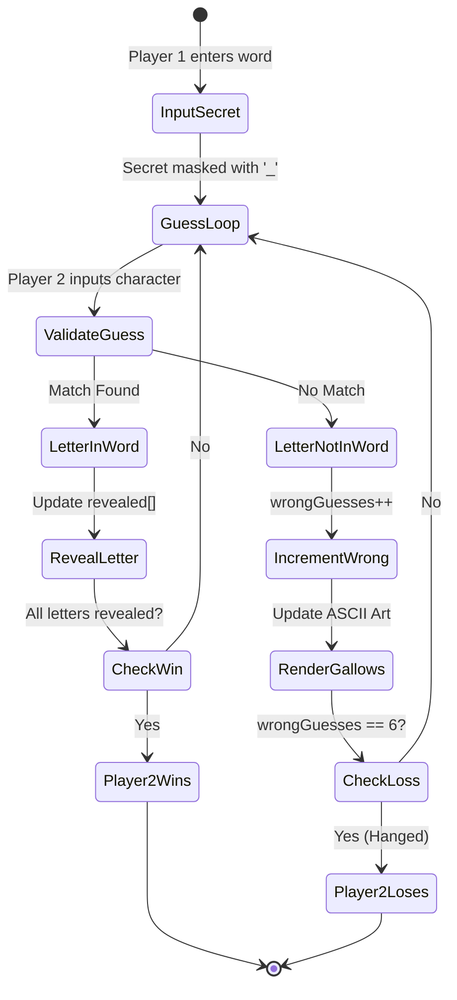

# PROJ - Hangman

> [!abstract] Summary
> A full console Hangman word-guessing game featuring multi-stage ASCII gallows artwork, masked secret words, letter tracking, case normalization, and error handling.

**Source:** `LAB_PROJECT/HANGMAN/hangman.c`

## Problem
Create a word-guessing game where Player 1 enters a secret English word (hidden with masked display) and Player 2 tries to deduce the word letter by letter within a limit of 6 incorrect guesses. Render progressive ASCII art of the hanging man for every missed attempt.

## Concepts used
- **String Masking & Reveal:** Initializing a `revealed` string of underscores `_` matching the length of the secret word, updating matched positions when guessed.
- **ASCII Art Gallows Progression:** Printing 7 distinct visual stages of the gallows (0 errors: empty gallows, up to 6 errors: head, torso, both arms, both legs).
- **Character Classification & Normalization (`tolower`):** Converting all guessed letters to lowercase to support case-insensitive play.
- **History Tracking Array:** Maintaining an array of previously guessed letters to reject duplicate guesses without penalty.

## Code
```c
#include<stdio.h>
#include<string.h>
#include<stdlib.h>

char words[20][20] = {
    "programming", "computer", "algorithm", "variable", "function",
    "keyboard", "monitor", "compiler", "language", "software",
    "hardware", "internet", "database", "network", "pointer",
    "terminal", "boolean", "integer", "library", "hangman"
};

char selectedWord[20];
char guessedWord[20];
char guessedLetters[26];
int guessCount = 0;
int attempts = 0;

void drawHangman(int wrong){
    printf("\n  Attempts Left: %d\n", 6 - wrong);
    printf("  +---+\n");
    printf("  |   |\n");

    if(wrong >= 1) printf("  o   |\n");
    else printf("      |\n");

    if(wrong == 2) printf("  |   |\n");
    else if(wrong == 3) printf(" /|   |\n");
    else if(wrong >= 4) printf(" /|\\  |\n");
    else printf("      |\n");

    if(wrong == 5) printf(" /    |\n");
    else if(wrong >= 6) printf(" / \\  |\n");
    else printf("      |\n");

    printf("=========\n\n");
}

void displayWord(){
    printf("  Word: ");
    for(int i = 0; i < strlen(selectedWord); i++){
        printf("%c ", guessedWord[i]);
    }
    printf("\n");
}

void displayGuessedLetters(){
    printf("  Guessed Letters: ");
    for(int i = 0; i < guessCount; i++){
        printf("%c ", guessedLetters[i]);
    }
    printf("\n");
}

int isAlreadyGuessed(char c){
    for(int i = 0; i < guessCount; i++){
        if(guessedLetters[i] == c) return 1;
    }
    return 0;
}

int isWordComplete(){
    for(int i = 0; i < strlen(selectedWord); i++){
        if(guessedWord[i] == '_') return 0;
    }
    return 1;
}

void processGuess(char c){
    guessedLetters[guessCount] = c;
    guessCount++;

    int found = 0;
    for(int i = 0; i < strlen(selectedWord); i++){
        if(selectedWord[i] == c){
            guessedWord[i] = c;
            found = 1;
        }
    }

    if(!found){
        attempts++;
        printf("  Wrong guess!\n");
    }
    else{
        printf("  Correct!\n");
    }
}

void selectWord(){
    int index = rand() % 20;
    strcpy(selectedWord, words[index]);
    int len = strlen(selectedWord);
    for(int i = 0; i < len; i++){
        guessedWord[i] = '_';
    }
    guessedWord[len] = '\0';
}

void resetGame(){
    guessCount = 0;
    attempts = 0;
    memset(guessedLetters, 0, 26);
    memset(guessedWord, 0, 20);
    selectWord();
}

void playGame(){
    resetGame();
    printf("\n===== HANGMAN GAME =====\n");
    printf("  Guess the word! You have 6 attempts.\n");

    while(attempts < 6 && !isWordComplete()){
        drawHangman(attempts);
        displayWord();
        displayGuessedLetters();

        char input;
        printf("\n  Enter a letter: ");
        scanf(" %c", &input);
        if(input >= 'A' && input <= 'Z') input = input + 32;

        if(!(input >= 'a' && input <= 'z')){
            printf("  Invalid input! Enter a letter (a-z).\n");
            continue;
        }

        if(isAlreadyGuessed(input)){
            printf("  You already guessed '%c'. Try another.\n", input);
            continue;
        }

        processGuess(input);
    }

    drawHangman(attempts);
    displayWord();

    if(isWordComplete()){
        printf("  You WIN! The word was: %s\n\n", selectedWord);
    }
    else{
        printf("  You LOST! The word was: %s\n\n", selectedWord);
    }
}

int main(){
    int seed;
    printf("Enter any number to start: ");
    scanf("%d", &seed);
    srand(seed);
    int choice;

    do{
        printf("=============================\n");
        printf("    HANGMAN - Main Menu\n");
        printf("=============================\n");
        printf("1. Play Game\n");
        printf("2. Exit\n");
        printf("\n");

        printf("Enter your choice: ");
        scanf("%d", &choice);
        printf("\n");

        if(choice == 1) playGame();
        else if(choice != 2) printf("Invalid choice!\n");
        printf("\n");
    } while(choice != 2);

    printf("Thanks for playing!\n");
    return 0;
}
```

## How it works
1. Prompts Player 1 to input a secret word, validates that it contains alphabetic characters, and normalizes it to lowercase.
2. Clears the screen (using line breaks) so Player 2 cannot see the secret word.
3. Initializes `revealed` string with underscores `_` of identical length.
4. Main guessing loop:
   - Displays the current ASCII gallows stage corresponding to `wrongGuesses`.
   - Displays the masked word with spaces (e.g., `_ _ P L E`).
   - Displays all letters previously guessed.
   - Reads a guess from Player 2. If already guessed, prompts again without penalty.
   - Searches the secret word: if found, reveals all occurrences in `revealed`.
   - If not found, increments `wrongGuesses`.
5. Victory check: if `strcmp(secret, revealed) == 0`, announces Player 2 wins.
6. Loss check: if `wrongGuesses == 6`, renders the completed gallows and reveals the secret word.

## Diagram / trace


## Sample run
```text
Enter the secret word: programmer

+---+
|   |
    |
    |
    |
    |
=========

Word: _ _ _ _ _ _ _ _ _ _ 
Guessed: 
Enter a letter: r

+---+
|   |
    |
    |
    |
    |
=========

Word: _ r _ _ r _ _ _ _ r 
Guessed: r 
Enter a letter: 
```

## Gotchas
> [!warning] Stdin Buffer Flushing with `%c`
> Reading single characters via `scanf(" %c", &guess)` requires a leading space to skip pending newline characters from prior enter keystrokes. Omitting the space causes the loop to consume phantom newlines as invalid guesses.

## Possible improvements
- Load secret words randomly from an external text dictionary file to enable true single-player mode.
- Add category hints (e.g. "Programming Languages", "Countries").

## Key takeaways
- Interactive games require maintaining multiple synchronized representations of the same underlying data (the secret string vs the masked display string).
- Progressive visual feedback (ASCII art stages) dramatically enhances terminal user experience.
- Input sanitization (case normalization and duplicate tracking) is critical to prevent user frustration.

## My notes
> [!question]- My notes

## Related
- [[CLASS 08 - string length]]
- [[CLASS 10 - string check equal]]
- [[PROJ TicTacToe - array]]
