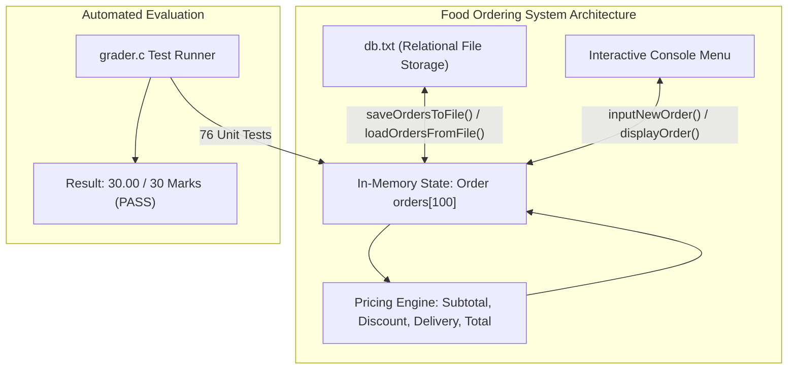

# PROJ Final Exam - Overview

> [!abstract] Summary
> Comprehensive specification and architecture of the University of Dhaka IIT BSSE 18th Batch First-Year Final Lab Examination (CSE 1101L): a robust file-backed terminal Food Ordering System.

**Source:** `LAB_PROJECT/FINAL_EXAM/`

## Problem
In a 2-hour, 30-mark structured programming lab exam, design and implement a production-grade Food Ordering System in C. The application must support multi-item order placement, tiered promotional discounting, progressive delivery charge evaluation, case-insensitive customer order search, record cancellation, and file-backed database persistence (`db.txt`).

## Concepts used
- **Compound Domain Structs:** Hierarchical data modeling combining multi-item purchases (`OrderItem`) inside parent transactional records (`Order`).
- **Tiered Commercial Discount Rules:**
  - $\text{Subtotal} < 500$: $0\%$ discount
  - $500 \le \text{Subtotal} < 1000$: $5\%$ discount
  - $1000 \le \text{Subtotal} < 2000$: $10\%$ discount
  - $\text{Subtotal} \ge 2000$: $15\%$ discount
- **Progressive Delivery Charge Thresholds:**
  - $\text{Subtotal} < 1000$: 80.00 BDT
  - $1000 \le \text{Subtotal} < 2000$: 40.00 BDT
  - $\text{Subtotal} \ge 2000$: 0.00 BDT (Free Delivery)
- **Formatted Tabular Serialization (`db.txt`):** Reading and writing relational order headers and nested item rows to disk.
- **Automated Verification Harness:** Validation via a 76-assertion test runner (`grader.c`) scoring unit test accuracy.

## Examination Modules
- `code.c`: Complete student implementation comprising 900+ lines of modular C covering data structures, business pricing logic, menu loop, and disk serialization.
- `grader.c`: Automated grading suite executing 76 rigorous unit tests covering mathematical accuracy, edge-case handling, and file parsing.
- `db.txt`: Persistent plain-text database storing saved order records.
- `CSE 1101L BSSE18 Final.md`: Official examination question paper with detailed functional specifications.

## Diagram / trace


## Sample run
```text
============================================================
 FOOD ORDERING SYSTEM - AUTOMATED MARKING
============================================================
Passed tests : 76
Failed tests : 0
Raw score    : 30.000 / 30
Final mark   : 30 / 30 (rounded up)
============================================================
```

## Gotchas
> [!warning] Exact Boundary Inclusion
> Promotional discount rules trigger *on or above* exact currency boundaries (e.g., exactly 500 BDT triggers 5%, exactly 1000 triggers 10%, exactly 2000 triggers 15%). Testing strictly with `<` instead of `<=` or vice versa leads to test suite failures.

## Key takeaways
- Production university programming exams test comprehensive systems competence: data structures, floating-point business logic, user interaction, and file I/O.
- Hierarchical struct modeling (`Order` containing an array of `OrderItem`) accurately represents real-world transactional workflows.
- Rigorous automated unit testing harnesses (`grader.c`) guarantee code reliability far beyond manual terminal testing.

## My notes
> [!question]- My notes

## Related
- [[PROJ Final Exam - food ordering system]]
- [[PROJ Final Exam - grader harness]]
- [[LAB 30 - student app]]
- [[ASG 09 - file marksheet]]
