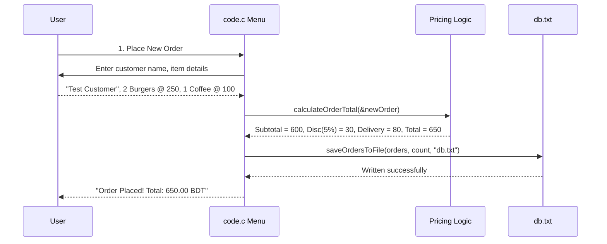

# PROJ Final Exam - food ordering system

> [!abstract] Summary
> A comprehensive, 900+ line terminal food ordering management application featuring nested struct data models, dynamic item pricing, tiered discounts, delivery fees, customer search, cancellation, and file database persistence.

**Source:** `LAB_PROJECT/FINAL_EXAM/code.c`

## Problem
Implement the complete business backend and interactive terminal interface for a restaurant delivery service. Manage up to 100 orders, each containing up to 10 distinct food items. Compute subtotals, apply tiered promotional discounts, evaluate delivery charges, support customer name search, handle order deletion, and persist data across sessions using `db.txt`.

## Concepts used
- **Hierarchical Compound Structs:**
  ```c
  typedef struct {
      int itemId;
      char itemName[MAX_NAME_LENGTH];
      float price;
      int quantity;
  } OrderItem;

  typedef struct {
      int orderId;
      char customerName[MAX_NAME_LENGTH];
      OrderItem items[MAX_ITEMS];
      int itemCount;
      float subtotal;
      float discount;
      float deliveryCharge;
      float total;
  } Order;
  ```
- **Business Financial Rules:**
  - $\text{Item Subtotal} = \text{price} \times \text{quantity}$
  - Discount tiers: $0\%$ ($<500$), $5\%$ ($500 \dots 999$), $10\%$ ($1000 \dots 1999$), $15\%$ ($\ge 2000$).
  - Delivery charge tiers: 80.00 ($<1000$), 40.00 ($1000 \dots 1999$), 0.00 ($\ge 2000$).
  - $\text{Total} = \text{Subtotal} - \text{Discount} + \text{DeliveryCharge}$.
- **Case-Insensitive String Substring Search:** Converting strings to lowercase or matching substrings to locate customer orders.
- **Relational Plain-Text File Serialization:** Writing multi-line structured records to `db.txt`:
  - Order header line: `ORDER,orderId,customerName,itemCount,subtotal,discount,deliveryCharge,total`
  - Item detail lines: `ITEM,itemId,itemName,price,quantity`

## Key Code Sections
*(File spans 913 lines; key business, calculation, and database persistence routines are shown below; see lines 1–913 in source for complete interactive menu loops).*

```c
/* Core Business Calculations (lines 65 - 130) */

float calculateItemSubtotal(float price, int quantity) {
    if (price < 0 || quantity < 0) return 0.0f;
    return price * quantity;
}

float calculateDiscount(float subtotal) {
    if (subtotal >= 2000.0f) return subtotal * 0.15f;
    if (subtotal >= 1000.0f) return subtotal * 0.10f;
    if (subtotal >= 500.0f)  return subtotal * 0.05f;
    return 0.0f;
}

float calculateDeliveryCharge(float subtotal) {
    if (subtotal >= 2000.0f) return 0.0f;
    if (subtotal >= 1000.0f) return 40.0f;
    return 80.0f;
}

void calculateOrderTotal(Order *order) {
    if (!order) return;
    float subtotal = 0.0f;
    for (int i = 0; i < order->itemCount; i++) {
        subtotal += calculateItemSubtotal(order->items[i].price, order->items[i].quantity);
    }
    order->subtotal = subtotal;
    order->discount = calculateDiscount(subtotal);
    order->deliveryCharge = calculateDeliveryCharge(subtotal);
    order->total = order->subtotal - order->discount + order->deliveryCharge;
}

/* Relational Disk Persistence (lines 350 - 460) */

int saveOrdersToFile(const Order orders[], int orderCount, const char *filename) {
    FILE *fp = fopen(filename, "w");
    if (!fp) return 0;

    fprintf(fp, "%d\n", orderCount);
    for (int i = 0; i < orderCount; i++) {
        const Order *o = &orders[i];
        fprintf(fp, "ORDER,%d,%s,%d,%.2f,%.2f,%.2f,%.2f\n",
                o->orderId, o->customerName, o->itemCount,
                o->subtotal, o->discount, o->deliveryCharge, o->total);
        for (int j = 0; j < o->itemCount; j++) {
            const OrderItem *item = &o->items[j];
            fprintf(fp, "ITEM,%d,%s,%.2f,%d\n",
                    item->itemId, item->itemName, item->price, item->quantity);
        }
    }
    fclose(fp);
    return 1;
}
```

## How it works
1. Program begins by calling `loadOrdersFromFile()` to restore previous orders from `db.txt`.
2. Main menu presents operations:
   - **1. Place New Order:** Prompts for customer name, item count, and each item's details (name, unit price, quantity). Automatically computes item subtotals, order subtotal, discount, delivery fee, and net total. Appends to `orders[]`.
   - **2. Display All Orders:** Prints formatted tabular summaries of all active orders.
   - **3. Search Orders by Customer:** Performs case-insensitive matching across customer names and displays matched orders.
   - **4. Cancel/Delete Order:** Locates order by ID, shifts subsequent orders left by 1 position to maintain contiguous storage, and decrements `orderCount`.
   - **5. Save & Exit:** Calls `saveOrdersToFile()` to write the updated database back to `db.txt` and exits.

## Diagram / trace


## Sample run
```text
=== Active Database Record in db.txt ===
2
ORDER,1001,Test Customer,2,600.00,30.00,80.00,650.00
ITEM,1,Burger,250.00,2
ITEM,2,Coffee,100.00,1
ORDER,1002,Ayesha Rahman,2,2100.00,315.00,0.00,1785.00
ITEM,3,Family Pizza,1500.00,1
ITEM,4,Juice,150.00,4
```

## Gotchas
> [!warning] Parsing Multi-Line Relational Records
> When reading `db.txt`, the parser must read the `ORDER` header first, extract the `itemCount` integer, and then execute an inner loop reading exactly that number of `ITEM` lines before attempting to read the next `ORDER`. Desynchronizing the line cursor corrupts the entire database load.

## Possible improvements
- Dynamically resize the order database using `malloc`/`realloc` instead of static array limit `MAX_ORDERS 100`.
- Support multiple delivery addresses and customer phone numbers.

## Key takeaways
- Real-world database files use hierarchical formatting (parent transaction header line followed by child item detail lines).
- Commercial software requires separating individual line item arithmetic from composite order discounting and shipping charges.
- Array element deletion requires left-shifting memory to preserve array density and valid index bounds.

## My notes
> [!question]- My notes

## Related
- [[PROJ Final Exam - Overview]]
- [[PROJ Final Exam - grader harness]]
- [[LAB 30 - student app]]
