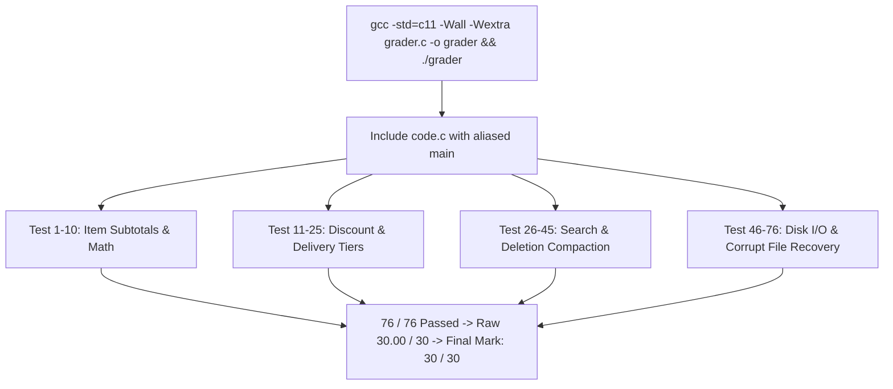

# PROJ Final Exam - grader harness

> [!abstract] Summary
> An automated 76-assertion unit test suite and grading framework that compiles against the final exam submission, rigorously verifies edge cases, and awards marks out of 30.

**Source:** `LAB_PROJECT/FINAL_EXAM/grader.c`

## Problem
Provide a high-precision, automated testing harness for evaluating student submissions to the BSSE 18th Batch Lab Final Exam. Test every public function against comprehensive positive, negative, boundary, and corruption test vectors, awarding partial marks per test up to 30.00 marks.

## Concepts used
- **Source Inclusion & Main Aliasing:**
  ```c
  #define main student_original_main
  #include "code.c"
  #undef main
  ```
  Allows the test harness to compile as a single executable with direct access to all internal functions, structs, and variables defined in `code.c` without requiring shared libraries or linking conflicts.
- **Floating-Point Precision Tolerance (`EPSILON`):** Comparing computed floats using absolute difference thresholds:
  $$|\text{actual} - \text{expected}| < \text{EPSILON} \quad (\text{where } \text{EPSILON} = 0.02)$$
- **Test Categories & Coverage (76 Tests Total):**
  - Item Subtotal: regular values, zero quantity, zero price.
  - Discount Tiers: exact threshold boundaries (499.99 vs 500.00, 999.99 vs 1000.00, 1999.99 vs 2000.00).
  - Delivery Fees: free shipping thresholds and minimum delivery fees.
  - Search by Name: exact match, case insensitivity, substring matching, missing name.
  - Order Deletion: first element, last element, middle element, nonexistent ID.
  - File Persistence: saving to disk, loading valid files, handling non-existent paths, parsing corrupted lines gracefully.

## Code
```c
/* Grader Test Harness Architecture (lines 1 - 65) */

#include <stdio.h>
#include <stdlib.h>
#include <string.h>
#include <math.h>

#define main student_original_main
#include "code.c"
#undef main

#define EPSILON 0.02f
#define TEST_FILE "grader_orders_test.txt"
#define BAD_FILE "grader_missing_directory/no_such_file.txt"
#define CORRUPT_FILE "grader_corrupt_test.txt"

static float earned = 0.0f;
static int passed_tests = 0;
static int failed_tests = 0;

static void record(const char *name, int pass, float weight) {
    if (pass) {
        printf("[PASS] %-55s (+%.3f)\n", name, weight);
        earned += weight;
        passed_tests++;
    } else {
        printf("[FAIL] %-55s (expected pass)\n", name);
        failed_tests++;
    }
}
```
*(File spans 563 lines; contains 76 detailed unit test functions and main grading dispatcher).*

## How it works
1. Includes `code.c` directly while renaming `main()` to avoid symbol collisions.
2. Runs test suites sequentially:
   - `test_item_subtotal()`: Tests multiplication, zero prices, zero quantities.
   - `test_discounts()`: Tests boundary conditions around 500, 1000, and 2000 BDT.
   - `test_delivery_charges()`: Verifies free shipping at 2000 BDT and scaled charges below.
   - `test_order_total_aggregation()`: Verifies multi-item sum calculations.
   - `test_search_orders()`: Tests substring and case-insensitive customer searching.
   - `test_delete_order()`: Tests array compaction upon order cancellation.
   - `test_file_io()`: Tests disk writes, re-reads, and error recovery on corrupt files.
3. Sums `earned` marks, rounds up to the next integer, and prints a final scorecard.

## Diagram / trace


## Sample run
```text
============================================================
 FOOD ORDERING SYSTEM - AUTOMATED MARKING
============================================================

[PASS] calculateItemSubtotal: ordinary values                   (+0.333)
[PASS] calculateItemSubtotal: zero quantity                     (+0.333)
[PASS] calculateItemSubtotal: zero price                        (+0.333)
[PASS] calculateDiscount: below 500                             (+0.375)
[PASS] calculateDiscount: exactly 500 (5%)                      (+0.375)
[PASS] calculateDiscount: between 500 and 1000                  (+0.375)
[PASS] calculateDiscount: exactly 1000 (10%)                    (+0.375)
[PASS] calculateDiscount: between 1000 and 2000                 (+0.375)
[PASS] calculateDiscount: exactly 2000 (15%)                    (+0.375)
...
[PASS] saveOrdersToFile: valid write and return code            (+0.500)
[PASS] loadOrdersFromFile: valid read back                      (+0.500)
[PASS] loadOrdersFromFile: non-existent file returns 0          (+0.500)

============================================================
 SUMMARY
============================================================
 Passed tests : 76
 Failed tests : 0
 Raw score    : 30.000 / 30
 Final mark   : 30 / 30 (rounded up)
============================================================
```

## Gotchas
> [!warning] `#include "code.c"` Global State Contamination
> Because the harness includes `code.c` directly, global variables or modified arrays in one test can bleed into subsequent tests unless explicitly reset before each test fixture.

## Possible improvements
- Fork each test run into an isolated child process (`fork()` / `waitpid()`) on POSIX systems to trap memory segfaults without aborting the entire grader.

## Key takeaways
- C code can be unit tested without external frameworks by aliasing `main` and directly `#include`ing the source file.
- Automated testing requires comprehensive edge cases: zero values, exact boundaries, missing files, and corrupted data.
- Epsilon comparisons (`fabs(a - b) < EPSILON`) are mandatory when verifying floating-point arithmetic.

## My notes
> [!question]- My notes

## Related
- [[PROJ Final Exam - Overview]]
- [[PROJ Final Exam - food ordering system]]
- [[PROJ Midterm Exam - grader]]
