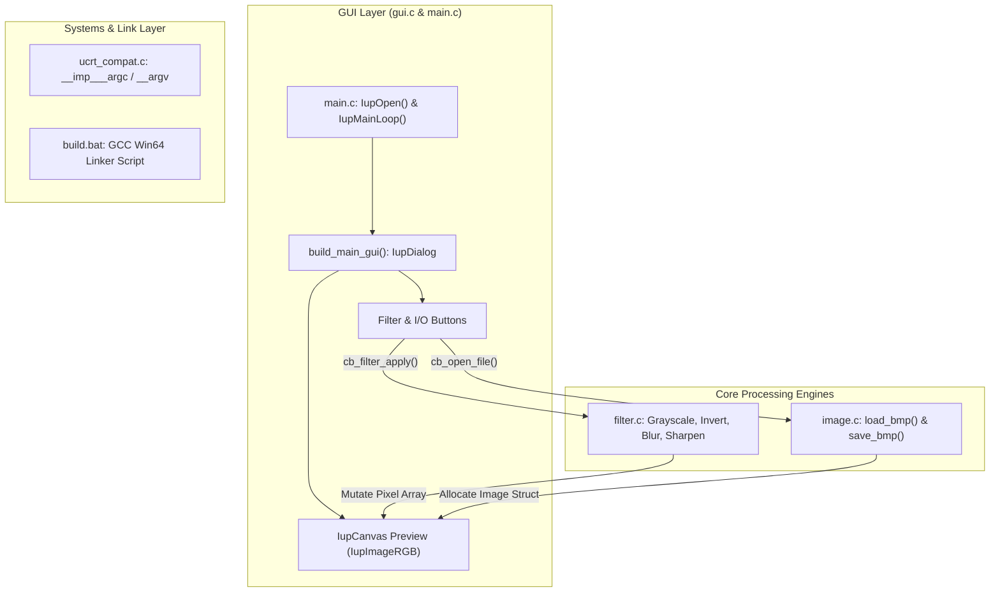

# PROJ Image Editor - Overview

> [!abstract] Summary
> Architectural design and modular breakdown of the capstone project: a native 64-bit desktop GUI image manipulation application built in C using the IUP 3.32 framework.

**Source:** `LAB_PROJECT/FINAL_PROJECT/`

## Problem
Design and engineer a complete, modular, real-world desktop application in pure C capable of loading 24-bit uncompressed Windows BMP images, applying real-time pixel filters and mathematical convolution operations, rendering interactive UI previews, and saving modified images back to disk.

## Concepts used
- **Multi-File Modular Architecture:** Decoupling application concerns into clear subsystems: entry point (`main.c`), binary file format and buffer management (`image.c`), mathematical filters (`filter.c`), graphical desktop user interface (`gui.c`), and runtime compatibility (`ucrt_compat.c`).
- **Native GUI Framework (IUP 3.32):** Leveraging the portable Tecgraf IUP toolkit to build native Win32 controls without heavyweight runtime dependencies.
- **2D Image Processing Pipeline:** In-memory pixel buffers representing RGB channels, supporting linear color transformations and 3x3 spatial convolution kernels.
- **Windows Runtime Compatibility:** Reconciling modern GCC MinGW-w64 toolchains with MSVC-compiled static C libraries via explicit runtime shims.

## Module Architecture
The project structure is organized as follows:
- `src/main.c`: Application lifecycle, IUP event loop setup, and teardown.
- `src/programs/image.c` & `src/header/image.h`: Packed BMP header definitions, dynamic allocation, row padding calculations, and binary file I/O.
- `src/programs/filter.c` & `src/header/filter.h`: Pure image processing algorithms (grayscale, brightness, inversion, flips, 90° rotation, crop, blur, sharpen).
- `src/programs/gui.c` & `src/header/gui.h`: Window layout, toolbar buttons, canvas drawing, file dialogs, and callback dispatchers.
- `src/programs/ucrt_compat.c`: Universal C Runtime symbol exports.
- `build.bat`: Automated build and link script.

## Diagram / trace


## Sample run
```text
====================================================
  Building Image Manipulation Software (Win64)
====================================================
[SUCCESS] ImageEditor.exe built successfully!
Launching ImageEditor.exe...
```
Launches the native desktop window featuring the Lena test image, showing interactive buttons for:
- Load BMP / Save BMP
- Grayscale / Invert
- Brightness +100 / Brightness -100
- Flip Horizontal / Flip Vertical
- Rotate 90° Clockwise
- Crop Center
- Gaussian Blur / Edge Sharpening

## Gotchas
> [!warning] Row Padding and Memory Alignment
> BMP files require row byte widths to be padded to multiples of 4 bytes. Neglecting this padding in `image.c` produces diagonal shearing artifacts when opening non-standard image dimensions.

## Key takeaways
- Production C applications separate business logic (pure pixel math in `filter.c`) completely from presentation logic (`gui.c`).
- Binary file processing requires exact struct packing (`#pragma pack(push, 1)`) to match file byte offsets directly.
- The IUP toolkit enables building lightweight, native Windows desktop applications using standard C without bloated frameworks.

## My notes
> [!question]- My notes

## Related
- [[PROJ Image Editor - main]]
- [[PROJ Image Editor - image]]
- [[PROJ Image Editor - filter]]
- [[PROJ Image Editor - gui]]
- [[PROJ Image Editor - ucrt compat]]
- [[PROJ Image Editor - build]]
- [[LAB 29 - grayscale]]
