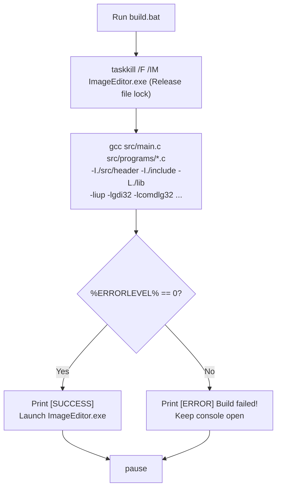

# PROJ Image Editor - build

> [!abstract] Summary
> The automated Windows Batch compilation and linking script for the 64-bit desktop image editor, orchestrating multi-file GCC compilation, system library linking, error trapping, and automatic execution.

**Source:** `LAB_PROJECT/FINAL_PROJECT/build.bat`

## Problem
Automate the compilation of 5 distinct C source files, include headers across two separate directories, link against static IUP libraries and 8 native Windows Win32 system libraries, terminate lingering application instances, and handle build errors gracefully.

## Concepts used
- **Process Termination (`taskkill`):** Executing `taskkill /F /IM ImageEditor.exe >nul 2>nul` to forcibly close any running instances of the application so the output binary is not locked during recompilation.
- **Multi-File GCC Invocation:** Compiling `main.c`, `gui.c`, `image.c`, `filter.c`, and `ucrt_compat.c` simultaneously in a single invocation.
- **Win32 System Library Dependency Chain:** Linking native Windows subsystems:
  - `-liup`: Static IUP graphical library.
  - `-lgdi32`: Windows Graphics Device Interface (drawing, pens, brushes).
  - `-lcomdlg32`: Common Dialogs (native File Open / File Save dialogs).
  - `-lcomctl32`: Common Controls (toolbars, status bars).
  - `-luuid`, `-loleaut32`, `-lole32`: OLE/COM interfaces required by IUP.
  - `-luxtheme`: Modern Windows visual styling engine.
- **Batch Error Trapping (`%ERRORLEVEL%`):** Checking `%ERRORLEVEL% EQU 0` to report build success or failure.

## Code
```bat
@echo off
setlocal

echo ====================================================
echo   Building Image Manipulation Software (Win64)
echo ====================================================
taskkill /F /IM ImageEditor.exe >nul 2>nul

gcc src\main.c src\programs\gui.c src\programs\image.c src\programs\filter.c src\programs\ucrt_compat.c ^
    -o ImageEditor.exe ^
    -I./src/header -I./include -L./lib ^
    -liup -lgdi32 -lcomdlg32 -lcomctl32 -luuid -loleaut32 -lole32 -luxtheme ^
    -Wall -Wextra

if %ERRORLEVEL% EQU 0 (
    echo.
    echo [SUCCESS] ImageEditor.exe built successfully!
    echo Launching ImageEditor.exe...
    .\ImageEditor.exe
) else (
    echo.
    echo [ERROR] Build failed! Please review compiler errors above.
)

pause
```

## How it works
1. Turns off echoing with `@echo off` and prints a formatted header banner.
2. Forcibly kills any running `ImageEditor.exe` process to release the file handle lock.
3. Invokes `gcc` with:
   - Source list: `main.c`, `gui.c`, `image.c`, `filter.c`, `ucrt_compat.c`
   - Include paths: `-I./src/header -I./include`
   - Library path: `-L./lib`
   - Library dependencies: `-liup -lgdi32 -lcomdlg32 -lcomctl32 -luuid -loleaut32 -lole32 -luxtheme`
   - Warning flags: `-Wall -Wextra`
4. Inspects `%ERRORLEVEL%`:
   - If 0, prints `[SUCCESS]` and automatically launches `.\ImageEditor.exe`.
   - Otherwise prints `[ERROR] Build failed!`.
5. Pauses the terminal prompt so output remains visible.

## Diagram / trace


## Sample run
```text
====================================================
  Building Image Manipulation Software (Win64)
====================================================

[SUCCESS] ImageEditor.exe built successfully!
Launching ImageEditor.exe...
Press any key to continue . . .
```

## Gotchas
> [!warning] Linker Order Sensitivity
> In GCC, library flags (`-l`) must appear *after* the source files that reference them. Placing `-liup` before `src/programs/gui.c` would cause the linker to ignore IUP functions because no preceding object file had requested them yet.

## Possible improvements
- Migrate to a standard `Makefile` or CMake configuration for incremental compilation (compiling changed `.c` files to `.o` rather than recompiling everything).
- Compile with `-mwindows` flag to suppress the background console window when launching the GUI application.

## Key takeaways
- Complex desktop C applications depend on an ecosystem of platform libraries (GDI, Common Dialogs, UxTheme) that must be linked explicitly.
- Automating cleanup (`taskkill`) prevents frustrating file-in-use compilation lockouts on Windows.
- Batch scripts provide a friction-free one-click developer workflow for rapid iteration.

## My notes
> [!question]- My notes

## Related
- [[PROJ Image Editor - ucrt compat]]
- [[PROJ Image Editor - Overview]]
