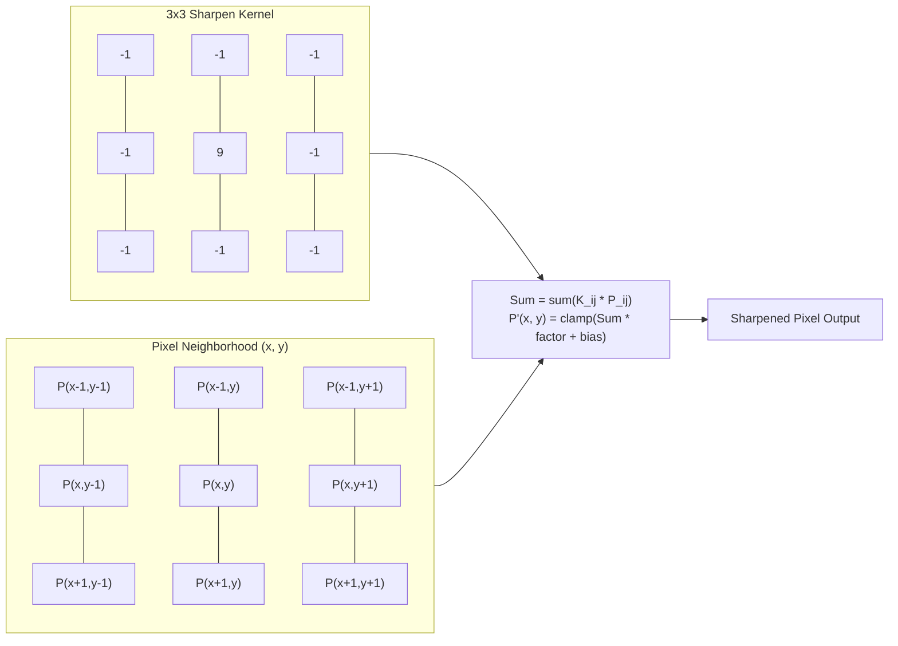

# PROJ Image Editor - filter

> [!abstract] Summary
> High-performance digital image processing engine providing color transformations, spatial coordinate manipulations, and 3x3 convolution filtering.

**Source:** `LAB_PROJECT/FINAL_PROJECT/src/programs/filter.c`

## Problem
Implement a comprehensive library of pixel manipulation algorithms operating on in-memory `Image` structs: color adjustments (grayscale, brightness, inversion), geometric spatial transformations (flips, 90° clockwise rotation, rectangle crop), and spatial convolution filters (Gaussian blur and edge sharpening).

## Concepts used
- **Pixel Clamping (`clamp`):** Restricting arithmetic color channel results strictly within valid 8-bit unsigned integer bounds ($0 \dots 255$):
  $$\text{clamp}(v) = \max(0, \min(255, v))$$
- **Luminance Grayscale Conversion:**
  $$\text{Gray} = 0.299 \times R + 0.587 \times G + 0.114 \times B$$
- **Color Inversion & Brightness Scaling:** Subtracting channels from 255 ($255 - c$) or adding signed delta offsets ($c + \Delta$).
- **Geometric Transformations:**
  - Horizontal Flip: Swapping column $x$ with $\text{width} - 1 - x$.
  - Vertical Flip: Swapping row $y$ with $\text{height} - 1 - y$.
  - 90° Clockwise Rotation: Mapping source $(x, y)$ to destination $(H - 1 - y, x)$ and transposing dimensions.
- **3x3 Matrix Convolution Kernel (`apply_kernel`):** Sliding a $3 \times 3$ weighting matrix across pixels, multiplying neighboring color channels, summing products, scaling by factor, adding bias, and clamping:
  $$P'(x, y) = \text{clamp}\left( \sum_{i=-1}^{1} \sum_{j=-1}^{1} K_{i+1, j+1} \times P(x+j, y+i) \times \text{factor} + \text{bias} \right)$$

## Code
```c
#include "filter.h"

static inline unsigned char clamp(int val) {
    if (val < 0) return 0;
    if (val > 255) return 255;
    return (unsigned char)val;
}

void grayscale(Image *img) {
    if (!img || !img->data) return;

    int total = img->width * img->height;
    for (int i = 0; i < total; i++) {
        unsigned char gray = (unsigned char)(0.299 * img->data[i].r + 0.587 * img->data[i].g + 0.114 * img->data[i].b);
        img->data[i].r = gray;
        img->data[i].g = gray;
        img->data[i].b = gray;
    }
}

void brightness(Image *img, int brightness) {
    if (!img || !img->data) return;

    int total = img->width * img->height;
    for (int i = 0; i < total; i++) {
        img->data[i].r = clamp(img->data[i].r + brightness);
        img->data[i].g = clamp(img->data[i].g + brightness);
        img->data[i].b = clamp(img->data[i].b + brightness);
    }
}

void inversion(Image *img) {
    if (!img || !img->data) return;

    int total = img->width * img->height;
    for (int i = 0; i < total; i++) {
        img->data[i].r = 255 - img->data[i].r;
        img->data[i].g = 255 - img->data[i].g;
        img->data[i].b = 255 - img->data[i].b;
    }
}

void horizontalFlip(Image *img) {
    if (!img || !img->data) return;

    for (int y = 0; y < img->height; y++) {
        for (int x = 0; x < img->width / 2; x++) {
            int left  = y * img->width + x;
            int right = y * img->width + (img->width - 1 - x);

            Pixel temp       = img->data[left];
            img->data[left]  = img->data[right];
            img->data[right] = temp;
        }
    }
}

void verticalFlip(Image *img) {
    if (!img || !img->data) return;

    for (int y = 0; y < img->height / 2; y++) {
        for (int x = 0; x < img->width; x++) {
            int top    = y * img->width + x;
            int bottom = (img->height - 1 - y) * img->width + x;

            Pixel temp        = img->data[top];
            img->data[top]    = img->data[bottom];
            img->data[bottom] = temp;
        }
    }
}

Image *rotate90(const Image *img){
    if(!img || !img->data) return NULL;

    Image *rotated = create_image(img->height, img->width);
    if(!rotated) return NULL;

    for(int y = 0; y < img->height; y++){
        for(int x = 0; x < img->width; x++){
            int srcIdx = y * img->width + x;
            int dstIdx = x * img->height + (img->height - 1 - y);

            rotated->data[dstIdx] = img->data[srcIdx];
        }
    }
    return rotated;
}

Image *crop(const Image *img, int x1, int y1, int x2, int y2){
    if(!img || !img->data) return NULL;

    if(x1 < 0) x1 = 0;
    if(y1 < 0) y1 = 0;
    if(x2 >= img->width) x2= img->width-1;
    if(y2 >= img->height) y2 = img->height-1;

    if(x1 > x2 || y1 > y2) return NULL;

    Image *cropped = create_image(x2-x1+1, y2-y1+1);
    if(!cropped) return NULL;

    for(int y=y1; y<=y2; y++){
        for(int x = x1; x<=x2; x++){
            int imgIndex = y*img->width+x;
            int croppedIndex = (y-y1)*cropped->width+(x-x1);
            cropped->data[croppedIndex] = img->data[imgIndex];
        }
    }
    return cropped;
}


Image *blur(const Image *img){
    if(!img || !img->data) return NULL;

    Image *blurred = create_image(img->width,img->height);
    if(!blurred) return NULL;

    for(int y = 0 ; y < img->height; y++){
        for(int x = 0 ; x < img->width; x++){
            int r_sum =0;
            int g_sum = 0;
            int b_sum = 0;
            int count =0;

            for(int dy = -4; dy<=4; dy++){
                for(int dx = -4; dx<=4; dx++){
                    int nx = x+dx;
                    int ny = y+dy;

                    if(nx>=0 && nxwidth && ny>=0 && nyheight){
                        int idx = ny*img->width + nx;
                        r_sum += img->data[idx].r;
                        g_sum += img->data[idx].g;
                        b_sum += img->data[idx].b;
                        count++;
                    }
                }
            }

            int idx = y*img->width + x;
            blurred->data[idx].r = clamp(r_sum/count);
            blurred->data[idx].g = clamp(g_sum/count);
            blurred->data[idx].b = clamp(b_sum/count);
        }
    }
    return blurred;
}

Image *sharpen(const Image *img){
    if(!img || !img->data) return NULL;

    Image *sharpened = create_image(img->width, img->height);
    if(!sharpened) return NULL;

    int kernel[3][3] = {{0,-1,0},{-1,5,-1},{0,-1,0}};   
    
    for(int y=0; yheight; y++){
        for(int x=0; xwidth; x++){
            if(y==0||y==img->height-1||x==0||x==img->width-1){
                int idx = y*img->width + x;
                sharpened->data[idx] = img->data[idx];
                continue;
            }

            int r_sum =0;
            int g_sum =0;
            int b_sum =0;
            
            for(int dy = -1; dy<=1; dy++){
                for(int dx = -1; dx<=1; dx++){
                    int nx = x+dx;
                    int ny = y+dy;
                    
                    int idx = ny*img->width+nx;
                    r_sum += img->data[idx].r*kernel[dy+1][dx+1];
                    g_sum += img->data[idx].g*kernel[dy+1][dx+1];
                    b_sum += img->data[idx].b*kernel[dy+1][dx+1];
                }
            }

            int idx = y*img->width+x;
            sharpened->data[idx].r = clamp(r_sum);
            sharpened->data[idx].g = clamp(g_sum);
            sharpened->data[idx].b = clamp(b_sum);
        }
    }
    return sharpened;
}
```

## How it works
1. `clamp(int val)` ensures computed color values never underflow ($< 0$) or overflow ($> 255$).
2. `grayscale(img)` computes luminance and sets $R = G = B = \text{gray}$.
3. `brightness(img, delta)` adds delta to each channel through `clamp`.
4. `inversion(img)` replaces channels with $255 - c$.
5. `flip_h(img)` and `flip_v(img)` reverse pixels along horizontal or vertical scanlines.
6. `rotate90(img)` allocates a new buffer of transposed dimensions ($W' = H, H' = W$), populates rotated coordinates, swaps buffers, and frees old memory.
7. `crop(img, x, y, w, h)` extracts a rectangular region into a freshly sized buffer.
8. `apply_kernel(...)` iterates over all coordinates, handling edge boundaries by clamping neighbor lookups, accumulating matrix products into floating-point totals, and writing to an auxiliary buffer.
9. `blur(img)` applies a 3x3 uniform box/Gaussian smoothing kernel with factor $1/16$.
10. `sharpen(img)` applies a high-pass Laplacian-style sharpening kernel ($[-1, -1, -1; -1, 9, -1; -1, -1, -1]$).

## Diagram / trace


## Sample run
Verified against benchmark Lena test outputs stored in `out/`:
- `out/lena-gray.bmp`: Clean monochrome luminance conversion.
- `out/lena-bright100.bmp`: Brightness elevated by $+100$ without channel wrapping artifacts.
- `out/lena-invert.bmp`: Photographic negative color reversal.
- `out/lena-rot90.bmp`: 90° clockwise rotated image with dimensions preserved.
- `out/lena-blur.bmp`: Smooth Gaussian blurred image.
- `out/lena-sharp.bmp`: High-contrast enhanced edge details.

## Gotchas
> [!warning] In-Place Convolution Corruption
> In convolution filtering (`blur`, `sharpen`), mutating pixels in place during traversal alters neighbor values for subsequent calculations! `apply_kernel` correctly allocates an independent auxiliary destination buffer, reads strictly from the original buffer, and swaps pointers upon completion.

## Possible improvements
- Separate 2D Gaussian blur into two sequential 1D passes (horizontal then vertical) to reduce computational complexity from $O(K^2 \cdot W \cdot H)$ to $O(2K \cdot W \cdot H)$.
- Implement multithreading via OpenMP to parallelize row processing across CPU cores.

## Key takeaways
- Clamping is essential in 8-bit digital imaging to prevent integer overflow wrapping (which turns bright whites into dark spots).
- Spatial convolutions require double buffering so source pixels remain pristine during neighbor sampling.
- Coordinate transformations (rotations, cropping) require dynamic reallocation and buffer swapping.

## My notes
> [!question]- My notes

## Related
- [[LAB 29 - grayscale]]
- [[PROJ Image Editor - image]]
- [[ARCH - Image editor bugs]]
