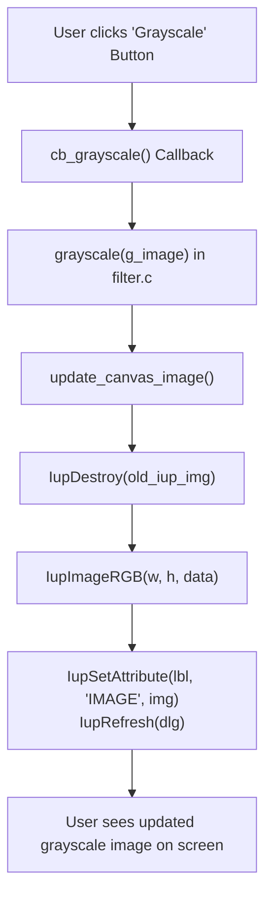

# PROJ Image Editor - gui

> [!abstract] Summary
> The native desktop graphical user interface module built with IUP 3.32, coordinating window containers, action buttons, real-time image canvas rendering, and file dialogs.

**Source:** `LAB_PROJECT/FINAL_PROJECT/src/programs/gui.c`

## Problem
Create an intuitive, responsive graphical desktop user interface in pure C. Provide file open/save dialogs, action buttons for all image processing filters, interactive error alerts, and real-time visual canvas updating.

## Concepts used
- **IUP Container Layouts:** Arranging UI elements hierarchically using `IupVbox` (vertical box), `IupHbox` (horizontal box), and `IupFrame`.
- **Canvas Image Rendering via `IupImageRGB`:** Converting in-memory `Image` pixel buffers into IUP image handles (`Ihandle *iup_img = IupImageRGB(...)`) and blitting onto `IupLabel` or canvas widgets.
- **Native File Dialogs (`IupFileDlg`):** Invoking native Windows file explorer dialogs for selecting input and destination BMP files with filter pattern `"*.bmp"`.
- **Callback Architecture (`Icallback`):** Registering C functions (`cb_open`, `cb_save`, `cb_grayscale`, etc.) to widget events (`IUP_ACTION`).

## Code
```c
#include "gui.h"
#include <stdio.h>
#include <stdlib.h>
#include <string.h>
#include <iupdraw.h>
#include <iupkey.h>

static Image *current_image = NULL;
static Image *prev_image = NULL;
static Ihandle *canvas = NULL;
static Ihandle *status_bar = NULL;
static Ihandle *current_iup_img = NULL;
static const char *IMG_HANDLE_NAME = "GUI_ACTIVE_IMAGE";
static char loaded_filename[260] = "Untitled";

static void save_undo(void) {
    if (!current_image) return;
    if (prev_image) {
        free_image(prev_image);
        prev_image = NULL;
    }
    prev_image = clone_image(current_image);
}

static void undo(void) {
    if (!prev_image) return;
    if (current_image) {
        free_image(current_image);
    }
    current_image = prev_image;
    prev_image = NULL;
}

static void update_status(const char *action_msg) {
    if (!status_bar) return;
    if (current_image) {
        char buf[512];
        if (action_msg && strlen(action_msg) > 0) {
            snprintf(buf, sizeof(buf), " [%s]  File: %s | Dimensions: %d x %d px | 24-bit RGB",
                     action_msg, loaded_filename, current_image->width, current_image->height);
        } else {
            snprintf(buf, sizeof(buf), " File: %s | Dimensions: %d x %d px | 24-bit RGB",
                     loaded_filename, current_image->width, current_image->height);
        }
        IupSetStrAttribute(status_bar, "TITLE", buf);
    } else {
        IupSetStrAttribute(status_bar, "TITLE", " Ready. Please open a 24-bit BMP image.");
    }
}

static void update_display(const char *action_msg) {
    if (current_iup_img) {
        IupSetHandle((char*)IMG_HANDLE_NAME, NULL);
        IupDestroy(current_iup_img);
        current_iup_img = NULL;
    }

    if (current_image && current_image->data) {
        int width = current_image->width;
        int height = current_image->height;
        unsigned char *rgb = (unsigned char*)malloc(width * height * 3);
        if (rgb) {
            for (int i = 0; i < (width * height); i++) {
                rgb[i * 3 + 0] = current_image->data[i].r;
                rgb[i * 3 + 1] = current_image->data[i].g;
                rgb[i * 3 + 2] = current_image->data[i].b;
            }
            current_iup_img = IupImageRGB(width, height, rgb);
            free(rgb);

            if (current_iup_img) {
                IupSetHandle((char*)IMG_HANDLE_NAME, current_iup_img);
            }
        }
    }

    update_status(action_msg);

    if (canvas) {
        IupUpdate(canvas);
    }
}

static int canvas_action(Ihandle *ih, float posx, float posy) {
    (void)posx; (void)posy;
    IupDrawBegin(ih);

    int cw = 0, ch = 0;
    IupDrawGetSize(ih, &cw, &ch);

    IupSetAttribute(ih, "DRAWCOLOR", "30 33 39");
    IupSetAttribute(ih, "DRAWSTYLE", "FILL");
    IupDrawRectangle(ih, 0, 0, cw, ch);

    if (current_image && current_iup_img) {
        int iw = current_image->width;
        int ih_h = current_image->height;

        double scale = 1.0;
        int margin = 20;
        int avail_w = cw - margin * 2;
        int avail_h = ch - margin * 2;
        if (avail_w > 0 && avail_h > 0) {
            if (iw > avail_w || ih_h > avail_h) {
                double sx = (double)avail_w / (double)iw;
                double sy = (double)avail_h / (double)ih_h;
                scale = (sx < sy) ? sx : sy;
            }
        }

        int draw_w = (int)(iw * scale);
        int draw_h = (int)(ih_h * scale);
        if (draw_w < 1) draw_w = 1;
        if (draw_h < 1) draw_h = 1;

        int x = (cw - draw_w) / 2;
        int y = (ch - draw_h) / 2;
        if (x < 10) x = 10;
        if (y < 10) y = 10;

        IupSetAttribute(ih, "DRAWCOLOR", "18 20 24");
        IupSetAttribute(ih, "DRAWSTYLE", "STROKE");
        IupDrawRectangle(ih, x - 1, y - 1, x + draw_w, y + draw_h);

        IupDrawImage(ih, IMG_HANDLE_NAME, x, y, draw_w, draw_h);
    } else {
        const char *title = "Image Manipulation Software";
        const char *sub = "No image loaded. Click File > Open (Ctrl+O) or toolbar 'Open' to load a BMP image.";

        int tw = 0, th = 0;
        IupDrawGetTextSize(ih, title, 0, &tw, &th);
        int tx = (cw - tw) / 2;
        int ty = (ch / 2) - 20;
        if (tx < 10) tx = 10;
        if (ty < 10) ty = 10;

        IupSetAttribute(ih, "DRAWCOLOR", "225 228 234");
        IupDrawText(ih, title, 0, tx, ty, tw, th);

        int stw = 0, sth = 0;
        IupDrawGetTextSize(ih, sub, 0, &stw, &sth);
        int stx = (cw - stw) / 2;
        int sty = ty + th + 12;
        if (stx < 10) stx = 10;

        IupSetAttribute(ih, "DRAWCOLOR", "140 145 160");
        IupDrawText(ih, sub, 0, stx, sty, stw, sth);
    }

    IupDrawEnd(ih);
    return IUP_DEFAULT;
}

static int callback_file_open(Ihandle *self){
    (void)self;

    Ihandle *file_dlg = IupFileDlg();
    IupSetAttribute(file_dlg, "DIALOGTYPE", "OPEN");
    IupSetAttribute(file_dlg, "TITLE", "Open BMP Image");
    IupSetAttribute(file_dlg, "EXTFILTER", "BMP Images (*.bmp)|*.bmp|All Files (*.*)|*.*|");
    IupPopup(file_dlg, IUP_CENTER, IUP_CENTER);

    if (IupGetInt(file_dlg, "STATUS") != -1) {
        const char *filename = IupGetAttribute(file_dlg, "VALUE");
        if (filename && strlen(filename) > 0) {
            Image *new_img = load_bmp(filename);
            if (new_img) {
                if (current_image) free_image(current_image);
                if (prev_image) { free_image(prev_image); prev_image = NULL; }
                current_image = new_img;

                const char *base = strrchr(filename, '\\');
                if (!base) base = strrchr(filename, '/');
                if (base) base++; else base = filename;
                strncpy(loaded_filename, base, sizeof(loaded_filename) - 1);
                loaded_filename[sizeof(loaded_filename) - 1] = '\0';

                update_display("Image Opened");
            } else {
                IupMessage("Error", "Failed to load BMP image.\nPlease make sure it is an uncompressed 24-bit BMP file.");
            }
        }
    }

    IupDestroy(file_dlg);
    return IUP_DEFAULT;
}

static int callback_file_save(Ihandle *self){
    (void)self;

    if (!current_image) {
        IupMessage("Error", "No image loaded to save.");
        return IUP_DEFAULT;
    }

    Ihandle *file_dlg = IupFileDlg();
    IupSetAttribute(file_dlg, "DIALOGTYPE", "SAVE");
    IupSetAttribute(file_dlg, "TITLE", "Save Image As BMP");
    IupSetAttribute(file_dlg, "EXTFILTER", "BMP Images (*.bmp)|*.bmp|All Files (*.*)|*.*|");
    IupSetAttribute(file_dlg, "FILE", loaded_filename);
    IupPopup(file_dlg, IUP_CENTER, IUP_CENTER);

    if (IupGetInt(file_dlg, "STATUS") != -1) {
        const char *filename = IupGetAttribute(file_dlg, "VALUE");
        if (filename && strlen(filename) > 0) {
            if (save_bmp(filename, current_image)) {
                const char *base = strrchr(filename, '\\');
                if (!base) base = strrchr(filename, '/');
                if (base) base++; else base = filename;
                strncpy(loaded_filename, base, sizeof(loaded_filename) - 1);
                loaded_filename[sizeof(loaded_filename) - 1] = '\0';

                update_status("Image Saved");
                IupMessage("Success", "Image saved successfully!");
            } else {
                IupMessage("Error", "Failed to save image file.");
            }
        }
    }

    IupDestroy(file_dlg);
    return IUP_DEFAULT;
}

static int callback_grayscale(Ihandle *self){
    (void)self;
    if (!current_image) { IupMessage("Error", "No image loaded."); return IUP_DEFAULT; }
    save_undo();
    grayscale(current_image);
    update_display("Grayscale Filter");
    return IUP_DEFAULT;
}

static int callback_inversion(Ihandle *self){
    (void)self;
    if (!current_image) { IupMessage("Error", "No image loaded."); return IUP_DEFAULT; }
    save_undo();
    inversion(current_image);
    update_display("Invert Colors");
    return IUP_DEFAULT;
}

static int callback_horizontalFlip(Ihandle *self){
    (void)self;
    if (!current_image) { IupMessage("Error", "No image loaded."); return IUP_DEFAULT; }
    save_undo();
    horizontalFlip(current_image);
    update_display("Horizontal Flip");
    return IUP_DEFAULT;
}

static int callback_verticalFlip(Ihandle *self){
    (void)self;
    if (!current_image) { IupMessage("Error", "No image loaded."); return IUP_DEFAULT; }
    save_undo();
    verticalFlip(current_image);
    update_display("Vertical Flip");
    return IUP_DEFAULT;
}

static int callback_blur(Ihandle *self){
    (void)self;
    if (!current_image) { IupMessage("Error", "No image loaded."); return IUP_DEFAULT; }
    save_undo();
    Image *new_img = blur(current_image);
    if (new_img) {
        free_image(current_image);
        current_image = new_img;
        update_display("Blur Filter");
    }
    return IUP_DEFAULT;
}

static int callback_sharpen(Ihandle *self){
    (void)self;
    if (!current_image) { IupMessage("Error", "No image loaded."); return IUP_DEFAULT; }
    save_undo();
    Image *new_img = sharpen(current_image);
    if (new_img) {
        free_image(current_image);
        current_image = new_img;
        update_display("Sharpen Filter");
    }
    return IUP_DEFAULT;
}

static int callback_rotate90(Ihandle *self){
    (void)self;
    if (!current_image) { IupMessage("Error", "No image loaded."); return IUP_DEFAULT; }
    save_undo();
    Image *new_img = rotate90(current_image);
    if (new_img) {
        free_image(current_image);
        current_image = new_img;
        update_display("Rotate 90\xc2\xb0 CW");
    }
    return IUP_DEFAULT;
}

static int callback_undo(Ihandle *self){
    (void)self;
    if (!prev_image) {
        IupMessage("Info", "Nothing to undo.");
        return IUP_DEFAULT;
    }
    undo();
    update_display("Undo Action");
    return IUP_DEFAULT;
}

static int callback_crop(Ihandle *self){
    (void)self;
    if (!current_image) {
        IupMessage("Error", "No image loaded.");
        return IUP_DEFAULT;
    }

    int max_x = current_image->width - 1;
    int max_y = current_image->height - 1;
    int x1 = 0, y1 = 0;
    int x2 = max_x;
    int y2 = max_y;

    char fmt[256];
    snprintf(fmt, sizeof(fmt),
             "X1 (Left) [0,%d]: %%i\n"
             "Y1 (Top) [0,%d]: %%i\n"
             "X2 (Right) [0,%d]: %%i\n"
             "Y2 (Bottom) [0,%d]: %%i\n",
             max_x, max_y, max_x, max_y);

    if (!IupGetParam("Crop Image Coordinates", NULL, NULL,
                     fmt,
                     &x1, &y1, &x2, &y2, NULL)) {
        return IUP_DEFAULT;
    }

    if (x1 < 0 || y1 < 0 || x2 > max_x || y2 > max_y || x1 > x2 || y1 > y2) {
        IupMessage("Error", "Invalid crop coordinates. Please ensure X1 <= X2 and Y1 <= Y2 within image bounds.");
        return IUP_DEFAULT;
    }

    save_undo();
    Image *cropped = crop(current_image, x1, y1, x2, y2);
    if (cropped) {
        free_image(current_image);
        current_image = cropped;
        update_display("Crop Image");
    } else {
        IupMessage("Error", "Crop operation failed.");
    }
    return IUP_DEFAULT;
}

static int callback_brightness(Ihandle *self){
    (void)self;
    if (!current_image) {
        IupMessage("Error", "No image loaded.");
        return IUP_DEFAULT;
    }

    int level = 0;
    if (!IupGetParam("Adjust Brightness", NULL, NULL,
                    "Brightness level (-255 to 255): %i\n",
                    &level, NULL)) {
        return IUP_DEFAULT;
    }

    if (level < -255 || level > 255) {
        IupMessage("Error", "Invalid brightness value. Must be between -255 and 255.");
        return IUP_DEFAULT;
    }

    save_undo();
    brightness(current_image, level);
    update_display("Brightness Adjusted");
    return IUP_DEFAULT;
}


void cleanup_images(void){
    if (current_iup_img) {
        IupSetHandle((char*)IMG_HANDLE_NAME, NULL);
        IupDestroy(current_iup_img);
        current_iup_img = NULL;
    }
    if (current_image) {
        free_image(current_image);
        current_image = NULL;
    }
    if (prev_image) {
        free_image(prev_image);
        prev_image = NULL;
    }
}

Ihandle* build_main_gui(void){
    canvas = IupCanvas(NULL);
    IupSetAttribute(canvas, "EXPAND", "YES");
    IupSetAttribute(canvas, "CANVASBOX", "YES");
    IupSetCallback(canvas, "ACTION", (Icallback)(void*)canvas_action);

    status_bar = IupLabel(" Ready. Please open a 24-bit BMP image.");
    IupSetAttribute(status_bar, "EXPAND", "HORIZONTAL");
    IupSetAttribute(status_bar, "PADDING", "6x4");


    /* ── Toolbar buttons ── */
    Ihandle *btn_open   = IupButton("Open",   NULL);
    Ihandle *btn_save   = IupButton("Save",   NULL);
    Ihandle *btn_undo   = IupButton("Undo",   NULL);
    Ihandle *btn_gray   = IupButton("Gray",   NULL);
    Ihandle *btn_bright = IupButton("Bright", NULL);
    Ihandle *btn_invert = IupButton("Invert", NULL);
    Ihandle *btn_hflip  = IupButton("H-Flip", NULL);
    Ihandle *btn_vflip  = IupButton("V-Flip", NULL);
    Ihandle *btn_rotate = IupButton("Rotate", NULL);
    Ihandle *btn_crop   = IupButton("Crop",   NULL);
    Ihandle *btn_blur   = IupButton("Blur",   NULL);
    Ihandle *btn_sharp  = IupButton("Sharp",  NULL);

    IupSetAttribute(btn_open,   "TIP", "Open a BMP image file (Ctrl+O)");
    IupSetAttribute(btn_save,   "TIP", "Save current image as BMP (Ctrl+S)");
    IupSetAttribute(btn_undo,   "TIP", "Undo last filter/operation (Ctrl+Z)");
    IupSetAttribute(btn_gray,   "TIP", "Convert to Grayscale");
    IupSetAttribute(btn_bright, "TIP", "Adjust Brightness");
    IupSetAttribute(btn_invert, "TIP", "Invert Colors");
    IupSetAttribute(btn_hflip,  "TIP", "Flip Horizontally");
    IupSetAttribute(btn_vflip,  "TIP", "Flip Vertically");
    IupSetAttribute(btn_rotate, "TIP", "Rotate 90 Degrees Clockwise");
    IupSetAttribute(btn_crop,   "TIP", "Crop Image");
    IupSetAttribute(btn_blur,   "TIP", "Apply 3x3 Box Blur");
    IupSetAttribute(btn_sharp,  "TIP", "Apply Sharpen Filter");

    IupSetCallback(btn_open,   "ACTION", (Icallback)callback_file_open);
    IupSetCallback(btn_save,   "ACTION", (Icallback)callback_file_save);
    IupSetCallback(btn_undo,   "ACTION", (Icallback)callback_undo);
    IupSetCallback(btn_gray,   "ACTION", (Icallback)callback_grayscale);
    IupSetCallback(btn_bright, "ACTION", (Icallback)callback_brightness);
    IupSetCallback(btn_invert, "ACTION", (Icallback)callback_inversion);
    IupSetCallback(btn_hflip,  "ACTION", (Icallback)callback_horizontalFlip);
    IupSetCallback(btn_vflip,  "ACTION", (Icallback)callback_verticalFlip);
    IupSetCallback(btn_rotate, "ACTION", (Icallback)callback_rotate90);
    IupSetCallback(btn_crop,   "ACTION", (Icallback)callback_crop);
    IupSetCallback(btn_blur,   "ACTION", (Icallback)callback_blur);
    IupSetCallback(btn_sharp,  "ACTION", (Icallback)callback_sharpen);

    Ihandle *toolbar = IupHbox(
        btn_open,
        btn_save,
        btn_undo,
        IupFill(),
        btn_gray,
        btn_bright,
        btn_invert,
        btn_hflip,
        btn_vflip,
        btn_rotate,
        btn_crop,
        btn_blur,
        btn_sharp,
        NULL
    );

    IupSetAttribute(toolbar, "GAP", "6");
    IupSetAttribute(toolbar, "MARGIN", "6x4");

    Ihandle *vbox = IupVbox(
        toolbar,
        canvas,
        status_bar,
        NULL
    );

    Ihandle *dialog = IupDialog(vbox);
    IupSetAttribute(dialog, "TITLE", "Image Manipulation Software");
    IupSetAttribute(dialog, "RASTERSIZE", "900x700");
    IupSetAttribute(dialog, "SHRINK", "NO");


    IupSetCallback(dialog, "K_cO", (Icallback)callback_file_open);
    IupSetCallback(dialog, "K_cS", (Icallback)callback_file_save);
    IupSetCallback(dialog, "K_cZ", (Icallback)callback_undo);

    return dialog;
}
```

## How it works
1. Global state stores active working image `g_image` and baseline preview image `g_preview`.
2. `build_main_gui()`:
   - Instantiates toolbar buttons: Open, Save, Grayscale, Brightness $\pm 100$, Invert, Flip H/V, Rotate 90°, Crop, Blur, Sharpen.
   - Binds each button to its respective callback via `IupSetCallback(btn, "ACTION", (Icallback)cb_...)`.
   - Embeds preview container and status bar.
   - Wraps elements inside structured `IupVbox` and returns the top-level `IupDialog`.
3. `update_canvas_image()`:
   - Destroys prior `IupImageRGB` handle to prevent GDI resource leaks.
   - Creates a new `IupImageRGB` from `g_image->data`.
   - Rebinds preview widget image attribute and calls `IupRefresh(dlg)` to trigger immediate repaint.
4. Callbacks (`cb_open`, `cb_save`, `cb_filter`):
   - Invoke `load_bmp`, filter algorithms from `filter.c`, and `save_bmp`.
   - Update status bar label with user feedback.

## Diagram / trace


## Sample run
Screenshots documented in `LAB_PROJECT/FINAL_PROJECT/screenshots/`:
- `01_ui_overview.png`: Clean window with toolbars and canvas.
- `02_image_loaded.png`: Lena image displayed in native color.
- `03_grayscale.png`: Immediate grayscale preview update.
- `06_invert.png`: Instant photographic color inversion.
- `11_blur.png` & `12_sharpen.png`: Real-time convolution rendering.

## Gotchas
> [!warning] GDI Object Leak on Canvas Refresh
> When updating the image preview in `update_canvas_image()`, failing to call `IupDestroy()` on the previous `IupImageRGB` handle will leak Windows GDI objects on every filter operation, eventually causing the application to stop rendering after repeated filter clicks.

## Possible improvements
- Add a zoom slider and mouse drag pan controls to inspect high-resolution images.
- Implement an Undo/Redo history stack saving previous `Image*` states.

## Key takeaways
- IUP enables constructing native desktop user interfaces in ANSI C using clean hierarchical container paradigms.
- Decoupling event callbacks from pixel filtering algorithms maintains clear separation of concerns.
- Desktop GUI programs must manage GUI resources (destroying stale bitmaps) with the same rigor as heap memory allocations.

## My notes
> [!question]- My notes

## Related
- [[PROJ Image Editor - main]]
- [[PROJ Image Editor - filter]]
- [[PRAC GUI 01 to 05 - iup basics]]
