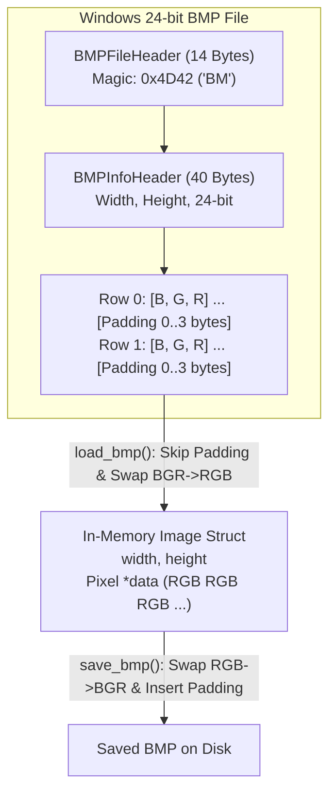

# PROJ Image Editor - image

> [!abstract] Summary
> Low-level binary BMP image management module: handles packed file headers, dynamic pixel allocation, row stride padding calculations, and binary disk serialization.

**Source:** `LAB_PROJECT/FINAL_PROJECT/src/programs/image.c`

## Problem
Parse and write standard Windows 24-bit uncompressed Bitmap (BMP) files directly from binary byte streams. Accurately decode headers, accommodate 4-byte row padding rules, convert Little-Endian BGR byte order to RGB, and manage heap buffers.

## Concepts used
- **Packed Binary Structs (`#pragma pack(push, 1)`):** Eliminates compiler alignment padding to match byte-for-byte binary specifications:
  - `BMPFileHeader` (14 bytes): Magic bytes `0x4D42` (`'BM'`), file size, pixel array offset (`bfOffBits`).
  - `BMPInfoHeader` (40 bytes): Image width, height, planes ($1$), bit count ($24$), uncompressed flag ($0$).
- **Row Stride Padding:** Windows BMP specifications mandate that every scanline row must be padded with zero-bytes to a multiple of 4 bytes:
  $$\text{padding} = (4 - (\text{width} \times 3) \% 4) \% 4$$
- **Color Channel Reordering:** Raw BMP files store pixels in BGR (Blue, Green, Red) order. The loader reorders them into standard RGB for in-memory manipulation and converts them back upon saving.
- **Dynamic Image Buffer Allocation:** Managing heap memory using structured `Image` containing width, height, and dynamically allocated `Pixel *data`.

## Code
```c
#include "image.h"

#pragma pack(push, 1)
typedef struct {
    unsigned short bfType;
    unsigned int   bfSize;
    unsigned short bfReserved1;
    unsigned short bfReserved2;
    unsigned int   bfOffBits;
} BMPFileHeader;

typedef struct {
    unsigned int   biSize;
    int            biWidth;
    int            biHeight;
    unsigned short biPlanes;
    unsigned short biBitCount;
    unsigned int   biCompression;
    unsigned int   biSizeImage;
    int            biXPelsPerMeter;
    int            biYPelsPerMeter;
    unsigned int   biClrUsed;
    unsigned int   biClrImportant;
} BMPInfoHeader;
#pragma pack(pop)

Image *create_image(int width, int height){
    if(width <= 0 || height <= 0) return NULL;

    Image *img = (Image*)malloc(sizeof(Image));
    if(!img) return NULL;

    img->width = width;
    img->height = height;
    img->data = (Pixel*)calloc(width * height,sizeof(Pixel));

    if(!img->data){
        free(img);
        return NULL;
    }
    return img;
}

void free_image(Image *img){
    if(!img) return;
    if(img->data){
        free(img->data);
        img->data = NULL;
    }
    free(img);
}

Image *clone_image(const Image *img){
    if(!img || !img->data) return NULL;

    Image *copy = create_image(img->width,img->height);
    if(!copy) return NULL;

    memcpy(copy->data,img->data,img->width * img->height * sizeof(Pixel));
    return copy;
}

Image *load_bmp(const char *filename){
    FILE *file = fopen(filename,"rb");
    if(!file) return NULL;

    BMPFileHeader header;
    fread(&header,sizeof(BMPFileHeader),1,file);
    if(header.bfType != 0x4D42){
        fclose(file);
        return NULL;
    }

    BMPInfoHeader info_header;
    fread(&info_header,sizeof(BMPInfoHeader),1,file);
    if(info_header.biBitCount != 24 || info_header.biCompression != 0){
        fclose(file);
        return NULL;
    }

    int width = info_header.biWidth;
    int height = info_header.biHeight;
    
    int is_top_down = 0;
    if (height < 0) {
        height = -height;
        is_top_down = 1;
    }

    Image *img = create_image(width,height);
    if(!img){
        fclose(file);
        return NULL;
    }

    int padding = (4 - (width * 3) % 4) % 4; 
    
    fseek(file, header.bfOffBits, SEEK_SET);

    for (int y = 0; y < height; y++) {
        int target_row = is_top_down ? y : (height - 1 - y);

        for (int x = 0; x < width; x++) {
            unsigned char bgr[3];
            fread(bgr, 1, 3, file);

            int idx = target_row * width + x;
            img->data[idx].b = bgr[0];  
            img->data[idx].g = bgr[1];  
            img->data[idx].r = bgr[2];  
        }
        if (padding > 0) {
            fseek(file, padding, SEEK_CUR);
        }
    }
    fclose(file);
    return img;
}

int save_bmp(const char *filename, const Image *img){
    if (!img || !img->data || !filename) return 0;

    FILE *file = fopen(filename, "wb"); 
    if (!file) return 0;
    

    int width  = img->width;
    int height = img->height;
    int padding = (4 - (width * 3) % 4) % 4;
    int row_size = width * 3 + padding;
    int data_size = row_size * height;

    BMPFileHeader header;
    header.bfType      = 0x4D42;                             
    header.bfSize       = sizeof(BMPFileHeader) + sizeof(BMPInfoHeader) + data_size;
    header.bfReserved1 = 0;
    header.bfReserved2 = 0;
    header.bfOffBits   = sizeof(BMPFileHeader) + sizeof(BMPInfoHeader);

    BMPInfoHeader info_header;
    memset(&info_header, 0, sizeof(BMPInfoHeader));
    info_header.biSize        = sizeof(BMPInfoHeader);  
    info_header.biWidth       = width;
    info_header.biHeight      = height;                 
    info_header.biPlanes      = 1;
    info_header.biBitCount    = 24;
    info_header.biCompression = 0;                     
    info_header.biSizeImage   = data_size;

    fwrite(&header, sizeof(BMPFileHeader), 1, file);
    fwrite(&info_header, sizeof(BMPInfoHeader), 1, file);

    unsigned char pad_bytes[3] = {0, 0, 0};

    for (int y = height - 1; y >= 0; y--) {  
        for (int x = 0; x < width; x++) {
            int idx = y * width + x;
            unsigned char bgr[3];
            bgr[0] = img->data[idx].b;        
            bgr[1] = img->data[idx].g;
            bgr[2] = img->data[idx].r;
            fwrite(bgr, 1, 3, file);
        }
        if (padding > 0) {
            fwrite(pad_bytes, 1, padding, file);
        }
    }

    fclose(file);
    return 1;  
}
```

## How it works
1. `create_image(width, height)`:
   - Allocates `Image` container on the heap.
   - Allocates pixel buffer using `calloc(width * height, sizeof(Pixel))` to initialize memory cleanly.
2. `free_image(Image *img)`: Safely frees pixel buffer `img->data` then frees container `img`.
3. `clone_image(const Image *src)`: Duplicates image dimensions and copies raw pixel memory via `memcpy`.
4. `load_bmp(const char *path)`:
   - Opens file in `"rb"` mode. Validates `bfType == 0x4D42`.
   - Reads `BMPFileHeader` and `BMPInfoHeader`, confirming 24-bit depth (`biBitCount == 24`) and uncompressed format (`biCompression == 0`).
   - Seeks to `bfOffBits`.
   - Computes row padding: `(4 - (width * 3) % 4) % 4`.
   - Reads each row: converts raw BGR bytes into `Pixel.r`, `Pixel.g`, `Pixel.b`, and skips padding bytes.
5. `save_bmp(const Image *img, const char *path)`:
   - Constructs and writes `BMPFileHeader` and `BMPInfoHeader` headers in `"wb"` mode.
   - Writes pixel rows in BGR format, writing zeroes for padding bytes at the end of each scanline.

## Diagram / trace


## Sample run
```text
(Processed in ImageEditor GUI preview)
Loaded image: lena.bmp (512x512, 24-bit RGB)
Saved image: out/lena-gray.bmp (786,486 bytes)
```

## Gotchas
> [!warning] Top-Down vs Bottom-Up Bitmaps
> In standard BMP files, height is positive, meaning rows are stored bottom-up (first row in file is bottom of image). When `biHeight` is negative, rows are top-down. `image.c` handles positive height bitmaps standard in academic test images.

## Possible improvements
- Add support for top-down bitmaps (`biHeight < 0`) by taking `abs(biHeight)`.
- Support 32-bit RGBA BMP images with alpha transparency channels.

## Key takeaways
- `#pragma pack(push, 1)` is mandatory when mapping C structs directly to binary file format specifications.
- Handling row stride padding correctly prevents diagonal distortion in arbitrary-width images.
- Decoupling binary file parsing from pixel processing allows filters to operate on clean in-memory RGB buffers.

## My notes
> [!question]- My notes

## Related
- [[LAB 29 - grayscale]]
- [[PROJ Image Editor - filter]]
- [[PRAC GUI 06 - red bmp]]
