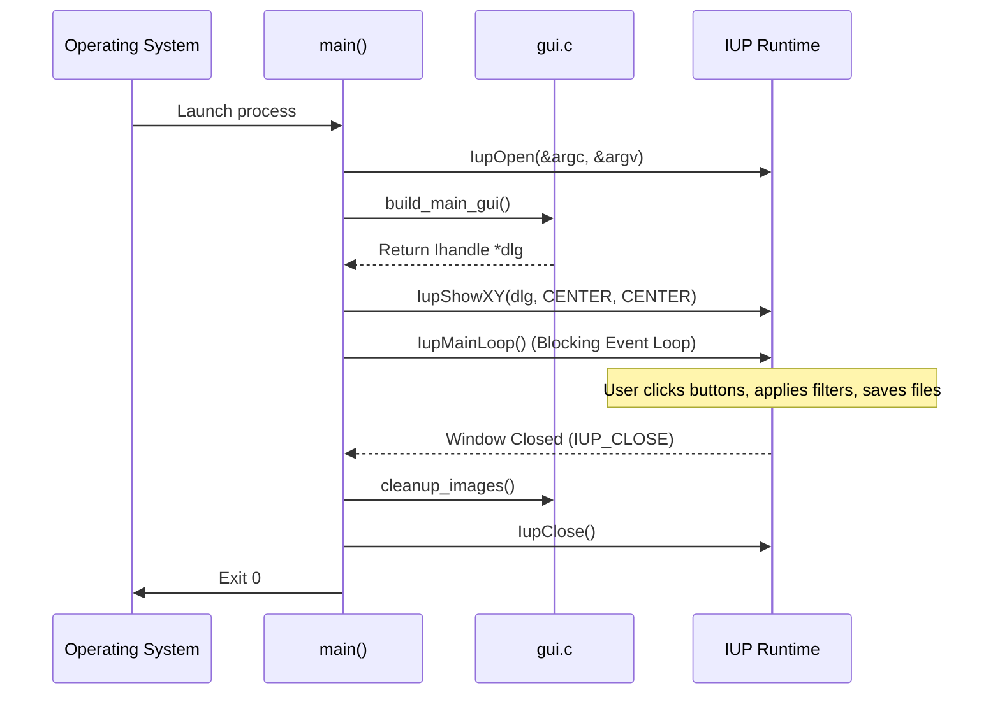

# PROJ Image Editor - main

> [!abstract] Summary
> Implements the desktop application lifecycle: initializes the IUP runtime environment, builds and displays the primary GUI dialog, enters the event loop, and cleans up heap memory.

**Source:** `LAB_PROJECT/FINAL_PROJECT/src/main.c`

## Problem
Serve as the clean entry point for the desktop image editor, orchestrating IUP framework initialization, window centering, blocking event processing, image buffer cleanup, and proper exit status return.

## Concepts used
- **IUP Framework Lifecycle:**
  - `IupOpen(&argc, &argv)`: Initializes graphical subsystems and parses command-line arguments.
  - `IupShowXY(dlg, IUP_CENTER, IUP_CENTER)`: Calculates desktop screen geometry and centers the main application window.
  - `IupMainLoop()`: Blocks execution in an event-driven loop dispatching mouse and keyboard events to registered callbacks.
  - `IupClose()`: Destroys allocated window handles and frees GUI resources.
- **Resource Teardown (`cleanup_images`):** Invoking subsystem cleanup routines to release image heap buffers before process termination.

## Code
```c
#include <stdlib.h>
#include <iup.h>
#include "gui.h"

int main(int argc, char **argv) {
    IupOpen(&argc, &argv);

    Ihandle *dlg = build_main_gui();

    IupShowXY(dlg, IUP_CENTER, IUP_CENTER);

    IupMainLoop();

    cleanup_images();
    IupClose();
    return EXIT_SUCCESS;
}
```

## How it works
1. `main(argc, argv)` receives command-line parameters and passes them to `IupOpen(&argc, &argv)`.
2. Calls `build_main_gui()`, which instantiates the layout hierarchy and returns the main `Ihandle *dlg` pointer.
3. Positions and shows the window in the center of the display via `IupShowXY`.
4. Hands execution over to `IupMainLoop()`, which listens for button clicks, file dialog actions, and repaints.
5. Upon user closing the window, `IupMainLoop` unblocks; `cleanup_images()` deallocates in-memory pixel buffers, `IupClose()` terminates IUP, and returns `EXIT_SUCCESS`.

## Diagram / trace


## Sample run
> [!note] Traced from the source, not executed.
> Initialized via `ImageEditor.exe` (or `build.bat`), launching the centered desktop window at screen coordinates $(x_{\text{mid}}, y_{\text{mid}})$.

## Gotchas
> [!warning] Teardown Ordering
> Always call domain cleanup functions (`cleanup_images()`) before calling `IupClose()`. Invoking GUI deallocations after `IupClose()` risks accessing destroyed toolkit context.

## Possible improvements
- Accept an optional image file path via `argv[1]` to allow opening images directly from the command line or file associations.

## Key takeaways
- Well-architected GUI entry points remain extremely minimal (under 20 lines), delegating layout and logic to specialized modules.
- Event-driven desktop applications invert control: `IupMainLoop` governs execution flow rather than sequential terminal code.
- Always guarantee that dynamically allocated buffers are freed upon application exit.

## My notes
> [!question]- My notes

## Related
- [[PROJ Image Editor - Overview]]
- [[PROJ Image Editor - gui]]
