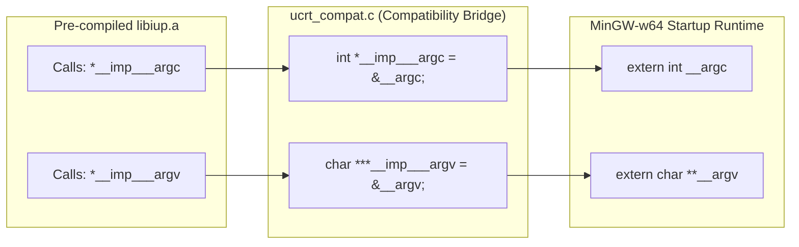

# PROJ Image Editor - ucrt compat

> [!abstract] Summary
> A systems programming compatibility layer that defines missing Universal C Runtime (UCRT) argument symbols, resolving linker errors when compiling with MinGW against static IUP libraries.

**Source:** `LAB_PROJECT/FINAL_PROJECT/src/programs/ucrt_compat.c`

## Problem
When linking the 64-bit Image Editor executable using modern GCC MinGW-w64 against pre-compiled static IUP libraries (`libiup.a`), the link step fails with unresolved symbol errors: `undefined reference to __imp___argc` and `undefined reference to __imp___argv`.

## Concepts used
- **C Runtime (CRT) Evolution:** Windows historically provided `msvcrt.dll`, which exported global command-line argument pointers as `__argc` and `__argv`. Modern Windows 10/11 and newer toolchains adopt the Microsoft Universal C Runtime (UCRT / `ucrtbase.dll`), where import library symbols expect `__imp___argc` and `__imp___argv`.
- **Indirect Function Pointers (`__imp_` prefix):** In the Windows PE/COFF dynamic linking architecture, symbols prefixed with `__imp_` represent pointers into the Import Address Table (IAT).
- **Symbol Shim / Bridging:** Synthesizing the missing import pointers by referencing GCC's native `extern int __argc` and `extern char **__argv` symbols.

## Code
```c
extern int    __argc;
extern char **__argv;

int    *__imp___argc = &__argc;
char ***__imp___argv = (char ***)&__argv;
```

## How it works
1. Declares `extern int __argc;` and `extern char **__argv;`, referencing the standard command-line argument variables provided by GCC's MinGW startup code (`crt0`).
2. Creates pointer `int *__imp___argc = &__argc;`, pointing directly to the address of `__argc`.
3. Creates triple pointer `char ***__imp___argv = (char ***)&__argv;`, pointing to the address of `__argv`.
4. When the static IUP library (`libiup.a`) references `__imp___argc` or `__imp___argv`, the linker resolves them to these exported global pointers, completely eliminating the undefined reference error!

## Diagram / trace


## Sample run
```text
(Compiler output without ucrt_compat.c):
libiup.a(iup_open.o): undefined reference to `__imp___argc'
libiup.a(iup_open.o): undefined reference to `__imp___argv'
collect2.exe: error: ld returned 1 exit status

(Compiler output with ucrt_compat.c):
[SUCCESS] ImageEditor.exe built successfully!
```

## Gotchas
> [!warning] Pointer Indirection Level
> Notice the triple pointer cast for argv: `char ***__imp___argv = (char ***)&__argv;`. Because `__argv` is already `char **`, its address `&__argv` is `char ***`. Missing an asterisk causes memory dereference faults when IUP parses flags.

## Possible improvements
- Wrap declarations with `#ifdef _WIN32` guards so the file compiles harmlessly on POSIX or Linux platforms if multi-platform builds are needed.

## Key takeaways
- Linker errors involving `__imp_` prefixes indicate a mismatch between compiler CRT expectations and library import tables.
- Systems programming in C allows defining runtime shims that satisfy external library dependencies without modifying binary `.a` archives.
- Understanding PE/COFF import address tables demystifies low-level Windows executable linking.

## My notes
> [!question]- My notes

## Related
- [[PROJ Image Editor - build]]
- [[CLASS 20 - cmd arg]]
- [[ARCH - Image editor bugs]]
