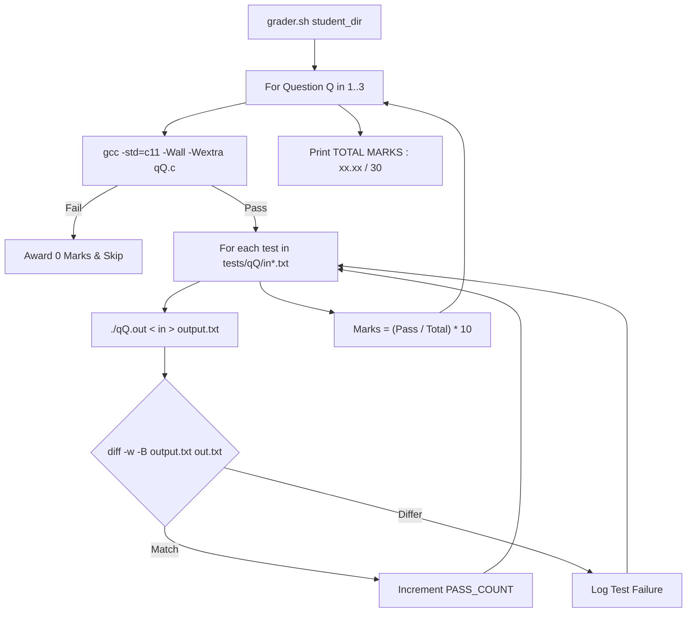

# PROJ Midterm Exam - grader

> [!abstract] Summary
> An automated Bash test harness script that compiles student exam submissions under strict flags (`-std=c11 -Wall -Wextra`), executes them against test datasets, and computes cumulative marks.

**Source:** `LAB_PROJECT/MIDTERM_EXAM/grader.sh`

## Problem
Automate the assessment of student programming exam submissions across three separate problems (`q1.c`, `q2.c`, `q3.c`). The script must compile source files, pipe input files (`tests/qX/in*.txt`), compare outputs against expected output benchmarks (`out*.txt`) while ignoring whitespace differences, score each question out of 10 marks, and tally total marks out of 30.

## Concepts used
- **Automated Shell Test Runner:** Orchestrating compilation, batch execution, diff verification, and cleanup via a Bash script.
- **Strict Compilation Gate:** Enforcing standard `-std=c11 -Wall -Wextra` compilation. If compilation fails, awards 0 marks immediately.
- **Whitespace-Tolerant Diffing (`diff -w -B`):** Using `-w` (ignore all whitespace) and `-B` (ignore blank lines) to avoid penalizing students for trailing spaces or blank line differences.
- **Floating-Point Mark Calculation (`awk`):** Calculating fractional marks per question via `awk "BEGIN {printf "%.2f", (PASS / TOTAL) * 10}"`.

## Code
```bash
#!/bin/bash

# ============================================================
# C Programming Lab Grader
# Usage:
#   ./grader.sh student_folder
#
# Student folder should contain:
#   q1.c
#   q2.c
#   q3.c
#
# Tests should be stored as:
#   tests/q1/in001.txt
#   tests/q1/out001.txt
#   ...
# ============================================================

STUDENT_DIR=${1:-.}
TEST_DIR="tests"

TOTAL=0

GREEN="\033[0;32m"
RED="\033[0;31m"
YELLOW="\033[1;33m"
BLUE="\033[0;34m"
NC="\033[0m"

grade_question() {

    Q=$1
    SRC="$STUDENT_DIR/q${Q}.c"
    EXE="q${Q}.out"

    echo
    echo -e "${BLUE}========== Question $Q ==========${NC}"

    if [ ! -f "$SRC" ]; then
        echo -e "${RED}Source file q${Q}.c not found.${NC}"
        return
    fi

    echo "Compiling..."

    gcc -std=c11 -Wall -Wextra "$SRC" -o "$EXE"

    if [ $? -ne 0 ]; then
        echo -e "${RED}Compilation Failed${NC}"
        return
    fi

    PASS_COUNT=0
    TOTAL_TESTS=0

    for INPUT in "$TEST_DIR"/q"$Q"/in*.txt
    do
        TOTAL_TESTS=$((TOTAL_TESTS + 1))

        NUM=$(basename "$INPUT" | sed 's/in//; s/.txt//')
        EXPECTED="$TEST_DIR/q$Q/out$NUM.txt"

        ./"$EXE" < "$INPUT" > output.txt

        STATUS=$?

        if [ $STATUS -ne 0 ]; then
            echo "Test $NUM : RUNTIME ERROR"
            continue
        fi

        if diff -w -B output.txt "$EXPECTED" >/dev/null
        then
            echo -e "Test $NUM : ${GREEN}PASS${NC}"
            PASS_COUNT=$((PASS_COUNT + 1))
        else
            echo -e "Test $NUM : ${RED}FAIL${NC}"
        fi
    done

    MARKS=$(awk "BEGIN {printf \"%.2f\", ($PASS_COUNT/$TOTAL_TESTS)*10}")

    echo
    echo "Passed : $PASS_COUNT / $TOTAL_TESTS"


    TOTAL=$(awk "BEGIN {printf \"%.2f\", $TOTAL + $MARKS}")

    rm -f "$EXE" output.txt
}

echo "==========================================="
echo "        C Programming Lab Grader"
echo "==========================================="

grade_question 1
grade_question 2
grade_question 3

echo
echo "==========================================="
printf "TOTAL MARKS : %.2f / 30\n" "$TOTAL"
echo "==========================================="
```

## How it works
1. Sets default student folder to current directory or command-line argument `$1`.
2. Iterates across questions 1, 2, and 3 via `grade_question()`:
   - Verifies existence of `q${Q}.c`.
   - Compiles with `gcc -std=c11 -Wall -Wextra`.
   - Loops over all input files `tests/q$Q/in*.txt`.
   - Runs `./q$Q.out < $INPUT > output.txt`.
   - Checks exit status: if non-zero, logs runtime error.
   - Diffs `output.txt` with `expected.txt`: increments `PASS_COUNT` on match.
   - Calculates scaled question marks using `awk`.
   - Removes temporary executable and output file.
3. Outputs total exam score out of 30 marks.

## Diagram / trace


## Sample run
```text
===========================================
        C Programming Lab Grader
===========================================

========== Question 1 ==========
Compiling...
Test 01 : PASS
Test 02 : PASS
Test 03 : PASS
Test 04 : PASS
Test 05 : PASS
Test 06 : PASS
Test 07 : PASS
Test 08 : PASS
Test 09 : PASS
Test 10 : PASS

Passed : 10 / 10

========== Question 2 ==========
Compiling...
Test 01 : PASS
...
Passed : 10 / 10

========== Question 3 ==========
Compiling...
Test 01 : PASS
...
Passed : 10 / 10

===========================================
TOTAL MARKS : 30.00 / 30
===========================================
```

## Gotchas
> [!warning] CRLF vs LF Line Endings in Test Files
> Windows CRLF line endings (`
`) in input or output text files can cause subtle comparison mismatches on POSIX diff runners if `-B` or `-w` flags are omitted.

## Possible improvements
- Add execution timeouts (e.g. `timeout 2s`) to prevent student infinite loops from freezing the entire grading suite.
- Output detailed diff snippets when a test fails to aid debugging.

## Key takeaways
- Automated test harnesses provide objective, reproducible, and instantaneous grading for programming coursework.
- Whitespace-insensitive diffing (`diff -w -B`) focuses evaluation on algorithmic correctness rather than trivial formatting quirks.
- Shell scripts orchestrate multi-tool workflows (compilers, streams, awk arithmetic) cleanly.

## My notes
> [!question]- My notes

## Related
- [[PROJ Midterm Exam - q1]]
- [[PROJ Midterm Exam - q2]]
- [[PROJ Midterm Exam - q3]]
- [[PROJ Final Exam - grader harness]]
