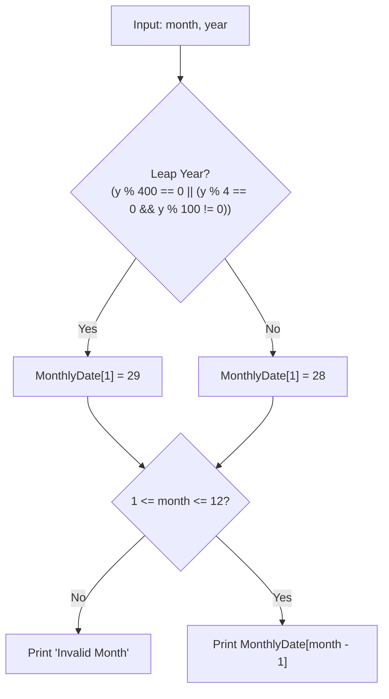

# PROJ Midterm Exam - q1

> [!abstract] Summary
> Evaluates the exact calendar day count of a specified month and year, handling Gregorian leap year adjustments for February.

**Source:** `LAB_PROJECT/MIDTERM_EXAM/q1.c`

## Problem
Given a month ($1 \dots 12$) and year, validate the month input, apply leap year rules to update February's days from 28 to 29 if applicable, and output the total number of days in that month.

## Concepts used
- **Lookup Table Array:** Initializing `MonthlyDate[12]` with baseline day counts for all twelve calendar months.
- **Leap Year Logic:** Testing astronomical leap rules:
  $$\text{year} \% 400 == 0 \lor (\text{year} \% 4 == 0 \land \text{year} \% 100 \ne 0)$$
- **Boundary Validation:** Checking $1 \le \text{month} \le 12$, printing `Invalid Month` for invalid inputs.

## Code
```c
#include<stdio.h>

int main(){
	int MonthlyDate[12] = {31,28,31,30,31,30,31,31,30,31,30,31};
	
	int month , year ;
    
	scanf("%d %d",&month , &year);

	if (year % 400 == 0 || (year % 4 == 0 && year % 100 != 0)){
		MonthlyDate[1] = 29 ;
	}

	if (month < 1 || month > 12) {
        printf("Invalid Month\n");
    } else {
        printf("%d\n" , MonthlyDate[month-1]);
    }
	return 0 ; 
	
      }
```

## How it works
1. Populates `MonthlyDate[12] = {31, 28, 31, 30, 31, 30, 31, 31, 30, 31, 30, 31}`.
2. Reads `month` and `year` via `scanf`.
3. If the year is divisible by 400, or divisible by 4 but not by 100, updates February: `MonthlyDate[1] = 29`.
4. If `month < 1 || month > 12`, prints `Invalid Month`.
5. Otherwise, prints `MonthlyDate[month - 1]`.

## Diagram / trace


## Sample run
```text
2 2024
29
```
```text
2 2023
28
```
```text
13 2024
Invalid Month
```

## Gotchas
> [!warning] Month Indexing Offset
> C arrays use 0-based indexing ($0 \dots 11$), while humans input 1-based months ($1 \dots 12$). Accessing `MonthlyDate[month]` instead of `MonthlyDate[month - 1]` will read an off-by-one month or out-of-bounds index for December ($12$).

## Possible improvements
- Add input format validation checking `if (scanf("%d %d", ...) != 2)` to guard against malformed non-integer inputs.
- Reject negative calendar years ($year \le 0$).

## Key takeaways
- Lookup tables eliminate bulky `switch-case` statements for fixed calendar datasets.
- The Gregorian leap year formula requires checking century years against 400 (`year % 400 == 0`).
- Always subtract 1 when converting 1-based human inputs to 0-based array indices.

## My notes
> [!question]- My notes

## Related
- [[LAB 03 - age calc simple]]
- [[PROJ Midterm Exam - grader]]
