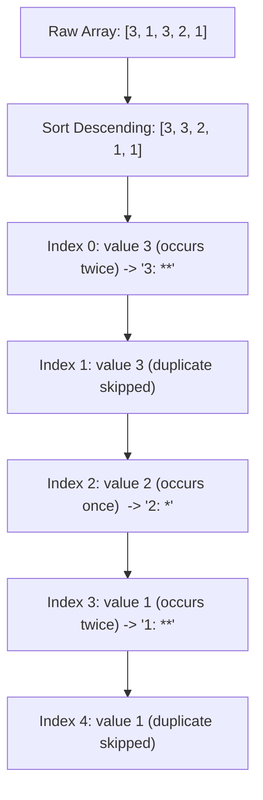

# PROJ Midterm Exam - q2

> [!abstract] Summary
> Reads an array of integers, sorts them in descending order, calculates element frequency counts, and renders a horizontal asterisk histogram for unique values.

**Source:** `LAB_PROJECT/MIDTERM_EXAM/q2.c`

## Problem
Read integer count $N$ followed by $N$ integers. Sort the array descending, count how many times each distinct value occurs, and print each value followed by a horizontal bar of asterisks matching its frequency.

## Concepts used
- **Nested Comparison Sort:** Sorting elements descending so identical duplicate values cluster together.
- **Frequency Counter Loop:** Scanning forward from index $i$ to count identical elements `arr[i] == arr[j]`.
- **Deduplication Output Mask:** Only printing the histogram row when `i == 0 || arr[i] != arr[i - 1]` to ensure each distinct number is printed once.

## Code
```c
#include <stdio.h>

int main() {
    int N;
    if (scanf("%d", &N) != 1) return 0;
    
    int arr[N];
    for (int i = 0; i < N; i++) {
        scanf("%d", &arr[i]);
    }
    
    for (int i = 0; i < N; i++) {
        for (int j = 0; j < N; j++) {
            if (arr[j] > arr[i]) {
                int temp = arr[j];
                arr[j] = arr[i];
                arr[i] = temp;
            }
        }
    }
    
    for (int i = 0; i < N; i++) {
        int counter = 0;
        for (int j = i; j < N; j++) {
            if (arr[i] == arr[j]) {
                counter++;
            }
        }
        
        if (i == 0 || arr[i] != arr[i - 1]) {
            printf("%d: ", arr[i]);
            for (int k = 0; k < counter; k++) {
                printf("*");
            }
            printf("\n");
        }
    }
    
    return 0;
}
```

## How it works
1. Reads length $N$ and populates `arr[N]`.
2. Sorts array descending: if `arr[j] > arr[i]`, swaps them.
3. For each index $i$:
   - Inner loop tallies occurrences of `arr[i]` in remaining slice.
   - If $i$ is the first occurrence of this value (`i == 0 || arr[i] != arr[i - 1]`), prints `value: ` and $counter$ asterisks `*`.
4. Produces a clean descending frequency histogram.

## Diagram / trace


## Sample run
```text
5
3 1 3 2 1
3: **
2: *
1: **
```

## Gotchas
> [!warning] Quadratic Frequency Scanning
> Re-counting duplicates using nested loops yields $O(N^2)$ complexity. Since the array is already sorted, adjacent counts can be accumulated in a single linear pass ($O(N)$).

## Possible improvements
- Step index $i$ forward by `counter` (i.e. `i += counter - 1`) to skip inner duplicate passes completely.

## Key takeaways
- Sorting an array simplifies frequency counting by clustering duplicate items into contiguous blocks.
- Deduplication conditions `arr[i] != arr[i - 1]` guard against repeating output rows.
- Visual character histograms provide immediate data distribution insights in terminal programs.

## My notes
> [!question]- My notes

## Related
- [[LAB 11 - sort array]]
- [[PROJ Midterm Exam - grader]]
