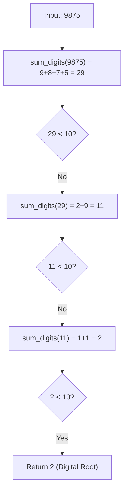

# PROJ Midterm Exam - q3

> [!abstract] Summary
> Computes the digital root of a positive integer by recursively summing its constituent digits until a single-digit result remains.

**Source:** `LAB_PROJECT/MIDTERM_EXAM/q3.c`

## Problem
Given a positive integer $n$, sum its digits. If the resulting sum has more than one digit, repeat the process recursively until the sum reduces to a single digit ($0 \dots 9$), then print that single digit.

## Concepts used
- **Modulo & Integer Division Extraction:** Isolating digits with `n % 10` and stripping with `n /= 10`.
- **Recursive Reduction:** Breaking the problem into `rec_sum(sum_digits(n))`.
- **Base Condition:** Halting recursion when $n < 10$.
- **Digital Root Congruence:** Mathematically equivalent to $n \pmod 9$ (modulo 9 arithmetic, where non-zero numbers with remainder 0 yield 9).

## Code
```c
#include <stdio.h>

int sum_digits(int n) {
    int sum = 0;
    for(int i = 0 ; n > 0 ; i++) {
        sum += n % 10;
        n /= 10;
    }
    return sum;
}

int rec_sum(int n) {
    if (n < 10) {
        return n;
    }
    return rec_sum(sum_digits(n));
}

int main() {
    int n;
    scanf("%d", &n) ;
        printf("%d\n", rec_sum(n));
    
    return 0;
}
```

## How it works
1. `sum_digits(n)` uses a loop extracting each decimal digit (`n % 10`) and adding it to `sum` until $n = 0$.
2. `rec_sum(n)`:
   - Base case: `if (n < 10) return n;`
   - Recursive step: calls `rec_sum(sum_digits(n))`.
3. In `main()`, reads integer $n$ and prints `rec_sum(n)`.

## Diagram / trace


## Sample run
```text
9875
2
```

## Gotchas
> [!warning] Negative Number Input
> If a negative integer is passed, `sum_digits` will loop zero times (as `n > 0` is false) and return 0. Inputs should be sanitized with `abs(n)`.

## Possible improvements
- Closed-form $O(1)$ calculation via the digital root property: `1 + (n - 1) % 9` for $n > 0$.

## Key takeaways
- Functions can delegate mathematical reduction to helper sub-routines before recurring.
- Digital roots compress large numbers into single digits through iterative digit summation.
- Checking termination conditions (`n < 10`) ensures finite recursion depth.

## My notes
> [!question]- My notes

## Related
- [[LAB 15 - sum array recursion]]
- [[ASG 08 - recursion practice]]
