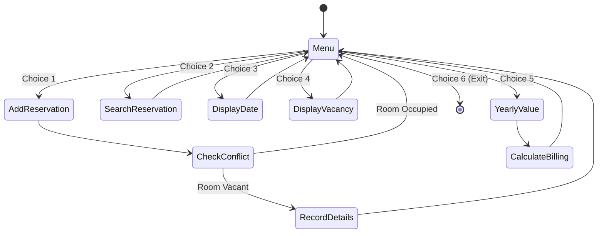

# PROJ Midterm Practice - hotel reservation

> [!abstract] Summary
> An interactive console hotel reservation system managing room bookings, tiered room pricing, multi-field guest profiles, date durations, vacancy checks, and billing invoices.

**Source:** `LAB_PROJECT/MIDTERM_PRACTICE/hotelReservation.c`

## Problem
Design a hotel management application for 10 rooms with distinct room rates (ranging from 2,000 to 200,000 BDT). Support room reservations, reservation search, date duration calculation, vacancy reporting, and revenue calculations based on stay length.

## Concepts used
- **Tiered Room Pricing Array:** Storing rates `roomRate[10] = {2000, 3000, 5000, 8000, 12000, 20000, 35000, 70000, 120000, 200000}`.
- **Calendar Day Conversion (`dateToDays`):** Converting structured date triplets $(D, M, Y)$ into absolute cumulative days to compute booking durations.
- **Conflict Prevention:** Verifying that a room is not already flagged as `occupancy[j] == 1` before creating a booking.
- **Formatted Date Strings:** Parsing dates using `scanf("%d-%d-%d")` and formatting output strings with `%02d-%02d-%d`.

## Code
```c
#include<stdio.h>
#include<string.h> 
#include<math.h>
 
#define MAX 10
int total = 0;
char reservationID[MAX][50];
char guestName[MAX][100];
int roomNumber[MAX]= {1,2,3,4,5,6,7,8,9,10};
char roomType[MAX][20];
int startDate[MAX][3];
int endDate[MAX][3];
int roomRate[MAX] = {2000, 3000, 5000, 8000, 12000, 20000, 35000, 70000, 120000, 200000};
int occupancy[MAX];

void addReservation(){
    int i = total;
    printf("Enter room number:\n");
    scanf("%d", &roomNumber[i]);
    for(int j = 0; j < total; j++){
        if(roomNumber[j] == roomNumber[i] && occupancy[j] == 1){
            printf("Room is already occupied!\n");
            return;
        }
    }
    printf("Enter reservation ID:(max 10 words)");
    scanf("%s", reservationID[i]);
    printf("Enter guest name:(max 100 words)");
    scanf(" %[^\n]", guestName[i]);
    printf("Enter room type: (Single ,Double ,Family)");
    scanf("%s", roomType[i]);
    printf("Enter start date (DD-MM-YYYY): ");
    scanf("%d-%d-%d", &startDate[i][0], &startDate[i][1], &startDate[i][2]);
    printf("Enter end date (DD-MM-YYYY): ");
    scanf("%d-%d-%d", &endDate[i][0], &endDate[i][1], &endDate[i][2]);
    printf("Confirm Reservation (0,1): ");
    scanf("%d", &occupancy[i]);
    printf("\n");
    if(occupancy[i] == 1) total++;
}

void searchReservation(){
    char searchID[50];
    printf("Enter reservation ID: ");
    scanf("%s", searchID);
    for(int i = 0; i < total; i++){
        if(strcmp(reservationID[i], searchID) == 0){
            printf("Reservation found!\n");
            printf("Room number: %d\n", roomNumber[i]);
            printf("Reservation ID: %s\n", reservationID[i]);
            printf("Guest name: %s\n", guestName[i]);
            printf("Room type: %s\n", roomType[i]);
            printf("Start date: %d-%d-%d\n", startDate[i][0], startDate[i][1], startDate[i][2]);
            printf("End date: %d-%d-%d\n", endDate[i][0], endDate[i][1], endDate[i][2]);
            printf("Occupancy: %d\n", occupancy[i]);
            printf("\n");
            return;
        }
    }
    printf("Reservation not found!");
}

int dateToDays(int day, int month, int year){
    return year * 365 + month * 30 + day;
}

void displayDate(){
    if (total == 0) {
        printf("No logs currently recorded.\n\n");
        return;
    }

    
    int sortedIndex[MAX];
    for(int i = 0; i < total; i++) {
        sortedIndex[i] = i;
    }


    for (int i = 0; i < total - 1; i++) {
        for (int j = 0; j < total - i - 1; j++) {
            int idx1 = sortedIndex[j];
            int idx2 = sortedIndex[j + 1];

            int days1 = dateToDays(startDate[idx1][0], startDate[idx1][1], startDate[idx1][2]);
            int days2 = dateToDays(startDate[idx2][0], startDate[idx2][1], startDate[idx2][2]);
            if (days1 > days2) {
                int temp = sortedIndex[j];
                sortedIndex[j] = sortedIndex[j + 1];
                sortedIndex[j + 1] = temp;
            }
        }
    }

    printf("--- Stored Reservations (Sorted by Start Date) ---\n");
    for(int i = 0; i < total; i++){
        int k = sortedIndex[i];
        printf("Room number: %d\n", roomNumber[k]);
        printf("Reservation ID: %s\n", reservationID[k]);
        printf("Guest name: %s\n", guestName[k]);
        printf("Room type: %s\n", roomType[k]);
        printf("Start date: %02d-%02d-%d\n", startDate[k][0], startDate[k][1], startDate[k][2]);
        printf("End date: %02d-%02d-%d\n", endDate[k][0], endDate[k][1], endDate[k][2]);
        printf("Occupancy status: %s\n\n", occupancy[k] == 1 ? "Occupied" : "Reserved/Unoccupied");
    }
}

void displayVacancy(){
    for(int i = 0; i < MAX; i++){
        if(occupancy[i] == 0){
            printf("Room %d is not occupied!\n", roomNumber[i]);
            printf("\n");
        }
    }
}


void yearlyValue(){
    int room;
    printf("Enter the room number for getting the yearly value :\n");
    scanf("%d", &room);

    for(int i = 0; i < total; i++){
        if(roomNumber[i] == room && occupancy[i] == 1){
            int startDays = dateToDays(startDate[i][0], startDate[i][1], startDate[i][2]);
            int endDays = dateToDays(endDate[i][0], endDate[i][1], endDate[i][2]);
            int duration = endDays - startDays;
            int value = duration * roomRate[roomNumber[i]-1];
            printf("Stay duration: %d days\n", duration);
            printf("The total value of room %d is %d\n", roomNumber[i], value);
            return;
        }
    }
    printf("Room not found!\n");
}

int main(){
    int choice;
    do {
        printf("1. Add Reservation\n");
        printf("2. Search Reservation\n");
        printf("3. Display Date\n");
        printf("4. Display Vacancy\n");
        printf("5. Yearly Value\n");
        printf("6. Exit\n");
        printf("\n");
        
        printf("Enter your choice: ");    
        scanf("%d", &choice);
        printf("\n");
    
        if(choice == 1) addReservation();
        else if(choice == 2) searchReservation();
        else if(choice == 3) displayDate();
        else if(choice == 4) displayVacancy();
        else if(choice == 5) yearlyValue();
        else if(choice != 6) printf("Invalid choice!");
        printf("\n");
    } while(choice != 6);
    return 0;
}
```

## How it works
1. Global state tracks up to 10 rooms: reservation IDs, guest names, room types, stay dates, rates, and occupancy flags.
2. `addReservation()`:
   - Prompts for room number ($1 \dots 10$). Checks for prior occupancy.
   - Reads reservation ID, guest name, room type, start date, and end date.
   - Marks occupancy flag as 1 and increments `total`.
3. `searchReservation()` searches by reservation ID and prints guest name, room number, dates, and stay details.
4. `displayVacancy()` iterates through all 10 rooms, listing unoccupied rooms.
5. `yearlyValue()` computes stay duration (`endDays - startDays`), multiplies duration by daily room rate, and outputs the total invoice value.
6. `main()` runs an interactive 6-option `do-while` menu loop.

## Diagram / trace


## Sample run
```text
1. Add Reservation
2. Search Reservation
3. Display Date
4. Display Vacancy
5. Yearly Value
6. Exit

Enter your choice: 1

Enter room number: 1
Enter reservation ID:(max 10 words) RES101
Enter guest name:(max 100 words) Alice Cooper
Enter room type: (Single ,Double ,Family) Single
Enter start date (DD-MM-YYYY): 01-05-2026
Enter end date (DD-MM-YYYY): 05-05-2026

1. Add Reservation
2. Search Reservation
3. Display Date
4. Display Vacancy
5. Yearly Value
6. Exit

Enter your choice: 5

Enter the room number for getting the yearly value : 1
Stay duration: 4 days
The total value of room 1 is 8000

1. Add Reservation
2. Search Reservation
3. Display Date
4. Display Vacancy
5. Yearly Value
6. Exit

Enter your choice: 6
```

## Gotchas
> [!warning] Month Day Approximation in `dateToDays`
> `dateToDays(d, m, y)` approximates every month as exactly 30 days (`days += m * 30`). This provides an approximation for class practice, but in production booking systems real calendar days per month must be looked up to avoid billing day errors.

## Possible improvements
- Use accurate month day lookup tables (as implemented in [[PROJ Midterm Exam - q1]]).
- Structure room and booking records into `struct Reservation` objects.

## Key takeaways
- Hospitality and reservation software requires strict conflict validation before confirming bookings.
- Converting multi-component dates into cumulative day integers simplifies interval and billing arithmetic.
- Parallel arrays track multi-attribute domain entities effectively in introductory programming.

## My notes
> [!question]- My notes

## Related
- [[ASG 07 - book reservation]]
- [[LAB 30 - student app]]
