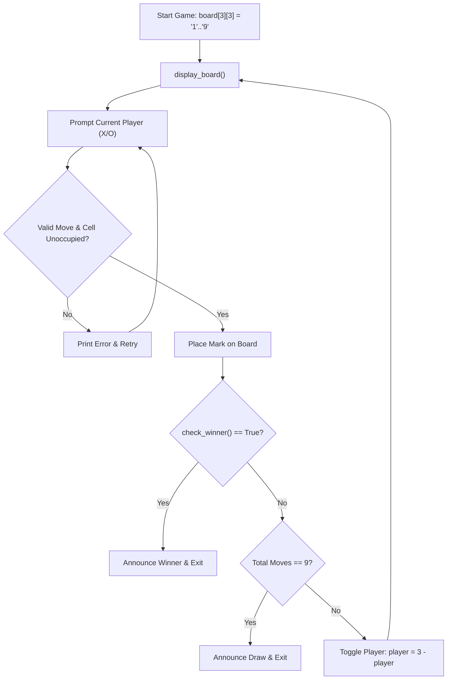

# PROJ TicTacToe - array

> [!abstract] Summary
> Implements an interactive 2-player terminal Tic-Tac-Toe game using a 2D character matrix (`board[3][3]`) with real-time coordinate translation and automated win detection.

**Source:** `LAB_PROJECT/TICTACTOE/tictactoe.c`

## Problem
Create a two-player terminal Tic-Tac-Toe game on a $3 \times 3$ grid. Players alternate turns selecting cells numbered 1 through 9. Validate each move, prevent overwriting occupied squares, detect horizontal, vertical, and diagonal win conditions, and detect drawn matches.

## Concepts used
- **2D Character Matrix (`board[3][3]`):** Representing the game board as a coordinate matrix initialized with numbers `'1'` through `'9'`.
- **Coordinate Transformation:** Translating 1D cell numbers ($1 \dots 9$) into 2D indices: $\text{row} = (c - 1) / 3$ and $\text{col} = (c - 1) \% 3$.
- **Win Condition Evaluation:** Scanning 3 rows, 3 columns, and 2 diagonals in a loop to check if all three cells match.
- **Stateful Game Loop:** Alternating active player (`player = 3 - player`), tallying total moves, and terminating upon victory or 9 moves (draw).

## Code
```c
#include <stdio.h>
#include <stdlib.h>

int winCondition(char board[9]) {
    if (board[0] == board[1] && board[1] == board[2]) return 1;
    if (board[3] == board[4] && board[4] == board[5]) return 1;
    if (board[6] == board[7] && board[7] == board[8]) return 1;
    if (board[0] == board[3] && board[3] == board[6]) return 1;
    if (board[1] == board[4] && board[4] == board[7]) return 1;
    if (board[2] == board[5] && board[5] == board[8]) return 1;
    if (board[0] == board[4] && board[4] == board[8]) return 1;
    if (board[2] == board[4] && board[4] == board[6]) return 1;
    return 0;
}

void printBoard(int n, int i, char board[9], char p1, char p2) {
    for (int j = 1; j < 10; j++) {
        if (j == n) {
            board[j - 1] = (i % 2 == 0) ? p1 : p2;
        }
        printf("%c", board[j - 1]);
        if (j % 3 == 0) {
            printf("\n----------\n");
        }
        if (j % 3 != 0) {
            printf(" | ");
        }
    }
}

int validMove(int n, int done[9]) {
    if (n > 9 || n < 1) return 0;
    for (int i = 0; i < 9; i++) {
        if (done[i] == n) {
            return 0;
        }
    }
    return 1;
}

int main() {
    int n, p;
    char board[9] = {'1', '2', '3', '4', '5', '6', '7', '8', '9'};
    int done[9] = {0};
    char p1, p2;

    printf("Choose your Character [1 for X and 2 for O] : ");
    scanf("%d", &p);
    if (p == 1) {
        p1 = 'X';
        p2 = 'O';
    } else {
        p1 = 'O';
        p2 = 'X';
    }

    for (int i = 0; i < 9; i++) {
        if (i % 2 == 0) {
            printf("Your Turn\n");
            printf("Enter Your Position (1-9) : ");
            scanf("%d", &n);
        } else {
            printf("Computers Turn\n");
            n = rand() % 9 + 1;
            printf("Computer Position : %d\n", n);
        }

        if (!validMove(n, done)) {
            printf("Invalid move\n");
            i--;
            continue;
        }

        done[i] = n;
        printBoard(n, i, board, p1, p2);

        if (winCondition(board)) {
            if (i % 2 == 0) {
                printf("You win\n");
            } else {
                printf("Computer wins\n");
            }
            break;
        }
        if (i == 8 && !winCondition(board)) {
            printf("Draw\n");
        }
    }

    return 0;
}
```

## How it works
1. Initializes `board[3][3]` with ASCII numbers `'1'` through `'9'`.
2. Inside a `while(1)` game loop:
   - Prints the current board layout with visual dividers (`|` and `---+---+---`).
   - Prompts current player (Player 1 = 'X', Player 2 = 'O') to enter a cell number ($1 \dots 9$).
   - Calculates matrix row and column indices.
   - If cell already contains `'X'` or `'O'`, rejects move and prompts again.
   - Marks the chosen cell with the player's glyph.
   - Checks all 8 winning lines: 3 rows, 3 columns, and both diagonals.
   - If winning condition is met, announces the winner and breaks.
   - If 9 moves have elapsed without a winner, announces a draw and breaks.

## Diagram / trace


## Sample run
```text
Player 1, enter a number (1-9): 5

 1 | 2 | 3 
---+---+---
 4 | X | 6 
---+---+---
 7 | 8 | 9 

Player 2, enter a number (1-9): 1

 O | 2 | 3 
---+---+---
 4 | X | 6 
---+---+---
 7 | 8 | 9 
```

## Gotchas
> [!warning] Input Coordinate Boundary Validation
> If a player inputs a number outside 1 to 9 (e.g. 0 or 15), indexing `(choice - 1) / 3` will cause out-of-bounds matrix memory access. Proper bounds checking `if (choice < 1 || choice > 9)` must precede coordinate math.

## Possible improvements
- Implement an automated AI opponent using the Minimax algorithm for single-player gaming.
- Clear console screen between turns (`system("cls")`) for a cleaner visual interface.

## Key takeaways
- 2D arrays provide a natural abstraction for grid-based game boards, allowing elegant mathematical coordinate mapping: `row = (c - 1) / 3`, `col = (c - 1) % 3`.
- Game loops alternate players cleanly using arithmetic inversion: `player = 3 - player` (alternating between 1 and 2).
- Win condition checks can be written concisely with helper comparison loops.

## My notes
> [!question]- My notes

## Related
- [[PROJ TicTacToe - no array]]
- [[LAB 28 - matrix]]
- [[CLASS 18 - pointer books 2d arr]]
