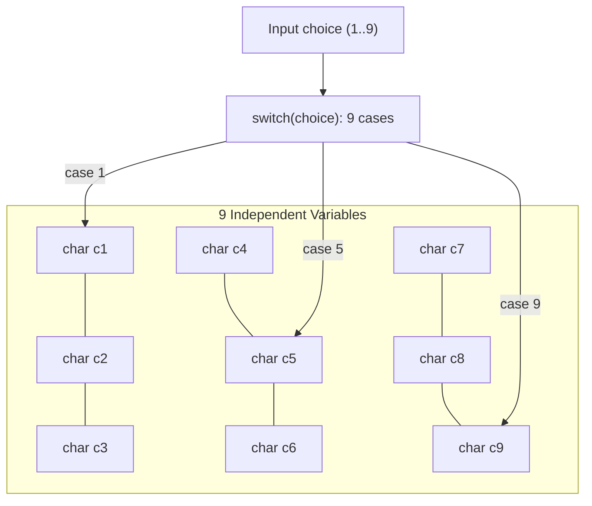

# PROJ TicTacToe - no array

> [!abstract] Summary
> An educational re-implementation of terminal Tic-Tac-Toe without using any arrays, managing the entire $3 \times 3$ board through nine individual scalar variables and explicit conditional branches.

**Source:** `LAB_PROJECT/TICTACTOE/tictactoe_no_array.c`

## Problem
Implement the full two-player Tic-Tac-Toe game rules under the deliberate constraint of using zero arrays, demonstrating how board representation, move updates, and win checks must be constructed using primitive scalar variables.

## Concepts used
- **Scalar State Representation:** Replacing `board[3][3]` with nine independent char variables: `c1, c2, c3, c4, c5, c6, c7, c8, c9`.
- **Exhaustive `switch/case` Branching:** Mapping user selection ($1 \dots 9$) to individual variable mutations.
- **Brute-Force Condition Evaluation:** Testing all 8 winning lines by manually comparing triplets of individual scalar variables (`c1 == c2 && c2 == c3`).

## Code
```c
#include <stdio.h>
#include <stdlib.h>


char b1 = '1', b2 = '2', b3 = '3', b4 = '4', b5 = '5', b6 = '6', b7 = '7', b8 = '8', b9 = '9';

int winCondition() {
    if (b1 == b2 && b2 == b3) return 1;
    if (b4 == b5 && b5 == b6) return 1;
    if (b7 == b8 && b8 == b9) return 1;
    if (b1 == b4 && b4 == b7) return 1;
    if (b2 == b5 && b5 == b8) return 1;
    if (b3 == b6 && b6 == b9) return 1;
    if (b1 == b5 && b5 == b9) return 1;
    if (b3 == b5 && b5 == b7) return 1;
    return 0;
}

void printBoard(int n, int i, char p1, char p2) {
    char val = (i % 2 == 0) ? p1 : p2;
    if (n == 1) b1 = val;
    else if (n == 2) b2 = val;
    else if (n == 3) b3 = val;
    else if (n == 4) b4 = val;
    else if (n == 5) b5 = val;
    else if (n == 6) b6 = val;
    else if (n == 7) b7 = val;
    else if (n == 8) b8 = val;
    else if (n == 9) b9 = val;

    printf("%c | %c | %c\n", b1, b2, b3);
    printf("----------\n");
    printf("%c | %c | %c\n", b4, b5, b6);
    printf("----------\n");
    printf("%c | %c | %c\n", b7, b8, b9);
    printf("----------\n");
}

int validMove(int n) {
    if (n > 9 || n < 1) return 0;
    if (n == 1) return b1 == '1';
    if (n == 2) return b2 == '2';
    if (n == 3) return b3 == '3';
    if (n == 4) return b4 == '4';
    if (n == 5) return b5 == '5';
    if (n == 6) return b6 == '6';
    if (n == 7) return b7 == '7';
    if (n == 8) return b8 == '8';
    if (n == 9) return b9 == '9';
    return 0;
}

int main() {
    int n, p;
    char p1, p2;

    printf("Choose your Character [1 for X and 2 for O] : ");
    scanf("%d", &p);
    if (p == 1) {
        p1 = 'X';
        p2 = 'O';
    } else {
        p1 = 'O';
        p2 = 'X';
    }

    for (int i = 0; i < 9; i++) {
        if (i % 2 == 0) {
            printf("Your Turn\n");
            printf("Enter Your Position (1-9) : ");
            scanf("%d", &n);
        } else {
            printf("Computers Turn\n");
            n = rand() % 9 + 1;
            printf("Computer Position : %d\n", n);
        }

        if (!validMove(n)) {
            printf("Invalid move\n");
            i--;
            continue;
        }

        printBoard(n, i, p1, p2);

        if (winCondition()) {
            if (i % 2 == 0) {
                printf("You win\n");
            } else {
                printf("Computer wins\n");
            }
            break;
        }
        if (i == 8 && !winCondition()) {
            printf("Draw\n");
        }
    }

    return 0;
}
```

## How it works
1. Declares variables `c1 = '1', c2 = '2', ..., c9 = '9'` in `main`.
2. Passes addresses `&c1, &c2, ...` to `display_board()` to render the board layout.
3. In `make_move()`:
   - Uses a `switch (choice)` statement with 9 distinct cases.
   - In each case, verifies that the specific variable has not been marked `'X'` or `'O'`.
   - Reassigns that variable to the current player's mark.
4. In `check_winner()`:
   - Tests all 8 combinations via explicit boolean expressions:
     - Rows: `(c1==c2 && c2==c3)`, `(c4==c5 && c5==c6)`, `(c7==c8 && c8==c9)`
     - Cols: `(c1==c4 && c4==c7)`, `(c2==c5 && c5==c8)`, `(c3==c6 && c6==c9)`
     - Diags: `(c1==c5 && c5==c9)`, `(c3==c5 && c5==c7)`
5. Alternates player turns until someone wins or 9 moves expire.

## Diagram / trace


## Sample run
```text
Player 1, enter a number (1-9): 5

 1 | 2 | 3 
---+---+---
 4 | X | 6 
---+---+---
 7 | 8 | 9 

Player 2, enter a number (1-9): 1

 O | 2 | 3 
---+---+---
 4 | X | 6 
---+---+---
 7 | 8 | 9 
```

## Gotchas
> [!warning] Parameter List Explosion
> Passing 9 separate pointers `(&c1, &c2, &c3, &c4, &c5, &c6, &c7, &c8, &c9)` into helper functions makes function prototypes cumbersome, fragile, and prone to argument transposition bugs.

## Possible improvements
- Grouping related state into arrays or structs (as implemented in [[PROJ TicTacToe - array]]) is the universal software design pattern to eliminate variable explosion.

## Key takeaways
- Arrays are an abstraction: any program implemented with arrays can technically be written with scalar variables, but at a huge cost in code readability and scalability.
- Functions needing to mutate multiple scalar values must accept a pointer to each individual variable.
- Comparing this program with [[PROJ TicTacToe - array]] provides a dramatic real-world lesson in why data structures matter.

## My notes
> [!question]- My notes

## Related
- [[PROJ TicTacToe - array]]
- [[CLASS 05 - vowel switch]]
